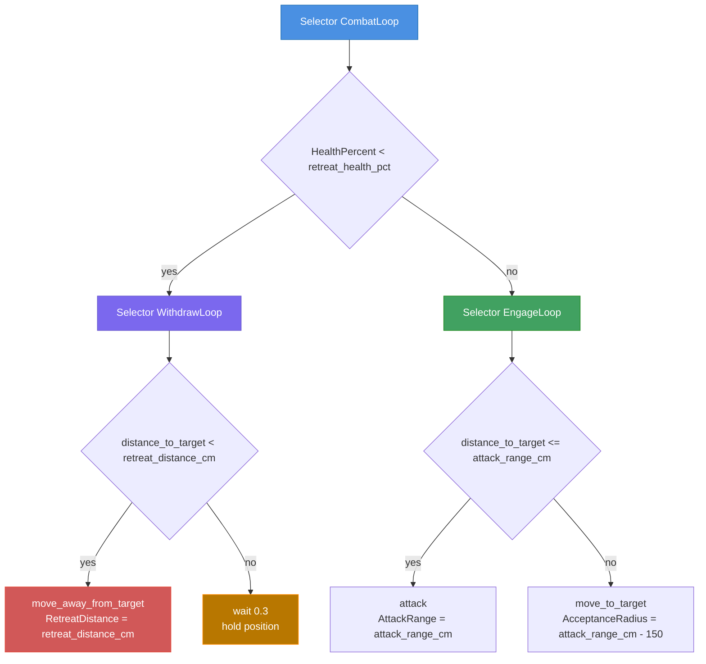
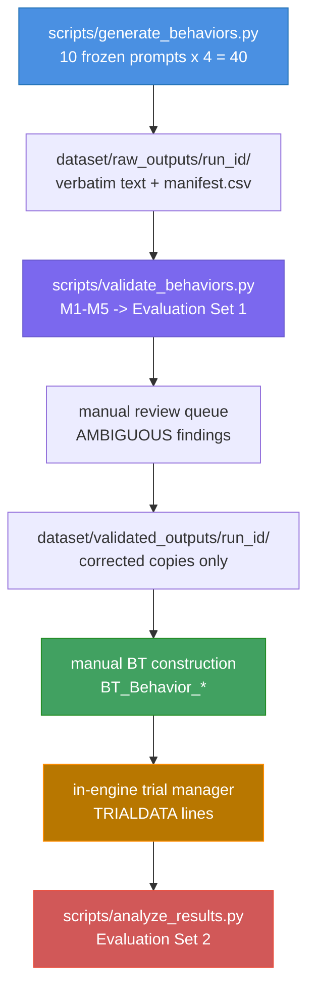

# Research progress checkpoint — LLM-generated enemy behaviour

**Module:** DS 340W. **Project:** Cosmic Animosity. **Engine:** Unreal Engine 5.7
(`EngineAssociation: 5.7`, install `C:\Program Files\Epic Games\UE_5.7`).

**Purpose of this file.** A single authoritative state record so work can resume without
re-inspecting the project. It records what exists, what was *verified by execution*, what was
only *inspected*, and what is still missing. Where a claim was never tested, it is marked
**UNVERIFIED** rather than assumed.

**Snapshot taken:** end of the Phase 4 Behaviour Tree slice — the BT attack path was built, verified in PIE across four runs, and the old Tick scaffold then removed.
**Last verified editor level:** `/Game/Research/Maps/Lvl_Research_Trial`.

---

## 1. How to resume from this file

If you are picking this up cold, read sections 2, 9 and 10 only. They contain the constraints
you must not break, the list of what does not exist yet, and the next step. Sections 3–8 are
reference detail you only need when touching that specific area.

---

## 2. Hard constraints (never violate)

These assets are the control group and the parity guarantee. They must **not** be modified,
renamed, or deleted.

| Asset | Path | Why it is frozen |
|---|---|---|
| `BP_AICharacter` | `/Game/FirstPerson/Blueprints/AI/BP_AICharacter` | Control group for RQ2 |
| `BP_WeaponBase` | `/Game/FirstPerson/Blueprints/Weapons/BP_WeaponBase` | Shared combat implementation |
| `BP_Projectile` | `/Game/FirstPerson/Blueprints/Weapons/BP_Projectile` | Shared damage path |
| `BP_FirstPersonCharacter` | `/Game/FirstPerson/Blueprints/BP_FirstPersonCharacter` | Player/target; changes alter survival time |
| `BP_AISpawner`, `BP_SpawnManager` | `/Game/FirstPerson/Blueprints/…` | Unused for trials; hard-code `BP_AICharacter_C` and `SetGamePaused` |
| `DT_CharacterData` / `ST_CharacterData` | `/Game/FirstPerson/Blueprints/` | Stat table (`Enemy` 500 HP / 500 cm·s⁻¹) |
| `IN_GenericActions` | `/Game/FirstPerson/Blueprints/IN_GenericActions` | Damage interface contract |
| `Lvl_FirstPerson` | `/Game/FirstPerson/Lvl_FirstPerson` | Original game level, 76 actors |

Additional invariants:

- `dataset/inputs/` and `dataset/outputs/` stay **byte-for-byte unchanged** and are never
  counted as LLM output.
- The project is **Blueprint-only**. No `*.Build.cs` exists, no C++ module exists. Do not
  introduce one.
- Generation must remain **unconstrained** — no `response_format`, no JSON-schema decoding.
  Constrained decoding would invalidate RQ1 (it would measure the decoder, not the model).
- `AttackRange`, `RetreatRange`, `BehaviorId`, `TrialId` and similar are set on Class Defaults.
  They are not instance-editable; setting them on a placed actor silently does nothing.

---

## 3. Research objectives

**RQ1 — Generation reliability.** How reliably can an LLM produce behaviour specifications
that are syntactically valid, structurally valid, expressible in the project's action space,
and logically coherent?

**RQ2 — Gameplay effectiveness.** When implemented in Unreal Engine, how do LLM-generated
behaviours perform on shared combat metrics compared with the hand-built baseline enemy, and
how well do they satisfy *their own* specification?

The behaviour space is deliberately minimal, so the experiment measures behavioural *logic*
rather than the model's ability to invent vocabulary:

| Space | Values |
|---|---|
| Actions (4) | `move_to_target`, `move_away_from_target`, `attack`, `wait` |
| Conditions (3) | `distance_to_target` (cm, 0–10000), `health_percent` (0–1), `can_attack` (bool, weapon cooldown) |
| Parameters | `attack_range_cm` 100–4000, `retreat_distance_cm` 100–4000 (must exceed `attack_range_cm`), `retreat_health_pct` 0–1 |
| Tree constraints | nodes `selector` / `sequence` / `action` only; `node_id` `^n\d{1,2}$`; depth ≤ 5; ≤ 15 nodes; 2–5 children per composite; root is a composite with no condition |

Schema version **2.0** — `dataset/schema/behavior_schema.json`.

---

## 4. The two evaluation sets

### Evaluation Set 1 — JSON generation and validation

Scored by `scripts/validate_behaviors.py`. Denominator for every rate: **N = number of
evaluated raw generations (target 40)**.

| Metric | Meaning |
|---|---|
| M1 JSON validity | `json.loads` succeeds on verbatim text |
| M2 Structural validity | keys, types, `node_id` format/uniqueness, depth, node count, children count, parameter presence and range |
| M3 Action validity | every `action` ∈ the 4 supported actions |
| M4 Logical correctness | `VALID` / `REVIEW` (ambiguous only) / `INVALID` (provable defect) |
| M5 Correction rate | bucketed `none / minimal / mapping / logic` |

Severity map as implemented:

- **FAIL** — `S*` structural, `A*` action, `C1–C3` vocabulary/domain, `L1` no action,
  `L2` provable contradiction, `L7` root not a composite.
- **AMBIGUOUS → manual review** — `C4` float equality, `L3` duplicate siblings, `L4`
  non-exhaustive selector, `L5` unguarded attack, `L6` unguarded retreat.
- **Advisory** — `L8` threshold/parameter mismatch, `S3` redundant wrapper.

**Unreachability policy (implemented and self-tested).** A selector falls through to the next
child when a child *fails*, so duplicate or overlapping sibling conditions are **not** proof of
unreachability and are never scored invalid. They are `AMBIGUOUS` (shadowing risk). A branch is
invalid only when unreachability is *provable*: two conditions on the same test along one path
(ancestors included) with an empty intersection, or a tree with no action / only `wait`.

### Evaluation Set 2 — Gameplay

Produced **only** from `TRIALDATA` log lines emitted by the in-engine trial manager at runtime.
Nothing is inferred from the specification; the spec supplies only the *expected* action, matched
by `node_id`.

| Metric | Definition | Denominator |
|---|---|---|
| Behaviour correctness | correct reactions / tested events × 100 %; correct = right action for that node **and** it reported SUCCESS | tested events (triggers) |
| Reaction time | `ACTION_START.t − TRIGGER.t` for the same `evt` id | paired events only |
| Behaviour failure rate | no `ACTION_START` within 2 s **or** `ACTION_RESULT ≠ SUCCESS` | tested events |
| Damage dealt | Σ `DAMAGE.amount` | per trial |
| Player survival time | engine clock at the death frame | per trial |
| Attack accuracy (parity) | hits / shots fired | per trial |

`evt` ids (`T<trial>-n<node>-E<count>`) are allocated at trigger time so repeated triggers pair
unambiguously with their own action start. Initiation and success are separate events, so
"started the right action but it failed" is distinguishable from "never reacted".

Correctness is scored **against each tree's own specification**, never against the baseline. The
baseline is compared only on damage dealt, survival time and accuracy.

**Combat parity** is *measured*, not assumed: one `CONFIG` line per trial carries max health, max
walk speed, weapon damage, weapon accuracy, firing interval, projectile speed and the target-point
rule, read from the live actors. Known structural difference to report: the baseline decides to
fire from its Tick `AI MoveTo` success callback plus `PawnSensing.OnSeePawn`; the experimental
enemy will fire only when a BT `attack` task executes.

**Trial protocol — three scenarios, one enemy per trial, player passive:**

| Scenario | Setup | Measures |
|---|---|---|
| `S1_STATIONARY` | player fixed, not shooting | attack correctness, damage, survival time, reaction time |
| `S2_DISTANCE_SCRIPT` | player teleported on 3000/1500/600/1500/3000 cm schedule, 3 s per step, each a `PUSH` event | approach/retreat correctness, reaction time |
| `S3_LOW_HEALTH_START` | enemy spawned below its `retreat_health_pct` | defensive branch correctness |

Between trials the session is reloaded, so health, position, weapon cooldown, AI state and BT
state are all fresh.

---

## 5. Completed phases and verified results

### Phase 1 — Project inspection (complete)

Audited both enemy Blueprints, `BP_WeaponBase`, `BP_Projectile`, both spawners, `DT_CharacterData`
and `Lvl_FirstPerson`. Two findings drove everything after:

1. `BP_BasicEnemyAI` was a stub — it dealt **zero** damage, and its `CharacterNames` defaulted to
   `Player`, which loaded the player stat row (200 HP / 800 speed) instead of the enemy row.
2. **No Behavior Tree, Blackboard, BTTask, BTDecorator or research AIController existed anywhere
   in the project.** (Superseded by Phase 4 below.)

### Phase 2 — Dataset audit, schema, validator (complete)

- `dataset/inputs|outputs` = **12 pairs, all self-labelled `synthetic_demo`** ("hand-authored
  illustrative example; not a recorded LLM response"). Therefore **0 authentic LLM outputs**.
- Legacy→supported expressibility: **4 expressible** (001, 002, 003, 009), **2 partial** (008,
  010), **6 not expressible** (004, 005, 006, 007, 011, 012). Of 18 legacy action names, 8 map;
  of 9 condition names, 3 map. Written up in `dataset/PROVENANCE.md`; originals untouched.
- Validator correction #1 implemented and proven with two fixtures:
  - `selftest_contradiction.json` — nested `distance > 800` containing `distance < 300` →
    **INVALID** (`L2`, ancestors included).
  - `selftest_duplicate_siblings.json` — duplicate sibling `health_percent < 0.3` →
    **REVIEW** (`L3` shadowing risk only, *not* unreachable).
- Legacy fixture run: `N=12, M1 12/12, M2 12/12, M3 12/12, M4 7/12, M5 9/12 mapping`.
  Artefacts: `results/validator_fixtures_synthetic.csv`, `results/generation_validation.csv`.

### Phase 3 — First vertical slice (complete and gameplay-verified)

**What was built:** the experimental enemy now has a working projectile combat loop, and a
dedicated research arena exists.

`BP_BasicEnemyAI` was rewritten with `bp_agent` and compiles clean — legacy montage/`Delay` chains
removed. `BP_ResearchGameInstance` was created. `Lvl_Research_Trial` was built with
`python_agent` (script id `2xv-c3OCe16DOgb7KNohW`).

**Verified by PIE execution** — 10.50 s, player stationary and never firing:

| Measurement | Value |
|---|---|
| Player `CurrentHealth` | **200 → 145** (−55) |
| Damage events | **11**, each exactly −5 |
| Damage timestamps (s) | 1.344, 2.361, 3.374, 4.444, 5.257, 6.319, 7.403, 8.364, 9.345, 10.369, 11.312 |
| Weapon fires (`LastFireTime`) | 11, t = 1.023 → 11.143 (FireRate 1.0 ⇒ 1 s cadence as designed) |
| Projectiles | 11 distinct `BP_Projectile`, Damage 5, Speed 2500 |
| Shot→hit latency | ≈ 0.32 s ≈ 800 cm / 2500 cm·s⁻¹ (ballistically consistent) |
| Enemy location | (0, 600, 90.2) — unchanged, player was inside `AttackRange` |
| Log errors/warnings | none from enemy, weapon, projectile, AI controller or navigation |

Recording: `Saved/AuraVerify/autopilot/2026-11-05T16-43-15-126Z-1j4knv/recording.mp4`.
Verdict returned by `verification_agent`: **working**.

**This proves:** the shared combat chain (`FireAt` → `CanFire` cooldown → accuracy cone → spawn
`BP_Projectile` → on hit, if target implements `IN_GenericActions` and ≠ instigator → `SendDamage`)
works when driven from the experimental enemy, and that the enemy's stats/aim/target-point rule
are correct.

**This does NOT prove:** anything about generated behaviours, navmesh pathing, or logging. See §9.

**Fidelity-log deviation.** Combat lives directly inside `BP_BasicEnemyAI` rather than in a
separate `AC_EnemyCombat` component. Record this in the implementation log of the paper; it does
not affect parity because the shared weapon/projectile path is unchanged.

### Phase 4 — Behaviour Tree slice: the attack path (complete and gameplay-verified)

**Built this session, all new assets under `/Game/Research/AI/`:**

| Asset | Contents |
|---|---|
| `BB_EnemyBehavior` | `TargetActor` (Object, base `Actor`), `DistanceToTarget` (Float), `HealthPercent` (Float), `CanAttack` (Bool). The engine injects a `SelfActor` key on creation and the saved asset carries it, so the blackboard holds these four plus `SelfActor` (Object, base `Actor`) |
| `AIController_ResearchEnemy` | Parent `AIController`. Variables `BehaviorTreeAsset` (default `BT_Behavior_AttackAlways`), `UpdateTimerHandle`. On Possess → `Run Behavior Tree` → write `TargetActor` → start a 0.1 s looping timer. `UpdateDerivedKeys` re-resolves the player pawn each tick, then writes `TargetActor`, `DistanceToTarget` (`GetDistanceTo`), `HealthPercent` (`CurrentHealth / MaxHealth`, guarded against `MaxHealth ≤ 0`) and `CanAttack` (`Weapon.CanFire`, pure). On Un Possess clears the timer |
| `BTTask_EnemyAttack` | Parent `BTTask_BlueprintBase`. Receive Execute AI → Cast `ControlledPawn` to `BP_BasicEnemyAI` → `FireAtTarget` → `Finish Execute(true)`; Cast Failed → `Finish Execute(false)`. Every path finishes, so the task cannot hang the tree |
| `BT_Behavior_AttackAlways` | **Development test tree only — not a research behaviour.** Root Sequence `AttackLoop` → `BTTask_EnemyAttack`, `BTTask_Wait` 0.1 s. Blackboard `BB_EnemyBehavior` |

**Engine facts established by reading UE 5.7 source, not assumed:**

- `AAIController::RunBehaviorTree` calls `BTComp->StartTree(*BTAsset, EBTExecutionMode::Looped)`
  (`AIModule/Private/AIController.cpp:1020`). The Blueprint `Run Behavior Tree` node therefore
  loops forever, and a root that returns SUCCESS restarts instead of stopping
  (`BehaviorTreeComponent.cpp:593–608`).
- That makes an instant-SUCCESS task dangerous: without a `Wait` the loop has zero duration. The
  `Wait` is a **safety floor**, and at 0.1 s it is deliberately shorter than the weapon cooldown so
  the cooldown, not the tree, sets the fire rate.
- `Run Behavior Tree` must run **before** any blackboard write: it is what creates the
  `BlackboardComponent`. Writing keys first silently does nothing.
- `UAIBlueprintHelperLibrary::GetBlackboard(AActor*)` (`AIBlueprintHelperLibrary.h:53`) is the
  Blueprint route to the blackboard; `AController::ReceivePossess`, displayed as "On Possess"
  (`Controller.h:289`), is the possession event.

**Verification history — four PIE runs, each isolating a different failure mode:**

| Run | Result | What it established |
|---|---|---|
| 1 | **FAIL** — zero damage | The level-placed `SM_ExperimentalEnemy` carried an **instance override** `AIControllerClass = /Script/AIModule.AIController`, which shadowed the Class Defaults. A plain C++ controller possessed the enemy, `Run Behavior Tree` never ran, and with the Tick gate off the enemy was inert. Fixed by setting the instance to `AIController_ResearchEnemy_C` |
| 2 | Passed on damage, 2 defects | Brain running, 11 hits of 5, but `TargetActor` was the **possessed pawn (the enemy itself)**, so `DistanceToTarget` read 0.0; and the 0.5 s `Wait` quantised the fire rate to ~1.135 s |
| 3 | Both fixes verified | `TargetActor` = player at 24/24 samples, `DistanceToTarget` = 800.04, cadence mean 1.060 s |
| 4 | Regression after Tick removal | Still 200 → 145 at 12 s, 12 hits of 5 by 13 s, cadence 1.092 s mean, no log errors |

**Verified numbers (run 4, the final state) — 13.0 s, player stationary and never firing:**

| Measurement | Value |
|---|---|
| Player `CurrentHealth` | **200 → 145 at 12 s** (11 hits); 200 → 140 by 13.0 s (12 hits) |
| Damage per hit | exactly −5 on every event |
| Brain | `BehaviorTreeComponent_0` `IsRunning = true`, asset `BT_Behavior_AttackAlways`, live instance `BTTask_EnemyAttack_C_0` |
| Controller | `AIController_ResearchEnemy_C_0` |
| Blackboard (42 samples) | `TargetActor` = `BP_FirstPersonCharacter_C_0` always; `DistanceToTarget` = **800.04** (min = max); `HealthPercent` = 1.0; `CanAttack` both True (7 samples) and False (88) |
| Fire cadence | mean **1.092 s** (intervals 1.006–1.164 s), gated by the weapon's 1.0 s cooldown |
| Shot→hit latency | ≈ 0.311 s, matching 800 cm at 2500 cm·s⁻¹ |
| Log errors | none — no `Accessed None`, no BT errors, no tree-start failures |

**Counterfactual proof that combat is tree-driven only** (needed because two mechanisms could
otherwise mask each other):

- Disabling the enemy's actor tick mid-run → the tree **kept firing** (health 200 → 170 over 6
  shots). Combat does not depend on tick.
- Calling `BehaviorTreeComponent.StopLogic` mid-run → the actor tick stayed enabled and **no
  further shots or damage occurred** for 4 s.

**Removal of the old scaffold:** the Tick event, the `bUseLegacyTickCombat` gate and variable, the
player lookup, the distance comparison, the Tick-local `FireAtTarget` call and `AI MoveTo` (plus
its two delegate events) were all deleted. `FireAtTarget` remains as a **function**, and is now
called only by the task.

**Methodological finding to report.** Tree-driven action timing is quantised by the loop period,
so an `attack` action cannot fire exactly on the weapon cooldown. Measured 1.060 s (run 3) and
1.092 s (run 4) mean cadence against a 1.0 s cooldown — roughly 6–9 % slower than the Tick
baseline, which fired at 1.000 s. This is a **measured implementation limitation of this specific
tree, not a Behaviour Tree ceiling**: `BT_Behavior_AttackAlways` holds a 0.1 s `Wait` and samples
`CanAttack` once per loop, so a shot can only begin on a loop boundary and the weapon's 1.0 s
cooldown is rounded up to the next one. A tree with a shorter `Wait` — or one that tests the
cooldown inside the task instead of per loop — need not show the offset. Keep any `Wait` in a real
tree ≤ 0.2 s so the weapon stays the limiter, and report the 6–9 % as a property of this tree in
the parity discussion rather than as an inherent cost of BT-driven behaviour.

---

### Phase 4B — Distance decorator gating (complete and gameplay-verified)

**Goal:** prove that a native blackboard decorator can gate the attack path on distance, i.e. that
"attack only while the target is closer than N cm" is enforceable from the tree alone.

**What was built.** `BT_Behavior_AttackAlways` (dev test tree; name retained for reference
stability) now carries exactly one `BTDecorator_Blackboard`, parented to the **`Enemy Attack` task**
(`BTTask_EnemyAttack_C`):

| Property | Value |
|---|---|
| `BlackboardKey` | `DistanceToTarget` (Float, `BB_EnemyBehavior`) |
| `ArithmeticOperation` | `Less` |
| `FloatValue` | `1000.0` |
| `NotifyObserver` | `ResultChange` |
| `FlowAbortMode` | `Self` — **clamped by the engine**: a decorator parented to a leaf task cannot be `Both` (requesting `Both` reads back `Self`; `LowerPriority` reads back `None`). `Self` suffices because the looped tree re-evaluates the decorator on every restart. |
| `bInverseCondition` | False |

Tree shape unchanged: `Root → Sequence "AttackLoop" → [Enemy Attack (decorator), Wait 0.1 s]`.

**The first placement failed, and that is the interesting half of the result.** The same decorator
was initially attached to the `AttackLoop` composite (the runtime root composite). Its properties
read back correctly — `DistanceToTarget / Less / 1000 / Both / ResultChange` — yet PIE showed the
enemy **firing continuously at 3000 cm**: 4 new projectiles inside the 6 s out-of-range phase at a
1.33 s cadence with `DistanceToTarget = 2999.8` in the blackboard, and 2 damage events in the
final out-of-range phase. A condition reading `2999.8 < 1000` cannot pass, so the decorator was
inert where it sat. Moving the identical decorator onto the attack task fixed the behaviour with
no other change.

**Verified behaviour (probe run after the move).** Scripted PIE teleported the player to 3000 cm,
then 600 cm, then back to 3000 cm, sampling the blackboard key, player health, geometric distance,
tree state and projectile population every editor frame.

| Phase | Blackboard `DistanceToTarget` (min / mean / max) | Damage events | Damage total | Tree running |
|---|---|---|---|---|
| A — 3000 cm (6 s) | 800.0 / 2877.6 / 2999.8 | **0** | 0.0 | 18/18 samples |
| B — 600 cm (5 s) | 600.0 / 760.0 / 2999.8 | **4** | 20.0 | 15/15 samples |
| C — 3000 cm (5 s) | 600.0 / 2839.8 / 2999.8 | **0** | 0.0 | 15/15 samples |

- The gate **opened within +0.674 s** of the inbound teleport (teleport at 6.216 s, first damage at
  6.890 s). That interval is the 0.1 s blackboard-update timer, the decorator's `ResultChange`
  re-evaluation and the projectile's flight time combined.
- The gate **closed cleanly** on the outbound teleport: zero damage across the final 5 s at 3000 cm
  from a full-health start, so no in-flight shot landed after the range change.
- `bt_running` was 1 in every sample of every phase and is **not** a discriminator — a looped tree
  whose root fails still reports `IsRunning = true` while it re-iterates. Task execution (damage)
  is the observable, not tree state.
- Damage was exactly 5.0 per event on a 200 HP player, matching `ShootingDamage` 5 in the control
  group.

**Measurement limits, stated rather than smoothed over.** The editor was backgrounded during these
runs, so PIE ran at `max tick rate 3` (engine log) and the probe sampled at ~0.33 s. Consequences:
all latencies above are quantised to 0.334 s; the inter-damage cadence measured 1.334 s, i.e. four
sample frames, and cannot be resolved more finely; and the projectile-population metric read 0 at
every sample because projectiles are created and destroyed inside a single 0.33 s window. The
gate/no-gate conclusion does not depend on any of them — it rests on 4 versus 0 damage events at
600 cm versus 3000 cm — but these latency and cadence figures must not be compared with the
millisecond-resolution Phase 4 numbers.

**Harness notes worth keeping.** The player's `CurrentHealth` was raised from 200 to 100000 once at
session start. Without it the enemy killed the player during the first out-of-range attempt, and
`BP_FirstPersonCharacter.Death()` → `SetGamePaused(true)` plus its 5 s destroy chain travelled the
PIE world out of `Lvl_Research_Trial` into `Lvl_FirstPerson` (three times in the log from
19:08:14), destroying the session.

Artefacts: harness `Content/Python/aura_pie_probe.py`; raw result `Saved/aura_pie_probe_report.txt`;
progress `Saved/aura_pie_probe_status.txt`.

### Maintenance - BP_ImpactFX null `ImpactMID` (shared VFX bug fix, NOT an experimental AI change)

**This entry is infrastructure hygiene, not a research result.** It touches no Behaviour Tree, no
blackboard, no AI controller and no damage value, so it changes nothing about either evaluation set.
`BP_ImpactFX` is shared: it is referenced by `BP_WeaponBase` and `BP_Projectile`, so both the control
and experimental enemies emit it on every hit.

**Symptom.** One 4-hit PIE run logged 8 x `PIE: Error: Blueprint Runtime Error: "Accessed None trying
to read (real) property ImpactMID in BP_ImpactFX_C". Node: Set Scalar Parameter Value Graph:
EventGraph`, each paired with a `LogScript` warning. The effect still drew; only its material fade was
dead.

**Root cause.** `Impact MID` has one writer, `Variable Set Impact MID`, fed by
`Create Dynamic Material Instance` on the `Impact Mesh` component - and that node had **no exec
input**, so the whole init chain was unreachable and `Impact MID` stayed `None`. The Timeline path
`Update -> SetActorScale3D -> Set Scalar Parameter Value` (Target from a fresh `Get Impact MID`) then
dereferenced it once per timeline update. Not a material problem: `M_VFX_Emissive` does expose the
`Opacity` scalar and `EmissiveColor` vector parameters.

**Correction - exec wiring only, no nodes added, removed or reconfigured.** One wire disconnected
(`ReceiveBeginPlay -> Timeline Play from Start`) and two connected, giving
`ReceiveBeginPlay -> CreateDynamicMaterialInstance -> Set Impact MID -> SetMaterial ->
Set Scalar Parameter Value (Opacity = 1) -> Set Vector Parameter Value (EmissiveColor) ->
Timeline Play from Start`. The fade path, `Finished -> DestroyActor`, `ReceiveTick` and
`ReceiveActorBeginOverlap` were untouched, and `BP_AICharacter`, `BP_WeaponBase`, `BP_Projectile` and
the material were not modified. Intended consequence: the authored `Opacity` ramp and
`EmissiveColor` (1.0, 0.6, 0.15) now actually apply, so the impact fades rather than popping.
Mesh, scale curve, lifespan and destruction are unchanged.

**Verified in PIE (same three-phase probe, after the fix).** Compiles clean (0 errors, 0 warnings) and
was saved. Zero new `ImpactMID` messages - the log's `PIE: Error` total stayed at 8 and every such line
is timestamped from the pre-fix run. Damage unchanged: 4 events x 5.0 = 20.0 in the 600 cm phase, 0 at
3000 cm either side, first damage +0.670 s after the inbound teleport. The absence of the error is
causal, not silence: the fade path's `Set Scalar Parameter Value` succeeded on all 4 impacts, which
requires a valid `MaterialInstanceDynamic`.

### Phase 5A — `BTTask_EnemyMoveToTarget` and the approach branch (complete and gameplay-verified)

**Goal.** Give the enemy the `move_to_target` action and a selector that chooses between attacking and
closing distance, without touching any baseline asset.

**New asset.** `BTTask_EnemyMoveToTarget` (`/Game/Research/AI`, parent `BTTask_BlueprintBase`), with an
instance-editable `AcceptanceRadius`. Three strands:

| Strand | Behaviour |
|---|---|
| `Receive Execute AI` | branch on `IsValid(Blackboard -> Get Value as Object "TargetActor")`; invalid -> print + `Finish Execute(false)`; valid -> `MoveToActor` (Goal = target, `Stop on Overlap`, `Use Pathfinding`, `Can Strafe`, `Allow Partial Path`) and return **without** finishing, so the task stays In Progress |
| `Receive Tick AI` | on `Get Move Status == Idle`: target invalid -> `Finish Execute(false)`; else `Vector_Distance(pawn, target) <= AcceptanceRadius + 150` -> `Finish Execute(true)`, otherwise `Finish Execute(false)` with the measured distance in the message |
| `Receive Abort AI` | `Stop Movement` then `Finish Abort` (never `Finish Execute`) |

Non-latent `MoveToActor` + tick polling was chosen over the latent `AI Move To` node because that
node's `On Fail` pin can fire after an abort and double-call `Finish Execute`. `bNotifyTick` needs no
manual flag — `UBTTask_BlueprintBase` derives it from whether `Receive Tick AI` is implemented.

**Tree.** `BT_Behavior_AttackAlways` became a selector rather than a sequence:

```
ROOT -> Selector "CombatLoop"
        |- Sequence "AttackLoop"    [0]  Enemy Attack (BTTask_EnemyAttack_C) -> Wait 0.1
        \- Sequence "ApproachLoop"  [1]  Enemy MoveToTarget (AcceptanceRadius 800) -> Wait 0.5
```

Selector order is the design: the attack branch is tried first every pass and only falls through to
the approach branch when its gate refuses.

**The attack gate is now HARD-CODED inside the task, and that is a workaround — not proof of
conditional execution.** `BTTask_EnemyAttack` gained `DistanceToTarget <= AttackRange` before
`FireAtTarget` (blackboard read through `Owner Controller -> Blackboard -> Get Value As Float`;
`AttackRange` taken off the existing cast to `BP_BasicEnemyAI`), failing with
`Finish Execute(false)` when out of range. The `BTDecorator_Blackboard`
(`Distance To Target < 1000`, `FlowAbortMode=Self`) remains on the `Enemy Attack` task node and was
observed gating in the same runs.

> **The gate exists because the `BTDecorator_Blackboard` proved unreliable, and it must never be
> treated as equivalent to correct execution of a generated tree.** The tree is currently gated by a
> literal 1000 written into the task graph, reading a blackboard float. That hard-coded check is what
> made `AttackLoop` fall through at 2999.8 cm. It does **not** demonstrate that the decorator on the
> node executes, that a `Less`/`FloatValue` condition authored by a generator would execute, or that
> any other node's own conditions will fire. The two mechanisms happen to agree on the runs recorded
> below; they were never separated experimentally, so the decorator's execution is **unverified**.
> Every future tree must be measured on its own behaviour rather than assumed correct because the
> hard-coded gate produced the expected result.

**Verified in PIE — one run, two phases, 47 samples** (`Saved/aura_pie_probe_report.txt`, 21:04):

| Phase | bb_dist min/mean/max | First shot | Damage events | Enemy position |
|---|---|---|---|---|
| A — player teleported to 2999.8 cm, 10 s | 800.0 / 1546.4 / 2999.8 | +5.999 s | 3 (15.0) | (0, 600) -> (-1146, -1182) |
| B — player teleported to 600 cm, 6 s | 600.0 / 615.7 / 882.1 | +0.000 s | 5 (25.0) | unchanged |

Displacement in phase A is **2118.7 cm**. The enemy came to rest **882.1 cm** from the player and the
move task logged `BTTask_EnemyMoveToTarget: SUCCESS` at arrival. The attack did **not** fire during
the approach — first damage at +6.335 s, after arrival — against 7 shots from +1.0 s in the pre-fix
run of the same phase. The 800.0 cm minimum in phase A is the single pre-teleport sample (the
`PlayerStart` is 800 cm from the enemy), not a closest approach.

**Two defects found by measurement, both worth remembering.**

1. `MoveToActor` with `Stop on Overlap` stops the pawn slightly *beyond* `AcceptanceRadius` — the
   angular stopping distance at 600 cm/s and 2048 deceleration is ~88 cm — so a
   `distance <= AcceptanceRadius` arrival test can never pass. Measured:
   `FAILURE (arrived too far) d=882.08615` against a radius of 800. The test now allows a 150 cm band.
2. That band first came from a new instance-editable `ArrivalTolerance` variable (CDO 150) and did
   not work: the `BTTask_EnemyMoveToTarget_C` node inside `BT_Behavior_AttackAlways` was serialized
   before the variable existed, so the getter on that instance did not return 150. Replacing the
   variable read with a **literal 150** produced `SUCCESS` on the next run. The threshold value was
   never printed (the literal replaced the variable in the same edit), so "the instance reads 0" is
   the only consistent explanation rather than a directly observed number. **Lesson: do not rely on
   a newly added variable reaching a pre-existing BT node instance — use a literal or re-add the
   node.**

**Decorator inertness was, at least once, stale compiled data rather than placement.** In the first
run after the decorator was moved onto the `Enemy Attack` task, the enemy still fired from 2999.8 cm:
the graph read back correctly (`ParentIndex=3`, i.e. the `BTTask_EnemyAttack_C` node, `Less`,
`FloatValue=1000`, `FlowAbortMode=Self`) yet the attack task executed on every pass. After the tree
asset was re-saved through the Behaviour Tree tooling (`set_bt_node_properties`, used to change
`AcceptanceRadius`), the next run had the attack task never executing out of range. `UBehaviorTree::RootNode`
is protected and unreadable from Python, so `Children[].Decorators` in the compiled tree could not be
inspected; the run sequence is the evidence and the stale-data mechanism is the likely explanation,
not a read fact. Practical rule: after any decorator change, re-save through the BT tooling and
re-measure before believing either "it gates" or "it does not".

**Measurement limits.** As Phase 4B: editor backgrounded, PIE at `max tick rate 3` (~0.33 s per
sample), so latencies are quantised to 0.334 s and the projectile-population counter collapses inside
one window (2 shots counted against 3 damage events in phase A). Additionally the probe's per-frame
`get_actor_location()` on the enemy failed on most frames of this session (`locs=4/29`), so the
report's own `enemy_move ... displacement=` line reads 0; the 2118.7 cm figure above is derived from
the phase-B teleport target (`target=(-1146, -1782, 90)` = enemy location + the fixed (0,-600,0)
offset), which reproduced to +/-1 cm across three runs.

---

### Phase 5B — `BTTask_EnemyMoveAwayFromTarget` and the retreat path (complete and gameplay-verified)

**Goal.** Give the enemy an inverse of the approach action — one that moves it *away* from the
blackboard `TargetActor` using Unreal navigation — and measure that the separation to the player
actually grows. No baseline asset, shared combat asset or previously verified tree was touched.

**New asset.** `BTTask_EnemyMoveAwayFromTarget` (`/Game/Research/AI`, parent `BTTask_BlueprintBase`),
three strands, **no variables of its own** — deliberately, because of the `ArrivalTolerance` lesson in
Phase 5A.

| Strand | Behaviour |
|---|---|
| `Receive Execute AI` | `IsValid(Blackboard -> Get Value as Object "TargetActor")` invalid -> print + `Finish Execute(false)`; else cast the controlled pawn to `BP_BasicEnemyAI` and read the existing **`RetreatRange`** (1500). Goal = `PawnLoc + Normal(PawnLoc - TargetLoc) * RetreatRange`. If the current distance is already `>= RetreatRange` -> print + `Finish Execute(false)` (nothing to do, selector falls through); otherwise `MoveToLocation` (Goal, `Acceptance Radius` 50, `Stop on Overlap`, `Use Pathfinding`, `Project Destination to Navigation` false, `Can Strafe`, `Allow Partial Path`) and return **without** finishing, so the task stays In Progress |
| `Receive Tick AI` | on `Get Move Status == Idle`: target invalid -> `Finish Execute(false)`; else `Vector_Distance(pawn, target) >= RetreatRange - 150` -> print `SUCCESS d=.. thr=..` + `Finish Execute(true)`, otherwise print `FAILURE (retreat too short) d=.. thr=..` + `Finish Execute(false)` |
| `Receive Abort AI` | `Stop Movement` then `Finish Abort` |

Design notes, each a consequence of an earlier measurement:

- `RetreatRange` on `BP_BasicEnemyAI` had **no consumer** until now; the retreat task is its first,
  which is why the task needed no new parameter and therefore cannot hit the stale-instance-variable
  failure mode. The existing `AttackRange` variable is read the same way in `BTTask_EnemyAttack`.
- The 150 cm arrival band and the 50 cm acceptance radius are both **literals**. Arrival lands
  ~48 cm short of the goal point (acceptance 50 plus stopping distance), comfortably inside the band.
- `Vector_Distance` is computed from actor locations, not from the blackboard `DistanceToTarget`
  float, so the retreat decision does not inherit any staleness of the controller's 0.1 s timer.
  `TargetActor` is the only blackboard key the task reads.
- The direction is `Normal(pawn - target)`: retreating straight along the pawn->player axis, so the
  final separation is `RetreatRange` plus however far the player already stood from the goal side.

**Verification tree.** `BT_Behavior_RetreatTest` (`/Game/Research/AI`) — `ROOT` (`BB_EnemyBehavior`)
-> Sequence `RetreatLoop` -> [0] `Enemy MoveAwayFromTarget`, [1] `Wait` 0.5. It is a **development
test tree only**, exactly like `BT_Behavior_AttackAlways`, and must never be reported as a research
behaviour.

**The retreat was deliberately NOT added to `BT_Behavior_AttackAlways`.** `RetreatRange` (1500) is
larger than both the approach acceptance radius (800) and `AttackRange` (1000), so a retreat branch
placed ahead of `ApproachLoop` would fire at the 800 cm spawn baseline and destroy the verified
Phase 5A behaviour. Combining the branches requires a threshold decision that belongs to the
parameter-plumbing step, not this one.

**The tree was swapped at runtime, not by editing the controller.** `AIController_ResearchEnemy`
still references `BT_Behavior_AttackAlways` — confirmed by reading `BehaviorTreeAsset` back after the
run. The probe called `AIController.RunBehaviorTree(BT_Behavior_RetreatTest)` on the live controller
(one BlueprintCallable call, which returned true), so no controller, level or tree asset was
altered to run the test.

**Verified in PIE — one run, 30 samples** (`Saved/aura_retreat_probe_report.txt`, 21:23):

| Quantity | Measured |
|---|---|
| Enemy start position | `(0.0, 600.0, 90.2)` |
| Player teleported to (close start) | `(0.0, 900.0, 98.2)` — 300 cm on the +Y side |
| Start distance to player | **300.1 cm** |
| Enemy end position | `(0.0, -851.4, 90.2)` |
| End distance to player | **1751.5 cm** |
| Enemy displacement | **1451.4 cm**, all in -Y |
| Distance change | **+1451.3 cm** |
| Task result | `SUCCESS d=1751.463477 thr=1350.0` |
| Path following | `IDLE -> MOVING -> IDLE`; goal `y=-900` reached within 48.6 cm |

`distance_to_player` rose monotonically across every sample — 300.1, 418.1, 584.8, 751.4, 918.1,
1084.8, 1251.4, 1418.1, 1584.8, 1751.5 — i.e. **no sample regressed**, so the increase is not an
artefact of comparing only two endpoints. Movement ran from t=0.87 s to t=3.87 s at ~500 cm/s
(`MaxWalkSpeed` 600, accelerating), then held at 1751.5 cm for the rest of the run.

The final separation exceeds 1500 because the player was standing 300 cm on the goal side of the
starting position: `1500 + 300 - 48.6`.

**Navigation failures: none during the retreat.** The goal `(0, -900)` was reachable, no partial path
was taken, and `PathFollowingStatus` was never stuck in `MOVING`. The report's `stall_windows` entries
all start at t=5.20 s, i.e. **after** arrival — the enemy is simply standing still with the looped
tree still running, which the heuristic cannot distinguish from a stall. Two real log events are
worth recording:

1. One `FAILURE (no target)` at the moment of the tree swap, before the controller's 0.1 s timer had
   written `TargetActor`. The task reported the missing target correctly; the looped tree retried and
   succeeded on the next pass. This is a startup race in the *blackboard*, not a task defect.
2. After arrival the tree re-ran `FAILURE (already beyond retreat range) d=1751.463477` about every
   0.67 s, because `RunBehaviorTree` uses `EBTExecutionMode::Looped` and the single-child sequence
   fails once the retreat condition is already satisfied. Expected for this test tree; a real tree
   would put a different branch after it in a selector.

**Measurement notes.** Probes that need to survive across Aura calls must be polled without
`importlib.reload` — a reload re-executes the module header, wiping probe state, while the already
registered tick callback keeps writing into the *old* environment. This run's report and status file
are consistent (one teleport, one tree swap, 30 samples), and `get_actor_location()` on the enemy
succeeded on **30/30** frames, unlike the `locs=4/29` sampled in Phase 5A — so the earlier failure was
transient, and the Phase 5A displacement was correctly derived from the teleport target rather than
from per-frame positions.

---

### Phase 5C — Parameter plumbing for the three schema parameters (complete and gameplay-verified)

**Goal.** Give `attack_range_cm`, `retreat_distance_cm` and `retreat_health_pct` a native, per-node home
so that an action task owns only a mechanism and the *tree* owns the decision. No combined tree was
built and no output was generated in this increment.

**Mapping — schema field to native Behaviour Tree data**

| JSON | Native home | Type / range | Why exactly there |
|---|---|---|---|
| `parameters.attack_range_cm` | instance property `BTTask_EnemyAttack.AttackRange` on the attack node | float, cm, 100–4000 | the gate has to exist (decorators are unproven) but its value must come from the tree, not from the pawn blueprint |
| `parameters.retreat_distance_cm` | instance property `BTTask_EnemyMoveAwayFromTarget.RetreatDistance` on the retreat node | float, cm, 100–4000 | target separation, and simultaneously the task's own "already far enough -> FAILURE" precondition |
| `parameters.retreat_health_pct` | `BTDecorator_Blackboard` on the retreat branch: key `HealthPercent`, `ArithmeticOperation = Less`, `FloatValue` = the pct | float 0.0–1.0 | health is a *condition*, and schema conditions attach to `selector`/`sequence` nodes as well as actions, so it cannot live in one action task. **No new asset needed** — `AIController_ResearchEnemy.UpdateDerivedKeys` already writes `HealthPercent = CurrentHealth / MaxHealth` every 0.1 s, in the schema's 0–1 range |
| approach stop distance | instance property `BTTask_EnemyMoveToTarget.AcceptanceRadius` | float, cm | translator sets it to `attack_range_cm - 150`; the measured stop overshoot is at most 88 cm, so arrival lands inside attack range |
| `wait_seconds` | `BTTask_Wait.WaitTime` | 0.1–3.0 s | native task, no wrapper needed |

Every JSON `condition` object maps to a native `BTDecorator_Blackboard` with
`NotifyObserver = ResultChange`, and `FlowAbortMode` chosen by node kind (`Self` on tasks — the setter
clamps it there anyway; composite nodes accept `Both`).

**Changes made (minimum set)**

- `BTTask_EnemyAttack`: added `AttackRange` (real, default 1000, instance editable, category Combat).
  The threshold now arrives through a Self getter instead of the pawn's `Attack Range`. The cast to
  `BP_BasicEnemyAI_C` was **kept**, because `FireAtTarget` is a function on that class; the Cast-Failed
  path is untouched.
- `BTTask_EnemyMoveAwayFromTarget`: added `RetreatDistance` (real, default 1500, instance editable,
  category Movement). Both `BP_BasicEnemyAI_C` casts and the "pawn not BP_BasicEnemyAI" failure path
  were **removed**, so the action now works on any pawn and cannot inherit a threshold from the enemy
  blueprint. Exec chains were re-read afterwards: no unwired exec inputs, no `BP_BasicEnemyAI` cast left.
- `BTTask_EnemyMoveToTarget`: **unchanged** — `AcceptanceRadius` was already instance editable.
- No new decorator asset. `BTDecorator_EnemyCondition` is still not needed for these three parameters.

**Measured: the stale-instance hazard is real and now has numbers.** Read back *before* writing the
node values, the attack node reported `AttackRange = 0.000000` and the retreat node
`RetreatDistance = 0.000000`, although both class defaults are 1000 / 1500 and both classes had
compiled and saved. After writing them explicitly the same nodes read 1000 and 1800. **Rule for the
translator: write every task-node property it depends on. A class default does not reach a node that
was serialized before the property existed, and the node then behaves as 0 rather than failing loudly.**

**Verification run 1 — retreat with node value 1800 (deliberately not the class default 1500)**
(`Saved/aura_retreat_probe_report.txt`, 21:40, 36 samples):

| Quantity | Measured |
|---|---|
| Start | enemy `(0.0, 600.0, 90.2)`, player teleported to `(0.0, 900.0, 98.2)`, 300.1 cm |
| End | enemy `(0.0, -1184.5, 90.2)`, separation **2084.6 cm** |
| Displacement | **1784.5 cm** |
| Task result | `SUCCESS d=2084.564107 thr=1650.0` |
| Goal `(0, -1200)` reached | within 15.4 cm, `IDLE -> MOVING -> IDLE`, no partial path |

This is the discriminating measurement: `thr` printed **1650** = 1800 - 150, and the enemy stopped at
2084.6 = 300 + 1800 - 15.4. A node reading the class default 1500 would have printed 1350 and stopped
at ~1751.5 — which is exactly what Phase 5B measured with 1500. A node reading 0 would have failed
instantly. So the node's own instance value drives both the goal and the threshold. The node was then
restored to 1800 -> **1500**, the value the tree was verified with in Phase 5B; the code path exercised
at 1800 is identical, so the 1500 configuration is the same mechanism with a different number.

**Verification run 2 — attack/approach regression** (`Saved/aura_pie_probe_report.txt`, 21:43, 48 samples,
attack node `AttackRange = 1000`):

| Phase | bb_dist min/mean/max | First shot | Damage events | Worst case |
|---|---|---|---|---|
| A — player at 2999.8 cm, 10 s | 800.0 / 1525.0 / 2999.8 | +7.006 s | 2 (10.0) | no fire while closing |
| B — player at 600 cm, 6 s | 600.0 / 615.8 / 883.0 | +0.000 s | 5 (25.0) | fires immediately in range |

The approach still stopped at ~883 cm (`bb_dist` max in phase B) and the attack then fired, as in
Phase 5A. Damage in phase B requires the task's own comparison to pass, i.e. `AttackRange > 0`; a
0-valued node would have swallowed every shot even with its decorator satisfied. What this run does
**not** isolate is the decorator from the in-task gate: no `BTTask_EnemyAttack: out of range` line
appears anywhere in the run, so during the approach the decorator refused the task before it executed
and the in-task check never had to refuse. The two mechanisms still moved together.

Known limitation of run 2: `locs=4/30` — per-frame `get_actor_location()` on the enemy failed on most
frames again, so that report's own `displacement=` line reads 0. The approach was confirmed from
`bb_dist`/`geo_dist` instead, and the phase-B teleport target `(-1146, -1781)` (enemy + the fixed
`(0,-600,0)` offset) puts the enemy at `(-1146, -1181)`, reproducing Phase 5A's `(-1146, -1182)` to 1 cm.

**Combined-tree priority — how retreat, attack and approach resolve overlap**

The selector order is the policy, because each branch must be refused before the next is tried. The
reference shape that follows from these parameters (validator rule **S5** guarantees
`retreat_distance_cm > attack_range_cm`):



| Situation | Branch that runs | Why |
|---|---|---|
| health low, `distance < retreat_distance_cm` | retreat | health condition passes; the task's own precondition also passes, so it moves |
| health low, `distance >= retreat_distance_cm` | **hold** | the retreat task returns `FAILURE (already beyond retreat range)` (measured); without the hold branch the selector would fall through to approach and walk the wounded enemy back in |
| health OK, `distance <= attack_range_cm` | attack | health condition fails, attack gate passes |
| health OK, `distance > attack_range_cm` | approach | attack gate fails inside the task, so the selector falls through |
| health low, `distance <= attack_range_cm` | **retreat** | both attack and retreat are eligible; retreat is first, so a wounded enemy disengages instead of trading shots. This is the one genuine priority decision in the tree, and it is decided by selector order, not by an action task |

**The oscillation hazard this design exists to avoid.** With `retreat_distance_cm > attack_range_cm`
(S5), a two-branch low-health subtree — "retreat if far, else fall through" — makes a wounded enemy
retreat to `retreat_distance`, fail the retreat precondition, fall into approach, close back inside
`retreat_distance`, and retreat again: a sawtooth walk. The hold branch is what breaks the loop. It is
not decoration; it is the thing that makes a low-health policy stable.

---

### Phase 5D — First authentic LLM generation, and why the validator scored nothing (complete)

#### The run

Run `20261105_p01_success`, sample `P01-G01`, prompt P01 (`aggressive`), `gpt-4.1`, temperature 0.7,
`max_tokens` 900, **unconstrained decoding** (no `response_format` — deliberate, see the methodology).
HTTP **200**; `response_model gpt-4.1-2025-04-14`, `system_fingerprint fp_3c6b77ab8c`, 1538 prompt /
326 completion tokens. **This is the first authentic LLM behaviour document in the project.**

The model returned clean JSON with no markdown fence, so `auto_corrections` is empty and
`strip_markdown_fence` never had to fire.

#### The tree the model produced

| node | type | condition | action |
|---|---|---|---|
| `n0` | selector | — | — |
| `n1` | sequence | — | — |
| `n2` | action | `distance_to_target <= 250` | `attack` |
| `n3` | action | `distance_to_target <= 250` | `wait` |
| `n4` | action | `distance_to_target > 250` | `move_to_target` |

`behavior_id` `close_range_rusher`; parameters `attack_range_cm 250`, `retreat_distance_cm 600`,
`retreat_health_pct 0.15` — all in schema range, and `retreat > attack` satisfies S5.

#### Root cause: an extension mismatch, not an empty run directory

`validate_behaviors.py` discovered inputs with `iter_json_files()`, which yielded only names ending
`.json`. `generate_behaviors.py` writes `"%s.txt" % sample_id` (line 215) — verbatim, `newline=""`,
never re-serialised. The directory was fully populated; the validator filtered out the only file it
was given, `run_specs` iterated over nothing, and `summarize` printed `no documents evaluated`.

This was a **silent zero, not an error**: `summarize` returns that string whenever `len(rows) == 0`,
and `main()` still writes a header-only CSV and returns `0`. A caller checking only the exit code
cannot tell "no data" from "data filtered away".

#### The fix — one predicate, both extensions

```python
RAW_SUFFIXES = (".json", ".txt")


def iter_json_files(path):
    """Yield candidate documents. Raw LLM outputs are written as verbatim .txt by
    generate_behaviors.py; hand-authored fixtures are .json. Both are scored the same way."""
    ...
            if name.lower().endswith(RAW_SUFFIXES):
                yield os.path.join(root, name)
```

Both extensions go through the identical `validate_document` path, so nothing about M1–M5 changed.
`manifest.csv` is `.csv` and is still never matched. `P01-G01.txt` and `manifest.csv` were **not
modified**: the file's sha256 was recomputed before and after the edit and is unchanged at
`fda8e1f6…d02806`.

#### Results — `results/generation_validation.csv`

```
LLM generations (run 20261105_p01_success): N=1
  M1 JSON valid .......... 1/1 (100.0%)
  M2 structural valid .... 1/1 (100.0%)
  M3 actions valid ....... 1/1 (100.0%)
  M4 logically valid ..... 0/1 (0.0%)   manual review: 1
  M5 needs correction .... 1/1 (100.0%)
      mapping    1
```

| Metric | Result | Detail |
|---|---|---|
| M1 syntax | 1/1 | strict `json.loads` succeeds |
| M2 schema compliance | 1/1 | no `S*` finding: ids, depth, child counts, parameter ranges all pass |
| M3 supported actions | 1/1 | `attack`, `wait`, `move_to_target` all in the four-action vocabulary |
| M4 logical consistency | 0/1 | `REVIEW`, `manual_review = 1` |
| M5 correction class | `mapping` | driven by the unresolved AMBIGUOUS flag |

**The single finding is `L3 AMBIGUOUS`**: "duplicate sibling conditions: shadowing risk only, NOT
unreachable (a failing child falls through), manual review required", raised at the `n1` sequence
because `n2` and `n3` carry the identical condition `distance_to_target <= 250`.

What the validator correctly did **not** flag, and why:

- `L4` (selector can stall) did not fire: the root selector's child `n1` carries no condition, so its
  "every child conditioned and the union misses the domain" premise is false. `n4` is genuinely
  reachable, because `n1`'s sequence fails outright once `distance_to_target > 250`.
- `L5` (unguarded attack) did not fire: `n2` is guarded by a `distance_to_target` condition.
- `L8` did not fire: the attack threshold 250 equals `attack_range_cm` 250, delta 0.
- No `L1`/`L2`/`L7`: the tree has actions, no path is provably unsatisfiable, and the root is a
  selector.

**Substantive reading of the L3.** `attack` and `n3`'s `wait` are gated on the same predicate the
parent sequence already established, so the wait is not a decision, only a pause after a successful
attack. It is a **degenerate sequence**, not an unreachable branch — which is exactly why the
validator classifies it AMBIGUOUS for manual review instead of FAIL. It cannot be fixed mechanically:
any repair changes structure, so it stays in the review queue and is **not** rewritten in place. This
is the first real RQ1 datapoint, and it is a genuine modelling weakness rather than a schema violation.

#### Provenance — one authentic document, plus a run-id reuse hazard

| Run directory | sample | HTTP | On disk | Authentic |
|---|---|---|---|---|
| `20261105T220949Z` | — | — | manifest header only | no |
| `20261105T220950Z` | — | — | manifest header only | no |
| `20261105_p01_first` | P01-G01 | 401 | `P01-G01.txt` (error body) | no |
| `20261105_p01_retry` | P01-G01 | 429 | `P01-G01.txt` (error body) | no |
| `20261105_p01_success` | P01-G01 | 200 | `P01-G01.txt` | **yes — 1 document** |

**Authentic LLM outputs: 1 of 40.** The 401 and 429 files are preserved error bodies, correctly
non-data; they must not be deleted and must never enter a denominator.

**Defect found while verifying the hash.** `20261105_p01_success/manifest.csv` contains **two** rows
for `P01-G01` — `2026-11-05T23:08:39` and `2026-11-06T03:45:08` UTC, both HTTP 200 — because the same
`--run-id` was used twice. The second run reopened `P01-G01.txt` with mode `"w"`, so the first
response's bytes no longer exist and its `raw_sha256 c46384c4…` matches no file on disk. The file
hashes to `fda8e1f6…`, which matches **only the later row**. The manifest is preserved verbatim as
instructed; the consequence to record is that **this run is one sample, not two**, and that a fresh
`--run-id` is mandatory per generation attempt.

Related: because the extension fix makes `.txt` discoverable, pointing `--inputs` at the parent
`dataset/raw_outputs` (the argument default) now scores all three files, and the two HTTP error
bodies will correctly fail M1 as invalid JSON. That is expected behaviour, not a regression.

---

### Phase 5E — Dataset-integrity guards and regression tests (complete)

Both Phase 5D failures were process mistakes that discipline alone could not prevent. Each is now
refused in code and pinned by tests. Nothing in `dataset/` or `results/` was rewritten by this phase.

#### 1. A run id is now single-use — `generate_behaviors.py`

`run_dir_conflicts(out_dir)` returns the paths that make a run id unusable:

- any `*.txt` raw response in the directory — a new sample would reopen `<sample_id>.txt` with mode
  `"w"`, which is exactly how the 23:08 response was destroyed; and
- a `manifest.csv` with more than the header row — the new sample would be appended under a
  `sample_id` already recorded.

A header-only manifest is deliberately **not** a conflict: it records no sample, so continuing into
it loses nothing and cannot duplicate an id. `run()` calls the guard **first** — before the key
check, before `os.makedirs` and before any HTTP request:

```
REFUSED: run id '20261105_p01_success' already contains generation data. No API calls were made and nothing was written.
    dataset\raw_outputs\20261105_p01_success\P01-G01.txt
    dataset\raw_outputs\20261105_p01_success\manifest.csv
Choose a new --run-id, or move the existing run directory aside first.
```

Exit code **2**. The ordering *is* the integrity guarantee: a refused run cannot read the key,
cannot spend a token, and cannot create, truncate or append a single file. `--dry-run` is refused
too — it writes nothing, but it cannot preview a run id that a real run would reject.

#### 2. Zero documents is now an error — `validate_behaviors.py`

A zero-row result used to print `no documents evaluated`, write a header-only CSV and return **0**.
`main()` now prints to stderr, names the cause (distinguishing a missing `--inputs` path from a path
that exists but holds no `.json`/`.txt`), **writes nothing** so an earlier run's CSV survives, and
returns **2**. `os.makedirs(args.results)` moved after the check, so a failed validation creates no
directory either. M1–M5, the rule codes, `behavior_schema.json` and the frozen prompts are untouched.

#### 3. Regression tests — `tests/test_dataset_integrity.py`

`python -m unittest discover -s tests -v` → **Ran 15 tests, OK (3.0 s)**. Both CLIs are driven as real
subprocesses inside temporary directories with `OPENAI_API_KEY` stripped from the child environment,
so no test reads or writes this repository's `dataset/` or `results/` and no test can reach the network.

| Group | Test | Asserts |
|---|---|---|
| guard | `test_refuses_when_run_dir_holds_raw_outputs` | exit 2 + `REFUSED` |
| guard | `test_refusal_wins_over_the_key_check` | refusal precedes the key error, so no HTTP is possible |
| guard | `test_refuses_when_manifest_has_data_rows_but_no_raw_outputs` | manifest-only reuse refused |
| guard | `test_rejected_run_does_not_modify_or_add_any_file` | sha256+size snapshot identical; manifest row count stays 2 |
| guard | `test_rejected_run_creates_no_new_directory` | parent directory listing unchanged |
| guard | `test_dry_run_is_refused_too` | `--dry-run` cannot bypass the guard |
| guard | `test_header_only_manifest_is_not_generation_data` | reaches the key check; header bytes unchanged |
| guard | `test_fresh_run_id_is_not_refused` | no over-rejection; no directory created |
| validator | `test_empty_input_directory_exits_nonzero_and_writes_no_csv` | exit 2, no CSV written |
| validator | `test_missing_input_path_exits_nonzero` | exit 2, cause names the missing path |
| validator | `test_zero_documents_does_not_clobber_existing_results` | sentinel CSV byte-identical after the failure |
| validator | `test_success_path_still_exits_zero` | `N=1`, exit 0 |
| validator | `test_txt_raw_output_is_scored` | Phase 5D regression: `.txt` found, M1/M2/M3 = 1, VALID, `none` |
| validator | `test_json_fixture_is_still_scored` | the `.json` path is intact |
| validator | `test_invalid_json_is_still_a_finding_not_a_crash` | invalid JSON → M1 finding, exit 0 |

"Does not modify existing files" is proved twice: by hash snapshot inside the suite, and once against
the real repository — the genuine `--run-id 20261105_p01_success` invocation now exits 2 and all 8
files under `dataset/raw_outputs/` hash identically before and after.

#### 4. Preservation and live verification

| Check | Result |
|---|---|
| `dataset/raw_outputs/20261105_p01_success/P01-G01.txt` | 1252 bytes, `fda8e1f6…d02806`, unchanged |
| its `manifest.csv` | 733 bytes, both original rows intact |
| `results/generation_validation.csv` | same single `REVIEW` row (`L3`, `mapping`), regenerated byte-identical by the success path |
| zero-document run against the real manifest-only dir `20261105T220949Z` | exit 2, CSV hash unchanged across the run |
| real refusal against `20261105_p01_success` | exit 2, 8/8 files unchanged |

**What the guards do not cover.** The check is per *directory*, so generating the same `--prompt-id`
under two different run ids still produces two physical `P01-G01` samples in two places. That is a
legitimate separate attempt, but the researcher must record which attempt is primary before any
denominator is computed.

---

## 6. Current state of the two enemies

### `BP_AICharacter` — control group, UNMODIFIED

Fork of the player BP: retains `FirstPersonCamera`, HUD creation, Enhanced Input and
`PawnSensing` (FOV 70). Fires from Tick's `AI MoveTo` success callback, plus
`PawnSensing.OnSeePawn` → `AIInteract` → `Weapon.FireAt`.

Reference values (the parity bar): `ShootingRange` 5000, `ShootingDamage` 5, `WeaponAccuracy`
0.6, `FiringInterval` 1.0, `EnemyBulletSpeed` 2500.

### `BP_BasicEnemyAI` — experimental enemy, working but temporary logic

| Item | State |
|---|---|
| Parent | `Character` |
| Interfaces | `IN_GenericActions_C` |
| Variables | `canAttack`, `isDead`, `CurrentHealth`, `CharacterNames` (`EN_CharacterNames`, = `Enemy`), `MaxHealth`, `Weapon` (`BP_WeaponBase_C`), `AttackRange`, `RetreatRange`, `BehaviorId` (`name`, none), `TrialId` (`int`, 0). `bUseLegacyTickCombat` was **deleted** along with the scaffold |
| Functions | `ReduceHealth(float)`, `Death`, `ApplyCharacterData`, `SpawnAndEquipWeapon`, `FireAtTarget` |
| Events | `BeginPlay`, `SendDamage(double)`, plus unimplemented `IN_GenericActions` members (`UpgradeCharacter`, `PlayTutorial`, `SpawnAI`, `IncreaseSpeed`, `LaunchCharacterGeneric`) |
| Controller | `AIControllerClass` = `AIController_ResearchEnemy_C` on Class Defaults **and** as an instance override on the placed actor |
| Tick | **No Tick event exists.** `PrimaryActorTick.bStartWithTickEnabled` was set false in Blueprint but reads back `true` at runtime; functionally irrelevant, and proven so by the Phase 4 counterfactual |
| Components | inherited `CapsuleComponent`, `ArrowComponent`, `Mesh`, `CharacterMovement` — no custom components |
| Compile | clean |

Behaviour as it stands — all combat comes from the Behaviour Tree:

- `BeginPlay` → `ApplyCharacterData` (DT row `"Enemy"` → `MaxHealth`/`CurrentHealth`/`MaxWalkSpeed`)
  → `SpawnAndEquipWeapon`.
- `SpawnAndEquipWeapon` spawns `BP_WeaponBase`, attaches to `hand_r` with relative rotation
  `(0, −90, 0)`, and sets Damage 5 / Range 5000 / Accuracy 0.6 / FireRate 1.0 / BulletSpeed 2500 /
  `WeaponOwner = self`.
- `FireAtTarget` aims at player location + `(0, 0, 60)`, faces the target, plays
  `MM_Pistol_DryFire`, then calls `Weapon.FireAt`. It is now called **only** by `BTTask_EnemyAttack`.
- `SendDamage` → `ReduceHealth` → `Death` (ragdoll).
- Movement comes entirely from the tree: `BTTask_EnemyMoveToTarget` (approach, Phase 5A) and
  `BTTask_EnemyMoveAwayFromTarget` (retreat, Phase 5B). The old `AI MoveTo` was removed in Phase 3.

> **`BT_Behavior_AttackAlways` is a development test tree, not a research behaviour.** It must
> never be reported as an LLM-generated behaviour. `BehaviorId` is intentionally empty.

Defaults: `MaxHealth` 500, `AttackRange` 1000, `RetreatRange` 1500, `CurrentHealth` 600 on Class
Defaults but overwritten to 500 from the data table at `BeginPlay` (still untidied).

---

## 7. Assets and files created or modified

### Unreal assets

| Asset | Path | Status |
|---|---|---|
| `BP_BasicEnemyAI` | `/Game/FirstPerson/Blueprints/AI/BP_BasicEnemyAI` | **Modified.** Rewritten in Phase 3; Phase 4 set `AIControllerClass`, then removed the Tick combat scaffold and `bUseLegacyTickCombat`. Compiles clean |
| `BP_ResearchGameInstance` | `/Game/Research/BP_ResearchGameInstance` | **Created**; variables `PendingTrialIndex` (int), `PendingRunId` (string), `PendingBehaviorId` (name), `PendingEnemyClass` (name). Has **zero referencers** — the project `GameInstanceClass` is still the engine default |
| `Lvl_Research_Trial` | `/Game/Research/Maps/Lvl_Research_Trial` | **Created**, then **modified in Phase 4**: the placed `SM_ExperimentalEnemy` had an instance override `AIControllerClass` → base `AIController`; it was repointed to `AIController_ResearchEnemy_C` and the level saved. Contents: `SM_Floor` (Plane, scale 40/40/1, BlockAll), `NavMeshBoundsVolume` at (0,0,200) scale 40/40/10, explicit `RecastNavMesh` with `runtime_generation = DYNAMIC`, `PlayerStart` at (0,−200,120), `SM_ExperimentalEnemy` at (0,600,120) yaw −90 |
| `BB_EnemyBehavior` | `/Game/Research/AI/BB_EnemyBehavior` | **Created** — 4 keys, see Phase 4 |
| `AIController_ResearchEnemy` | `/Game/Research/AI/AIController_ResearchEnemy` | **Created** — runs the tree, populates the blackboard on a 0.1 s timer |
| `BTTask_EnemyAttack` | `/Game/Research/AI/BTTask_EnemyAttack` | **Created** — the `attack` action; calls `FireAtTarget`. **Modified in Phase 5A**: refuses to fire unless `DistanceToTarget <= AttackRange`, failing the task otherwise. **Modified in Phase 5C**: `AttackRange` is now an instance-editable property of the task (default 1000) read through a Self getter; the pawn's `Attack Range` is no longer consulted. Cast to `BP_BasicEnemyAI` kept for `FireAtTarget` |
| `BTTask_EnemyMoveToTarget` | `/Game/Research/AI/BTTask_EnemyMoveToTarget` | **Created in Phase 5A** — the `move_to_target` action; non-latent `MoveToActor` + tick polling, `AcceptanceRadius` + 150 cm arrival band |
| `BT_Behavior_AttackAlways` | `/Game/Research/AI/BT_Behavior_AttackAlways` | **Created** — development test tree. **Restructured in Phase 5A** into a Selector (`CombatLoop`: `AttackLoop` then `ApproachLoop`). Not a research behaviour |
| `BTTask_EnemyMoveAwayFromTarget` | `/Game/Research/AI/BTTask_EnemyMoveAwayFromTarget` | **Created in Phase 5B** — the `move_away_from_target` action. Goal = `PawnLoc + Normal(PawnLoc - TargetLoc) * RetreatDistance`, non-latent `MoveToLocation` (acceptance 50) + tick polling, literal 150 cm band. **Modified in Phase 5C**: gained instance property `RetreatDistance` (default 1500) read through a Self getter, and lost both `BP_BasicEnemyAI_C` casts so it works on any pawn |
| `BT_Behavior_RetreatTest` | `/Game/Research/AI/BT_Behavior_RetreatTest` | **Created in Phase 5B** — development test tree only: `ROOT -> Sequence "RetreatLoop" [Enemy MoveAwayFromTarget, Wait 0.5]`. Exists purely so the retreat could be measured without altering the Phase 5A selector. Its task node carries `RetreatDistance = 1500` (Phase 5C briefly set it to 1800 as a measurement control, then restored it). Not a research behaviour |

Known blemish: `PendingTrialIndex` reads back a garbage default (`1913622816`). Reset to 0 before
the trial manager relies on it.

### Config

`Config/DefaultEngine.ini` line 13 is still `GameInstanceClass=/Script/Engine.GameInstance` — the
engine default. **Deliberate**: the normal game stays untouched until a trial manager exists that
can honour `PendingTrialIndex`. Left unchanged this session.

### Dataset files (read-only or new; nothing legacy edited)

| Path | Status |
|---|---|
| `dataset/schema/behavior_schema.json` | Schema v2.0, authoritative |
| `dataset/PROVENANCE.md` | Written; records synthetic vs authentic, compatibility verdicts |
| `dataset/behaviors/legacy_approach_attack.json` | Reference mapping of a legacy behaviour |
| `dataset/selftest/selftest_contradiction.json` | Fixture → INVALID (`L2`) |
| `dataset/selftest/selftest_duplicate_siblings.json` | Fixture → REVIEW (`L3`) |
| `dataset/prompts/P01.json` … `P10.json` | **Exists** — exported; each carries `prompt_sha256`, `schema_sha256`, shared `system_prompt_sha256 c6b14b9f…`. Style map verified P01/P06 aggressive, P02/P07 defensive, P03/P09 tactical, P04/P08 range_based, P05/P10 retreating |
| `dataset/raw_outputs/20261105_p01_success/P01-G01.txt` | **First authentic sample**, 1252 bytes, sha256 `fda8e1f6…d02806` verified against disk; preserved byte-verbatim |
| `dataset/raw_outputs/*/manifest.csv` | Five manifests; only the `20261105_p01_success` row for `03:45:08` is verifiable against its file |
| `dataset/inputs/`, `dataset/outputs/`, `dataset/manifest.csv`, `dataset/README.md` | **Untouched** |

### Scripts and results

| Path | Status |
|---|---|
| `scripts/validate_behaviors.py` | Working; M1–M5, `--fixtures` mode, severity map above. **Phase 5D:** `iter_json_files` matches `RAW_SUFFIXES = (".json", ".txt")`, so raw LLM outputs are scored. **Phase 5E:** zero documents is a hard error — exit 2 and nothing written |
| `scripts/generate_behaviors.py` | Working and **run with a real key for the first time in Phase 5D** (`--prompt-id P01 --n 1`). Holds the 10 frozen prompts (P01–P10); `--export-prompts` wrote `dataset/prompts/P01..P10.json`; writes samples as `<sample_id>.txt`. **Phase 5E:** `run_dir_conflicts()` refuses a reused run id (exit 2) before the key check and before any write |
| `tests/test_dataset_integrity.py` | **Phase 5E** regression suite — 15 stdlib `unittest` tests covering both guards. Runs each CLI as a subprocess in a temp directory with `OPENAI_API_KEY` stripped. `python -m unittest discover -s tests -v` |
| `scripts/analyze_results.py` | Written; **has never parsed a live `TRIALDATA` line** |
| `results/generation_validation.csv` | **Now populated from authentic LLM data** (N=1, run `20261105_p01_success`). This overwrote the previous fixture-derived contents; regenerate fixtures with `--legacy-fixtures` into `results/validator_fixtures_synthetic.csv` if both are wanted |
| `results/validator_fixtures_synthetic.csv` | Populated from fixtures (not authentic) |
| `Content/Python/aura_pie_probe.py` | Phase 5A PIE probe: two distance phases, blackboard/geometric distance, shots, damage, positions. Writes `Saved/aura_pie_probe_report.txt` |
| `Content/Python/aura_retreat_probe.py` | Phase 5B PIE probe: one close-start phase, teleports the player to 300 cm, swaps the tree with `RunBehaviorTree`, records distance, move status and positions. Writes `Saved/aura_retreat_probe_report.txt` |

### Docs

`docs/methodology.md` (93 lines), `docs/evaluation_metrics.md` (83 lines), this file.

---

## 8. Dataset provenance and the planned 40-output run

### Current provenance — 1 authentic document

| Item | Value |
|---|---|
| Authentic LLM outputs | **1 of 40** — `P01-G01`, run `20261105_p01_success` |
| RQ1 denominator | **not usable at N=1** — a single sample cannot support a rate; report it as a case study, not a statistic |
| `dataset/raw_outputs/` | **exists** — five run directories (two manifest-only, three holding a `P01-G01.txt`) |
| `dataset/prompts/` | **exists** — `P01.json` … `P10.json`, exported and hash-verified |
| `dataset/validated_outputs/` | **does not exist** — nothing has been corrected, by design |

Per-sample provenance is complete for `P01-G01`: `model gpt-4.1`, `temperature 0.7`, `max_tokens 900`,
`response_model gpt-4.1-2025-04-14`, `system_fingerprint fp_3c6b77ab8c`, `prompt_tokens 1538`,
`completion_tokens 326`, `http_status 200`, `prompt_sha256 f3dbf818…`, `raw_sha256 fda8e1f6…` — the
last one verified by recomputing the hash from the file on disk, not by trusting the manifest.

Failed attempts are preserved rather than deleted: `20261105_p01_first` holds a 401 body,
`20261105_p01_retry` a 429 body, and `20261105T220949Z` / `…0950Z` hold a manifest header and nothing
else. None of these may enter a denominator.

**Known provenance defect (unfixed, recorded).** `20261105_p01_success/manifest.csv` carries two rows
for `P01-G01` because the run id was reused; only the later row (`03:45:08`, `fda8e1f6…`) is verifiable
against disk, and the earlier row's `c46384c4…` matches no file. Count this run as **one** sample.
See Phase 5D.

The 12 legacy pairs must never be counted. Their own files declare
`"dataset_type": "synthetic_demo"` and `"source": "hand-authored illustrative example; not a
recorded LLM response"`; `dataset/manifest.csv` has `data_origin = synthetic_demo` on all 12 rows.
Permitted use is schema/prompt design and validator fixtures only.

### Planned authentic run

| Item | Value |
|---|---|
| Command | `python scripts/generate_behaviors.py --run --model gpt-4.1 --temperature 0.7 --n 4` |
| Design | 10 frozen prompts × 4 generations = **40 outputs** |
| Decoding | **Unconstrained** — no `response_format`, no JSON-schema mode |
| Output location | `dataset/raw_outputs/<run_id>/<sample_id>.txt` (e.g. `P01-G01.txt`) + `manifest.csv` |
| Per-sample provenance | `run_id`, `sample_id`, `prompt_id`, `prompt_sha256`, `model`, `temperature`, `top_p`, `max_tokens`, `seed` (if returned), `timestamp_utc`, `raw_sha256`, HTTP status |
| Acceptance rule | An output counts as authentic **only** if a manifest row exists and `raw_sha256` matches the preserved raw file |

Handling rules: raw text is written verbatim and never edited. Invalid JSON stays in
`raw_outputs/`. Corrections only ever produce a new file under `validated_outputs/<run_id>/` with
a `corrections[]` record.

### Remaining blocker

The key problem is **solved**: a valid key was supplied in the user's PowerShell session and the call
returned HTTP 200. What is missing is **scale** — 1 of 40 samples exists, and `--n 4` (four
generations per prompt) has never been exercised.

The key is **not** in the agent's shell: `execute_command` spawns a fresh `cmd.exe` per call so
environment variables do not persist between calls, and `generate_behaviors.py` reads `os.environ`
only, so a `.env` file would be inert. Generation therefore stays a user-run step with the agent
validating afterwards — which is what Phase 5D did.

---

## 9. Errors, incomplete work and unverified functionality

### What does not exist yet (entirely unstarted)

| Missing | Purpose |
|---|---|
| `BTTask_EnemyWait` | **not needed** — the native `BTTask_Wait` already implements `wait` and both loops use it; record that mapping in the JSON translator instead of building a wrapper |
| `BTDecorator_EnemyCondition` | `distance_to_target` / `health_percent` / `can_attack` guard. The asset exists at `/Game/Research/AI/BTDecorator_EnemyCondition` with its variables and its full condition logic, but **it has no return node and cannot be completed with the current Blueprint tooling** (see the tool gap under Latent issues). It returns nothing, compiles only with its override event disabled, and is attached to no tree. The native `BTDecorator_Blackboard` is what gates the attack path today (Phase 4B) |
| `BT_Behavior_*` (real) | one tree per validated behaviour; `BT_Behavior_AttackAlways` is only a dev test |
| Parameter plumbing | `attack_range_cm`, `retreat_distance_cm`, `retreat_health_pct` have no home yet — no variables, no decorator thresholds. This is what makes a tree reproducible from its JSON |
| `BPL_ResearchLog` | log-emitting function library |
| Trial manager | emits `CONFIG` / `TRIGGER` / `PUSH` / `ACTION_START` / `ACTION_RESULT` / `DAMAGE` / `TRIAL_END` |
| Scenario harness | `S1_STATIONARY`, `S2_DISTANCE_SCRIPT`, `S3_LOW_HEALTH_START` |
| `.gitignore` entries | `.env` and `dataset/_private/` are **not** present (file is 12 lines, engine/VCS rules only) |

### Unverified functionality

| Item | Status |
|---|---|
| `max_tokens` request compatibility | **VERIFIED (Phase 5D).** `gpt-4.1-2025-04-14` accepted `"max_tokens": 900` and returned HTTP 200 with 326 completion tokens; the `max_completion_tokens` rejection path (400) did not occur and the raw file is real JSON, not an error body |
| `move_away_from_target` / retreat navigation | **VERIFIED (Phase 5B).** From a 300.1 cm close start the enemy retreated 1451.4 cm to `(0, -851.4)`, the separation rose monotonically to 1751.5 cm, and the task logged `SUCCESS d=1751.463477 thr=1350.0`. No partial path and `PathFollowingStatus` never stuck. What is measured once rather than tuned is the threshold choice (`RetreatRange` 1500) and the 150 cm band |
| `move_to_target` / navigation | **VERIFIED (Phase 5A).** The enemy walked 2118.7 cm, closed from 2999.8 cm to 882.1 cm, logged `BTTask_EnemyMoveToTarget: SUCCESS` on arrival, and did not fire until it had arrived. What remains tunable rather than verified is the 150 cm arrival band and the 800 cm stop radius |
| `can_attack` as a guard | **UNVERIFIED consumption.** The key is written and observed toggling True/False, but no decorator reads it yet — only the write path is proven |
| `retreat_health_pct` consumption | **UNVERIFIED.** The value has a native home (a `BTDecorator_Blackboard` on `HealthPercent`, which the controller writes as `CurrentHealth / MaxHealth` every 0.1 s), but no tree uses that decorator yet, and decorator execution is the least trustworthy part of this project. Phase 5C proves the *mapping*, not the gating |
| Task-node parameter plumbing | **VERIFIED (Phase 5C).** A node instance value of 1800 (vs the 1500 class default) drove both the retreat goal and its printed threshold 1650; the attack node's 1000 gated correctly at 2999.8/600 cm. Node instances read 0 before the explicit write, so the write is mandatory |
| Navmesh reachability in `Lvl_Research_Trial` | **VERIFIED.** A synchronous path query enemy -> 3000 cm point returned `valid=True partial=False length=2999.825`, and the pawn then physically traversed that route to within 882 cm of the goal. Phase 5B then traversed a second, opposite route (`(0,600)` -> `(0,-851)`) with no partial path |
| `TRIALDATA` logging | **UNVERIFIED.** `analyze_results.py` has never parsed a live line |
| Paused-world death detection | **UNVERIFIED.** `BP_FirstPersonCharacter.Death()` calls `SetGamePaused(true)`, and its `SendDamage` chain destroys the player 5 s later via an uncancellable `Delay` |
| Between-trial reset | **UNVERIFIED.** Design is one trial = one `OpenLevel` reload with the trial index carried in `BP_ResearchGameInstance`, which is not yet installed as the project GameInstance |
| Survival-time endpoint | **Never observed.** Enemy 500 HP vs player 200 max, so a stationary trial can only end on player death |
| Death→reset loop end to end | **UNVERIFIED** |

### Latent issues worth remembering

- `BP_SpawnManager` / `BP_AISpawner` hard-code `BP_AICharacter_C` and `SetGamePaused`, so they
  cannot be reused for trials.
- `BlueprintFileUtils` ships `EnabledByDefault: false` and has no string-write function — hence
  log-then-parse rather than direct CSV, which is why `analyze_results.py` exists at all.
- UE `Rotator` argument order is **(roll, pitch, yaw)**; yaw −90 required `Rotator(0, 0, −90)`.
- `docs/methodology.md` claims the script loads a `.env`. It does **not** — `generate_behaviors.py`
  reads `os.environ["OPENAI_API_KEY"]` only, so a `.env` file is inert and the key must be a real
  environment variable. (The other half of that doc's claim, that `dataset/prompts/P01..P10.json`
  exists, is now true.)
- **Run-id reuse destroyed a sample (Phase 5D; FIXED in Phase 5E).** A second run with the same
  `--run-id` reopened `<sample_id>.txt` in `"w"` mode, destroying the earlier response's bytes and
  leaving a `raw_sha256` that matches no file. `run_dir_conflicts()` now refuses that run with exit 2
  before the key check and before any write. Residual manual issue: the guard is per directory, so the
  same `--prompt-id` under two different run ids still yields two sample ids in two places — decide and
  record which attempt is primary.
- **A zero-document validation was silent (Phase 5D; FIXED in Phase 5E).** `summarize` printed
  `no documents evaluated` and `main()` returned `0` with a header-only CSV, so an empty directory and
  a wrong extension filter looked identical to a caller checking only the exit code. `main()` now exits
  2 and writes nothing. The `summarize` branch is kept as a library-level fallback and is unreachable
  from the CLI.
- **The generation output extension is `.txt`, and now the input side knows it.** `RAW_SUFFIXES` in
  `validate_behaviors.py` gates all input discovery; any future change to the writer's extension must
  be mirrored there or the validator will again report a silent zero.
- **The placed enemy's `AIControllerClass` is an instance override, not an inherited default.**
  Class Defaults and the instance now agree, but any duplicated or newly spawned enemy instance
  must be checked — this exact mismatch silently disabled the whole AI for one verification run.
- `PrimaryActorTick.bStartWithTickEnabled` could not be written from Blueprint (it reads back
  `true` at runtime) and `bCanEverTick` is not Blueprint-writable at all. Harmless while no Tick
  event exists; set it from Python on the CDO if a clean flag is ever wanted.
- `BB_EnemyBehavior` does carry a `SelfActor` key (Object, base `Actor`), alongside `TargetActor`, `DistanceToTarget`, `HealthPercent` and `CanAttack`. An earlier revision of this document claimed the key had been removed; the saved asset contradicts that, so plan on `SelfActor` being available.
- Tree loop period ≠ weapon cooldown: see the Phase 4 methodological note. The systematic ~6–9 %
  fire-rate difference comes from **this tree's 0.1 s `Wait` quantisation plus its per-loop
  `CanAttack` sampling** — a measured implementation limitation of `BT_Behavior_AttackAlways`, not a
  Behaviour Tree ceiling. It must be stated in the parity discussion, not smoothed over.
- **Decorator placement is not free.** The same, correctly configured `BTDecorator_Blackboard` was
  inert when parented to the `AttackLoop` composite and gating when parented to the `Enemy Attack`
  task (Phase 4B). Put blackboard conditions on the node whose execution they must block.
- **`FlowAbortMode` is clamped on leaf tasks.** A decorator on a task cannot be `Both`; the setter
  silently stores `Self` (and `LowerPriority` stores `None`). Only composite-parented decorators
  accept `Both`, which is how the inert first attempt carried a value that looked correct.
- **Decorator inertness may be stale compiled tree data, not placement.** See Phase 5A: the same
  correctly-parented decorator was inert before the tree asset was re-saved through the BT tooling and
  gating immediately after. Treat both "this decorator gates" and "this decorator is inert" as
  unproven until re-measured after a re-save.
- **A variable added to a task class after a BT node instance was saved does not reach that
  instance.** `ArrivalTolerance` read back 150 on the blueprint CDO and did not take effect on the
  node inside `BT_Behavior_AttackAlways`; a literal produced the correct behaviour on the next run.
  Use literals for thresholds that a tree node must honour, or re-add the node after adding the
  variable.
- **`MoveToActor` with `Stop on Overlap` overshoots `AcceptanceRadius`.** The request completes inside
  `AcceptanceRadius` + the goal capsule radius, then the pawn coasts its stopping distance (~88 cm at
  600 cm/s, 2048 deceleration), so an exact `distance <= AcceptanceRadius` arrival test never passes.
  Any arrival band must also stay *below* `AttackRange`, or an arriving enemy parks out of range and
  the two branches fight each other.
- **The attack gate is hard-coded, and a hard-coded gate is not tree execution.** `BTTask_EnemyAttack`
  refuses to fire unless `DistanceToTarget <= AttackRange`, with the 1000 reaching it through the
  cast to `BP_BasicEnemyAI`; the decorator on the node is present but its own execution has never
  been isolated experimentally. Never cite the gate behaving correctly as evidence that a generated
  tree's own conditions execute (see the Phase 5A box).
- **`AIController.RunBehaviorTree` swaps trees on a live controller** (`BlueprintCallable`), which is
  how Phase 5B measured a task without editing `AIController_ResearchEnemy` or any tree asset.
  `RunBehaviorTree` runs in `EBTExecutionMode::Looped`, so a test tree whose sequence fails restarts
  and repeats its failure print at frame rate rather than stopping — a bare test tree is not a
  one-shot probe.
- **Blueprint tool gap — no bot can complete a BP override with a return value.** Setting the
  result node's `FunctionReference` requires writing an `FMemberReference` struct and an `FName`
  through the graph-node property setter, and that setter rejects both (`Unsupported property type:
  StructProperty` / `NameProperty`) in every encoding tried. There is no reconstruct/refresh entry
  point, node creation produces a result node with an empty reference, and Python cannot reach
  graph nodes (`ubergraph_pages` is not exposed; `MemberReference.member_name` is not writable).
  The compile error is `Cannot order parameters ReturnValue in function PerformConditionCheckAI`.
  Corollary: only `BTDecorator_BlueprintBase` is Blueprintable — no key-based decorator can be
  subclassed in Blueprint — so distance/health guards must use the native decorators.
- **Python during PIE: asset-registry lookups fail.** `unreal.EditorAssetLibrary.does_asset_exist`
  returns `False` and `list_assets` returns `[]` while PIE runs, so `load_blueprint_class` yields
  `None` and no actor is ever found. `unreal.load_asset` / `load_object` still work. Runtime code
  should locate actors by class-name fragment instead of by class asset.
- **Inline Aura Python scripts lose their namespace when the call returns.** A long-lived
  `register_slate_post_tick_callback` handler must therefore live in a module loaded from disk
  (`importlib.util.spec_from_file_location` + `exec_module`; `sys.modules` and `os.remove` are
  blocked by the script validator), otherwise every tick raises `NameError` for names the module
  imported.
- **Unreal recycles actor names.** Counting projectile spawns by unique actor name silently
  undercounts once a destroyed actor's name comes back; count increases in the live population
  instead, and expect that metric to collapse at low frame rates.

---

## 10. Next specific implementation step

**Step: the first authentic LLM JSON, then its faithful translation into one tree.**

`attack`, `move_to_target` and `move_away_from_target` are all gameplay-verified, and the three schema
parameters now have native per-node homes (Phase 5C). The next increment is a generated behaviour, not
another mechanism.

1. **Generate (done for one sample).** `P01-G01` exists, is authentic, and is hash-verified. The
   remaining 39 samples need `--n 4` per prompt with a **fresh `--run-id` per attempt** (Phase 5D:
   reusing a run id overwrites the sample and orphans the earlier manifest row). Raw text stays
   verbatim in `dataset/raw_outputs/<run_id>/`.
2. **Validate before translating (now working).**
   `python scripts/validate_behaviors.py --inputs dataset/raw_outputs/<run_id> --run-id <run_id>`
   scores every `.txt`. An output only counts as authentic if a manifest row exists and `raw_sha256`
   matches the file on disk. `P01-G01` currently scores M1/M2/M3 pass, M4 `REVIEW` on `L3`, M5 `mapping`.
3. **Translate one validated tree faithfully** into `BT_Behavior_<behavior_id>`. Map selector/sequence
   to native composites, each `condition` to a `BTDecorator_Blackboard`, each action to its task, and the
   three `parameters` onto the instance properties listed in Phase 5C. Write every task-node property
   explicitly — a node that predates a property reads 0.
4. **Accept the hold-branch rule.** A low-health subtree that lacks a hold/wait branch oscillates
   between retreat and approach once `retreat_distance_cm > attack_range_cm` (S5 guarantees it). The
   generated JSON may or may not contain such a branch; if it does not, that is a finding to record, not
   something to patch silently.
5. Only after that: `BPL_ResearchLog`, the trial manager and the `TRIALDATA` event stream.

**Before the next generation batch:** run `python -m unittest discover -s tests -v` (15 tests, ~3 s)
and keep it green. It is what stops a reused `--run-id` from destroying the sample it is about to
collect, and it fails loudly if the validator ever scores nothing again.

**`BTDecorator_EnemyCondition` is no longer on the critical path.** It still cannot be completed with
this tooling (no return node — see Latent issues), and the two conditions needed so far are served by
the native `BTDecorator_Blackboard` plus an in-task check. If a generated behaviour needs a
health-threshold or `CanAttack` guard, it will have to be a native decorator or an in-task check as
well.

**Verification gate for step 4 — the gate must flip, and damage is not evidence.**
Run `S2_DISTANCE_SCRIPT` in PIE (3000 / 1500 / 600 / 1500 / 3000 cm, 3 s per step) and confirm: at
3000 cm the attack does **not** fire and the enemy closes distance, at 600 cm it fires, and
`DistanceToTarget` tracks the player at each step. A missing or always-true gate still produces
damage, so an attack-only measurement would pass a broken tree. Also assert the move task logs
`SUCCESS` and not `FAILURE (arrived too far)`: a reappearing "too far" line means the arrival band no
longer covers the stop overshoot (Phase 5A).

**Dependency outside the implementation:** the 40-output generation run needs `OPENAI_API_KEY`
exported. It is independent of the BT work and can proceed in parallel, but nothing in Evaluation
Set 1 can be reported until it does.

---

## 11. Pipeline reference



Current position on this pipeline: **A is unblocked for one sample — `P01-G01` exists and validates; 39 remain. C now reads raw `.txt` outputs (Phase 5D). D holds one item (`L3` on the `close_range_rusher` sequence). F has its attack, approach and retreat actions verified in isolation, but no translated behaviour tree exists yet (`BT_Behavior_AttackAlways` and `BT_Behavior_RetreatTest` are both dev tests). G–H do not exist.**
