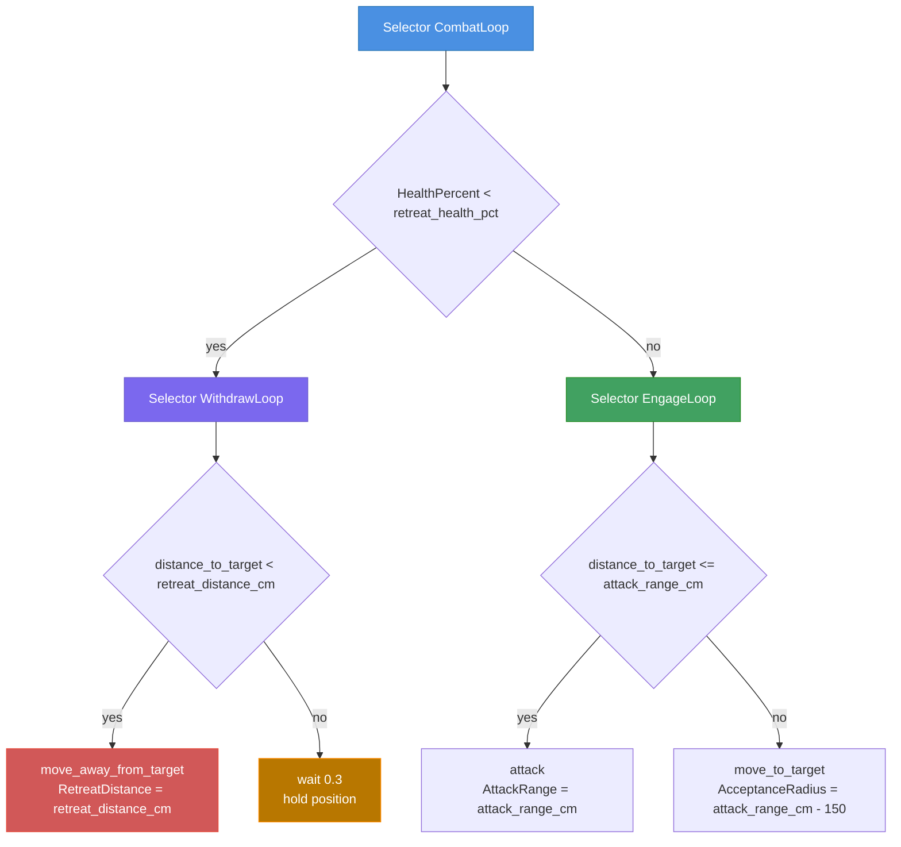
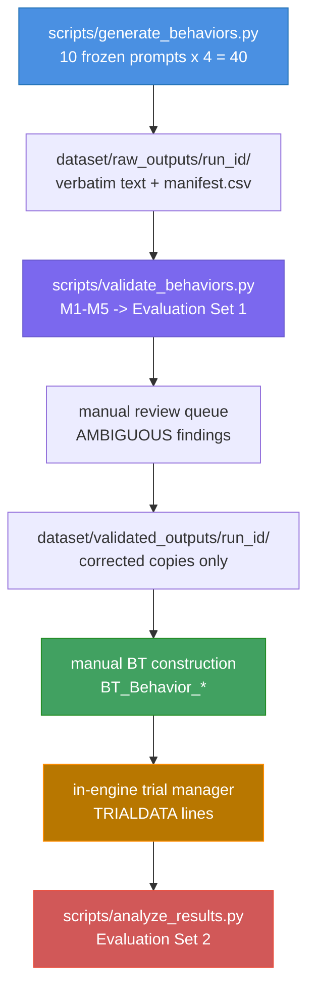

# Research progress checkpoint — LLM-generated enemy behaviour

**Module:** DS 340W. **Project:** Cosmic Animosity. **Engine:** Unreal Engine 5.7
(`EngineAssociation: 5.7`, install `C:\Program Files\Epic Games\UE_5.7`).

**Purpose of this file.** A single authoritative state record so work can resume without
re-inspecting the project. It records what exists, what was *verified by execution*, what was
only *inspected*, and what is still missing. Where a claim was never tested, it is marked
**UNVERIFIED** rather than assumed.

**Snapshot taken:** end of Phase 7F — candidates #1, #2, #3, #6 and #5 are implemented,
condition-isolated and measured against the baseline. Candidate #2's attack branch was proved
**unreachable by construction**; candidate #3's entire close band was proved **unsatisfiable in this
arena**; candidate #6's two branches were proved **mutually exclusive with the tasks they gate**;
candidate #5's attack branch was proved **starved by its own unguarded siblings** and its two leaf
distance guards proved **observationally inert**. Each produced zero damage in every trial except #3.
All findings were left intact.
**Last verified editor level:** `/Game/Research/Maps/Lvl_Research_Trial`.

---

## 1. How to resume from this file

If you are picking this up cold, read sections 2, 9 and 10 only. They contain the constraints
you must not break, the list of what does not exist yet, and the next step. Sections 3–8 are
reference detail you only need when touching that specific area.

---

## 2. Hard constraints (never violate)

These assets are the control group and the parity guarantee. They must **not** be modified,
renamed, or deleted.

| Asset | Path | Why it is frozen |
|---|---|---|
| `BP_AICharacter` | `/Game/FirstPerson/Blueprints/AI/BP_AICharacter` | Control group for RQ2 |
| `BP_WeaponBase` | `/Game/FirstPerson/Blueprints/Weapons/BP_WeaponBase` | Shared combat implementation |
| `BP_Projectile` | `/Game/FirstPerson/Blueprints/Weapons/BP_Projectile` | Shared damage path |
| `BP_FirstPersonCharacter` | `/Game/FirstPerson/Blueprints/BP_FirstPersonCharacter` | Player/target; changes alter survival time |
| `BP_AISpawner`, `BP_SpawnManager` | `/Game/FirstPerson/Blueprints/…` | Unused for trials; hard-code `BP_AICharacter_C` and `SetGamePaused` |
| `DT_CharacterData` / `ST_CharacterData` | `/Game/FirstPerson/Blueprints/` | Stat table (`Enemy` 500 HP / 500 cm·s⁻¹) |
| `IN_GenericActions` | `/Game/FirstPerson/Blueprints/IN_GenericActions` | Damage interface contract |
| `Lvl_FirstPerson` | `/Game/FirstPerson/Lvl_FirstPerson` | Original game level, 76 actors |

Additional invariants:

- `BT_Behavior_P01_G01`, `BT_Behavior_P02_G01`, `BT_Behavior_P04_G01`, `BT_Behavior_P07_G01` and
  `BT_Behavior_P03_G02` are **measured research artefacts**. They must stay byte-identical to the
  configuration each was measured in, including every generated defect (candidate #2's unreachable
  `n6_Attack`, candidate #3's unsatisfiable close band, candidate #6's zero-width attack window and
  unreachable retreat success, candidate #5's starved attack branch and inert leaf guards). Reproduce
  a candidate by repointing `AIController_ResearchEnemy.BehaviorTreeAsset`, never by editing a
  measured tree.
- `dataset/inputs/` and `dataset/outputs/` stay **byte-for-byte unchanged** and are never
  counted as LLM output.
- The project is **Blueprint-only**. No `*.Build.cs` exists, no C++ module exists. Do not
  introduce one.
- Generation must remain **unconstrained** — no `response_format`, no JSON-schema decoding.
  Constrained decoding would invalidate RQ1 (it would measure the decoder, not the model).
- `AttackRange`, `RetreatRange`, `BehaviorId`, `TrialId` and similar are set on Class Defaults.
  They are not instance-editable; setting them on a placed actor silently does nothing.

---

## 3. Research objectives

**RQ1 — Generation reliability.** How reliably can an LLM produce behaviour specifications
that are syntactically valid, structurally valid, expressible in the project's action space,
and logically coherent?

**RQ2 — Gameplay effectiveness.** When implemented in Unreal Engine, how do LLM-generated
behaviours perform on shared combat metrics compared with the hand-built baseline enemy, and
how well do they satisfy *their own* specification?

The behaviour space is deliberately minimal, so the experiment measures behavioural *logic*
rather than the model's ability to invent vocabulary:

| Space | Values |
|---|---|
| Actions (4) | `move_to_target`, `move_away_from_target`, `attack`, `wait` |
| Conditions (3) | `distance_to_target` (cm, 0–10000), `health_percent` (0–1), `can_attack` (bool, weapon cooldown) |
| Parameters | `attack_range_cm` 100–4000, `retreat_distance_cm` 100–4000 (must exceed `attack_range_cm`), `retreat_health_pct` 0–1 |
| Tree constraints | nodes `selector` / `sequence` / `action` only; `node_id` `^n\d{1,2}$`; depth ≤ 5; ≤ 15 nodes; 2–5 children per composite; root is a composite with no condition |

Schema version **2.0** — `dataset/schema/behavior_schema.json`.

---

## 4. The two evaluation sets

### Evaluation Set 1 — JSON generation and validation

Scored by `scripts/validate_behaviors.py`. Denominator for every rate: **N = number of
evaluated raw generations — 40 as collected and verified in Phase 6**.

| Metric | Meaning |
|---|---|
| M1 JSON validity | `json.loads` succeeds on verbatim text |
| M2 Structural validity | keys, types, `node_id` format/uniqueness, depth, node count, children count, parameter presence and range |
| M3 Action validity | every `action` ∈ the 4 supported actions |
| M4 Logical correctness | `VALID` / `REVIEW` (ambiguous only) / `INVALID` (provable defect) |
| M5 Correction rate | bucketed `none / minimal / mapping / logic` |

Severity map as implemented:

- **FAIL** — `S*` structural, `A*` action, `C1–C3` vocabulary/domain, `L1` no action,
  `L2` provable contradiction, `L7` root not a composite.
- **AMBIGUOUS → manual review** — `C4` float equality, `L3` duplicate siblings, `L4`
  non-exhaustive selector, `L5` unguarded attack, `L6` unguarded retreat.
- **Advisory** — `L8` threshold/parameter mismatch, `S3` redundant wrapper.

**Unreachability policy (implemented and self-tested).** A selector falls through to the next
child when a child *fails*, so duplicate or overlapping sibling conditions are **not** proof of
unreachability and are never scored invalid. They are `AMBIGUOUS` (shadowing risk). A branch is
invalid only when unreachability is *provable*: two conditions on the same test along one path
(ancestors included) with an empty intersection, or a tree with no action / only `wait`.

### Evaluation Set 2 — Gameplay

Produced **only** from `TRIALDATA` log lines emitted by the in-engine trial manager at runtime.
Nothing is inferred from the specification; the spec supplies only the *expected* action, matched
by `node_id`.

| Metric | Definition | Denominator |
|---|---|---|
| Behaviour correctness | correct reactions / tested events × 100 %; correct = right action for that node **and** it reported SUCCESS | tested events (triggers) |
| Reaction time | `ACTION_START.t − TRIGGER.t` for the same `evt` id | paired events only |
| Behaviour failure rate | no `ACTION_START` within 2 s **or** `ACTION_RESULT ≠ SUCCESS` | tested events |
| Damage dealt | Σ `DAMAGE.amount` | per trial |
| Player survival time | engine clock at the death frame | per trial |
| Attack accuracy (parity) | hits / shots fired | per trial |

`evt` ids (`T<trial>-n<node>-E<count>`) are allocated at trigger time so repeated triggers pair
unambiguously with their own action start. Initiation and success are separate events, so
"started the right action but it failed" is distinguishable from "never reacted".

Correctness is scored **against each tree's own specification**, never against the baseline. The
baseline is compared only on damage dealt, survival time and accuracy.

**Combat parity** is *measured*, not assumed: one `CONFIG` line per trial carries max health, max
walk speed, weapon damage, weapon accuracy, firing interval, projectile speed and the target-point
rule, read from the live actors. Known structural difference to report: the baseline decides to
fire from its Tick `AI MoveTo` success callback plus `PawnSensing.OnSeePawn`; the experimental
enemy will fire only when a BT `attack` task executes.

**Trial protocol — three scenarios, one enemy per trial, player passive:**

| Scenario | Setup | Measures |
|---|---|---|
| `S1_STATIONARY` | player fixed, not shooting | attack correctness, damage, survival time, reaction time |
| `S2_DISTANCE_SCRIPT` | player teleported on 3000/1500/600/1500/3000 cm schedule, 3 s per step, each a `PUSH` event | approach/retreat correctness, reaction time |
| `S3_LOW_HEALTH_START` | enemy spawned below its `retreat_health_pct` | defensive branch correctness |

Between trials the session is reloaded, so health, position, weapon cooldown, AI state and BT
state are all fresh.

---

## 5. Completed phases and verified results

### Phase 1 — Project inspection (complete)

Audited both enemy Blueprints, `BP_WeaponBase`, `BP_Projectile`, both spawners, `DT_CharacterData`
and `Lvl_FirstPerson`. Two findings drove everything after:

1. `BP_BasicEnemyAI` was a stub — it dealt **zero** damage, and its `CharacterNames` defaulted to
   `Player`, which loaded the player stat row (200 HP / 800 speed) instead of the enemy row.
2. **No Behavior Tree, Blackboard, BTTask, BTDecorator or research AIController existed anywhere
   in the project.** (Superseded by Phase 4 below.)

### Phase 2 — Dataset audit, schema, validator (complete)

- `dataset/inputs|outputs` = **12 pairs, all self-labelled `synthetic_demo`** ("hand-authored
  illustrative example; not a recorded LLM response"). Therefore **0 authentic LLM outputs**.
- Legacy→supported expressibility: **4 expressible** (001, 002, 003, 009), **2 partial** (008,
  010), **6 not expressible** (004, 005, 006, 007, 011, 012). Of 18 legacy action names, 8 map;
  of 9 condition names, 3 map. Written up in `dataset/PROVENANCE.md`; originals untouched.
- Validator correction #1 implemented and proven with two fixtures:
  - `selftest_contradiction.json` — nested `distance > 800` containing `distance < 300` →
    **INVALID** (`L2`, ancestors included).
  - `selftest_duplicate_siblings.json` — duplicate sibling `health_percent < 0.3` →
    **REVIEW** (`L3` shadowing risk only, *not* unreachable).
- Legacy fixture run: `N=12, M1 12/12, M2 12/12, M3 12/12, M4 7/12, M5 9/12 mapping`.
  Artefacts: `results/validator_fixtures_synthetic.csv`, `results/generation_validation.csv`.

### Phase 3 — First vertical slice (complete and gameplay-verified)

**What was built:** the experimental enemy now has a working projectile combat loop, and a
dedicated research arena exists.

`BP_BasicEnemyAI` was rewritten with `bp_agent` and compiles clean — legacy montage/`Delay` chains
removed. `BP_ResearchGameInstance` was created. `Lvl_Research_Trial` was built with
`python_agent` (script id `2xv-c3OCe16DOgb7KNohW`).

**Verified by PIE execution** — 10.50 s, player stationary and never firing:

| Measurement | Value |
|---|---|
| Player `CurrentHealth` | **200 → 145** (−55) |
| Damage events | **11**, each exactly −5 |
| Damage timestamps (s) | 1.344, 2.361, 3.374, 4.444, 5.257, 6.319, 7.403, 8.364, 9.345, 10.369, 11.312 |
| Weapon fires (`LastFireTime`) | 11, t = 1.023 → 11.143 (FireRate 1.0 ⇒ 1 s cadence as designed) |
| Projectiles | 11 distinct `BP_Projectile`, Damage 5, Speed 2500 |
| Shot→hit latency | ≈ 0.32 s ≈ 800 cm / 2500 cm·s⁻¹ (ballistically consistent) |
| Enemy location | (0, 600, 90.2) — unchanged, player was inside `AttackRange` |
| Log errors/warnings | none from enemy, weapon, projectile, AI controller or navigation |

Recording: `Saved/AuraVerify/autopilot/2026-11-05T16-43-15-126Z-1j4knv/recording.mp4`.
Verdict returned by `verification_agent`: **working**.

**This proves:** the shared combat chain (`FireAt` → `CanFire` cooldown → accuracy cone → spawn
`BP_Projectile` → on hit, if target implements `IN_GenericActions` and ≠ instigator → `SendDamage`)
works when driven from the experimental enemy, and that the enemy's stats/aim/target-point rule
are correct.

**This does NOT prove:** anything about generated behaviours, navmesh pathing, or logging. See §9.

**Fidelity-log deviation.** Combat lives directly inside `BP_BasicEnemyAI` rather than in a
separate `AC_EnemyCombat` component. Record this in the implementation log of the paper; it does
not affect parity because the shared weapon/projectile path is unchanged.

### Phase 4 — Behaviour Tree slice: the attack path (complete and gameplay-verified)

**Built this session, all new assets under `/Game/Research/AI/`:**

| Asset | Contents |
|---|---|
| `BB_EnemyBehavior` | `TargetActor` (Object, base `Actor`), `DistanceToTarget` (Float), `HealthPercent` (Float), `CanAttack` (Bool). The engine injects a `SelfActor` key on creation and the saved asset carries it, so the blackboard holds these four plus `SelfActor` (Object, base `Actor`) |
| `AIController_ResearchEnemy` | Parent `AIController`. Variables `BehaviorTreeAsset` (default `BT_Behavior_AttackAlways`), `UpdateTimerHandle`. On Possess → `Run Behavior Tree` → write `TargetActor` → start a 0.1 s looping timer. `UpdateDerivedKeys` re-resolves the player pawn each tick, then writes `TargetActor`, `DistanceToTarget` (`GetDistanceTo`), `HealthPercent` (`CurrentHealth / MaxHealth`, guarded against `MaxHealth ≤ 0`) and `CanAttack` (`Weapon.CanFire`, pure). On Un Possess clears the timer |
| `BTTask_EnemyAttack` | Parent `BTTask_BlueprintBase`. Receive Execute AI → Cast `ControlledPawn` to `BP_BasicEnemyAI` → `FireAtTarget` → `Finish Execute(true)`; Cast Failed → `Finish Execute(false)`. Every path finishes, so the task cannot hang the tree |
| `BT_Behavior_AttackAlways` | **Development test tree only — not a research behaviour.** Root Sequence `AttackLoop` → `BTTask_EnemyAttack`, `BTTask_Wait` 0.1 s. Blackboard `BB_EnemyBehavior` |

**Engine facts established by reading UE 5.7 source, not assumed:**

- `AAIController::RunBehaviorTree` calls `BTComp->StartTree(*BTAsset, EBTExecutionMode::Looped)`
  (`AIModule/Private/AIController.cpp:1020`). The Blueprint `Run Behavior Tree` node therefore
  loops forever, and a root that returns SUCCESS restarts instead of stopping
  (`BehaviorTreeComponent.cpp:593–608`).
- That makes an instant-SUCCESS task dangerous: without a `Wait` the loop has zero duration. The
  `Wait` is a **safety floor**, and at 0.1 s it is deliberately shorter than the weapon cooldown so
  the cooldown, not the tree, sets the fire rate.
- `Run Behavior Tree` must run **before** any blackboard write: it is what creates the
  `BlackboardComponent`. Writing keys first silently does nothing.
- `UAIBlueprintHelperLibrary::GetBlackboard(AActor*)` (`AIBlueprintHelperLibrary.h:53`) is the
  Blueprint route to the blackboard; `AController::ReceivePossess`, displayed as "On Possess"
  (`Controller.h:289`), is the possession event.

**Verification history — four PIE runs, each isolating a different failure mode:**

| Run | Result | What it established |
|---|---|---|
| 1 | **FAIL** — zero damage | The level-placed `SM_ExperimentalEnemy` carried an **instance override** `AIControllerClass = /Script/AIModule.AIController`, which shadowed the Class Defaults. A plain C++ controller possessed the enemy, `Run Behavior Tree` never ran, and with the Tick gate off the enemy was inert. Fixed by setting the instance to `AIController_ResearchEnemy_C` |
| 2 | Passed on damage, 2 defects | Brain running, 11 hits of 5, but `TargetActor` was the **possessed pawn (the enemy itself)**, so `DistanceToTarget` read 0.0; and the 0.5 s `Wait` quantised the fire rate to ~1.135 s |
| 3 | Both fixes verified | `TargetActor` = player at 24/24 samples, `DistanceToTarget` = 800.04, cadence mean 1.060 s |
| 4 | Regression after Tick removal | Still 200 → 145 at 12 s, 12 hits of 5 by 13 s, cadence 1.092 s mean, no log errors |

**Verified numbers (run 4, the final state) — 13.0 s, player stationary and never firing:**

| Measurement | Value |
|---|---|
| Player `CurrentHealth` | **200 → 145 at 12 s** (11 hits); 200 → 140 by 13.0 s (12 hits) |
| Damage per hit | exactly −5 on every event |
| Brain | `BehaviorTreeComponent_0` `IsRunning = true`, asset `BT_Behavior_AttackAlways`, live instance `BTTask_EnemyAttack_C_0` |
| Controller | `AIController_ResearchEnemy_C_0` |
| Blackboard (42 samples) | `TargetActor` = `BP_FirstPersonCharacter_C_0` always; `DistanceToTarget` = **800.04** (min = max); `HealthPercent` = 1.0; `CanAttack` both True (7 samples) and False (88) |
| Fire cadence | mean **1.092 s** (intervals 1.006–1.164 s), gated by the weapon's 1.0 s cooldown |
| Shot→hit latency | ≈ 0.311 s, matching 800 cm at 2500 cm·s⁻¹ |
| Log errors | none — no `Accessed None`, no BT errors, no tree-start failures |

**Counterfactual proof that combat is tree-driven only** (needed because two mechanisms could
otherwise mask each other):

- Disabling the enemy's actor tick mid-run → the tree **kept firing** (health 200 → 170 over 6
  shots). Combat does not depend on tick.
- Calling `BehaviorTreeComponent.StopLogic` mid-run → the actor tick stayed enabled and **no
  further shots or damage occurred** for 4 s.

**Removal of the old scaffold:** the Tick event, the `bUseLegacyTickCombat` gate and variable, the
player lookup, the distance comparison, the Tick-local `FireAtTarget` call and `AI MoveTo` (plus
its two delegate events) were all deleted. `FireAtTarget` remains as a **function**, and is now
called only by the task.

**Methodological finding to report.** Tree-driven action timing is quantised by the loop period,
so an `attack` action cannot fire exactly on the weapon cooldown. Measured 1.060 s (run 3) and
1.092 s (run 4) mean cadence against a 1.0 s cooldown — roughly 6–9 % slower than the Tick
baseline, which fired at 1.000 s. This is a **measured implementation limitation of this specific
tree, not a Behaviour Tree ceiling**: `BT_Behavior_AttackAlways` holds a 0.1 s `Wait` and samples
`CanAttack` once per loop, so a shot can only begin on a loop boundary and the weapon's 1.0 s
cooldown is rounded up to the next one. A tree with a shorter `Wait` — or one that tests the
cooldown inside the task instead of per loop — need not show the offset. Keep any `Wait` in a real
tree ≤ 0.2 s so the weapon stays the limiter, and report the 6–9 % as a property of this tree in
the parity discussion rather than as an inherent cost of BT-driven behaviour.

---

### Phase 4B — Distance decorator gating (complete and gameplay-verified)

**Goal:** prove that a native blackboard decorator can gate the attack path on distance, i.e. that
"attack only while the target is closer than N cm" is enforceable from the tree alone.

**What was built.** `BT_Behavior_AttackAlways` (dev test tree; name retained for reference
stability) now carries exactly one `BTDecorator_Blackboard`, parented to the **`Enemy Attack` task**
(`BTTask_EnemyAttack_C`):

| Property | Value |
|---|---|
| `BlackboardKey` | `DistanceToTarget` (Float, `BB_EnemyBehavior`) |
| `ArithmeticOperation` | `Less` |
| `FloatValue` | `1000.0` |
| `NotifyObserver` | `ResultChange` |
| `FlowAbortMode` | `Self` — **clamped by the engine**: a decorator parented to a leaf task cannot be `Both` (requesting `Both` reads back `Self`; `LowerPriority` reads back `None`). `Self` suffices because the looped tree re-evaluates the decorator on every restart. |
| `bInverseCondition` | False |

Tree shape unchanged: `Root → Sequence "AttackLoop" → [Enemy Attack (decorator), Wait 0.1 s]`.

**The first placement failed, and that is the interesting half of the result.** The same decorator
was initially attached to the `AttackLoop` composite (the runtime root composite). Its properties
read back correctly — `DistanceToTarget / Less / 1000 / Both / ResultChange` — yet PIE showed the
enemy **firing continuously at 3000 cm**: 4 new projectiles inside the 6 s out-of-range phase at a
1.33 s cadence with `DistanceToTarget = 2999.8` in the blackboard, and 2 damage events in the
final out-of-range phase. A condition reading `2999.8 < 1000` cannot pass, so the decorator was
inert where it sat. Moving the identical decorator onto the attack task fixed the behaviour with
no other change.

**Verified behaviour (probe run after the move).** Scripted PIE teleported the player to 3000 cm,
then 600 cm, then back to 3000 cm, sampling the blackboard key, player health, geometric distance,
tree state and projectile population every editor frame.

| Phase | Blackboard `DistanceToTarget` (min / mean / max) | Damage events | Damage total | Tree running |
|---|---|---|---|---|
| A — 3000 cm (6 s) | 800.0 / 2877.6 / 2999.8 | **0** | 0.0 | 18/18 samples |
| B — 600 cm (5 s) | 600.0 / 760.0 / 2999.8 | **4** | 20.0 | 15/15 samples |
| C — 3000 cm (5 s) | 600.0 / 2839.8 / 2999.8 | **0** | 0.0 | 15/15 samples |

- The gate **opened within +0.674 s** of the inbound teleport (teleport at 6.216 s, first damage at
  6.890 s). That interval is the 0.1 s blackboard-update timer, the decorator's `ResultChange`
  re-evaluation and the projectile's flight time combined.
- The gate **closed cleanly** on the outbound teleport: zero damage across the final 5 s at 3000 cm
  from a full-health start, so no in-flight shot landed after the range change.
- `bt_running` was 1 in every sample of every phase and is **not** a discriminator — a looped tree
  whose root fails still reports `IsRunning = true` while it re-iterates. Task execution (damage)
  is the observable, not tree state.
- Damage was exactly 5.0 per event on a 200 HP player, matching `ShootingDamage` 5 in the control
  group.

**Measurement limits, stated rather than smoothed over.** The editor was backgrounded during these
runs, so PIE ran at `max tick rate 3` (engine log) and the probe sampled at ~0.33 s. Consequences:
all latencies above are quantised to 0.334 s; the inter-damage cadence measured 1.334 s, i.e. four
sample frames, and cannot be resolved more finely; and the projectile-population metric read 0 at
every sample because projectiles are created and destroyed inside a single 0.33 s window. The
gate/no-gate conclusion does not depend on any of them — it rests on 4 versus 0 damage events at
600 cm versus 3000 cm — but these latency and cadence figures must not be compared with the
millisecond-resolution Phase 4 numbers.

**Harness notes worth keeping.** The player's `CurrentHealth` was raised from 200 to 100000 once at
session start. Without it the enemy killed the player during the first out-of-range attempt, and
`BP_FirstPersonCharacter.Death()` → `SetGamePaused(true)` plus its 5 s destroy chain travelled the
PIE world out of `Lvl_Research_Trial` into `Lvl_FirstPerson` (three times in the log from
19:08:14), destroying the session.

Artefacts: harness `Content/Python/aura_pie_probe.py`; raw result `Saved/aura_pie_probe_report.txt`;
progress `Saved/aura_pie_probe_status.txt`.

### Maintenance - BP_ImpactFX null `ImpactMID` (shared VFX bug fix, NOT an experimental AI change)

**This entry is infrastructure hygiene, not a research result.** It touches no Behaviour Tree, no
blackboard, no AI controller and no damage value, so it changes nothing about either evaluation set.
`BP_ImpactFX` is shared: it is referenced by `BP_WeaponBase` and `BP_Projectile`, so both the control
and experimental enemies emit it on every hit.

**Symptom.** One 4-hit PIE run logged 8 x `PIE: Error: Blueprint Runtime Error: "Accessed None trying
to read (real) property ImpactMID in BP_ImpactFX_C". Node: Set Scalar Parameter Value Graph:
EventGraph`, each paired with a `LogScript` warning. The effect still drew; only its material fade was
dead.

**Root cause.** `Impact MID` has one writer, `Variable Set Impact MID`, fed by
`Create Dynamic Material Instance` on the `Impact Mesh` component - and that node had **no exec
input**, so the whole init chain was unreachable and `Impact MID` stayed `None`. The Timeline path
`Update -> SetActorScale3D -> Set Scalar Parameter Value` (Target from a fresh `Get Impact MID`) then
dereferenced it once per timeline update. Not a material problem: `M_VFX_Emissive` does expose the
`Opacity` scalar and `EmissiveColor` vector parameters.

**Correction - exec wiring only, no nodes added, removed or reconfigured.** One wire disconnected
(`ReceiveBeginPlay -> Timeline Play from Start`) and two connected, giving
`ReceiveBeginPlay -> CreateDynamicMaterialInstance -> Set Impact MID -> SetMaterial ->
Set Scalar Parameter Value (Opacity = 1) -> Set Vector Parameter Value (EmissiveColor) ->
Timeline Play from Start`. The fade path, `Finished -> DestroyActor`, `ReceiveTick` and
`ReceiveActorBeginOverlap` were untouched, and `BP_AICharacter`, `BP_WeaponBase`, `BP_Projectile` and
the material were not modified. Intended consequence: the authored `Opacity` ramp and
`EmissiveColor` (1.0, 0.6, 0.15) now actually apply, so the impact fades rather than popping.
Mesh, scale curve, lifespan and destruction are unchanged.

**Verified in PIE (same three-phase probe, after the fix).** Compiles clean (0 errors, 0 warnings) and
was saved. Zero new `ImpactMID` messages - the log's `PIE: Error` total stayed at 8 and every such line
is timestamped from the pre-fix run. Damage unchanged: 4 events x 5.0 = 20.0 in the 600 cm phase, 0 at
3000 cm either side, first damage +0.670 s after the inbound teleport. The absence of the error is
causal, not silence: the fade path's `Set Scalar Parameter Value` succeeded on all 4 impacts, which
requires a valid `MaterialInstanceDynamic`.

### Phase 5A — `BTTask_EnemyMoveToTarget` and the approach branch (complete and gameplay-verified)

**Goal.** Give the enemy the `move_to_target` action and a selector that chooses between attacking and
closing distance, without touching any baseline asset.

**New asset.** `BTTask_EnemyMoveToTarget` (`/Game/Research/AI`, parent `BTTask_BlueprintBase`), with an
instance-editable `AcceptanceRadius`. Three strands:

| Strand | Behaviour |
|---|---|
| `Receive Execute AI` | branch on `IsValid(Blackboard -> Get Value as Object "TargetActor")`; invalid -> print + `Finish Execute(false)`; valid -> `MoveToActor` (Goal = target, `Stop on Overlap`, `Use Pathfinding`, `Can Strafe`, `Allow Partial Path`) and return **without** finishing, so the task stays In Progress |
| `Receive Tick AI` | on `Get Move Status == Idle`: target invalid -> `Finish Execute(false)`; else `Vector_Distance(pawn, target) <= AcceptanceRadius + 150` -> `Finish Execute(true)`, otherwise `Finish Execute(false)` with the measured distance in the message |
| `Receive Abort AI` | `Stop Movement` then `Finish Abort` (never `Finish Execute`) |

Non-latent `MoveToActor` + tick polling was chosen over the latent `AI Move To` node because that
node's `On Fail` pin can fire after an abort and double-call `Finish Execute`. `bNotifyTick` needs no
manual flag — `UBTTask_BlueprintBase` derives it from whether `Receive Tick AI` is implemented.

**Tree.** `BT_Behavior_AttackAlways` became a selector rather than a sequence:

```
ROOT -> Selector "CombatLoop"
        |- Sequence "AttackLoop"    [0]  Enemy Attack (BTTask_EnemyAttack_C) -> Wait 0.1
        \- Sequence "ApproachLoop"  [1]  Enemy MoveToTarget (AcceptanceRadius 800) -> Wait 0.5
```

Selector order is the design: the attack branch is tried first every pass and only falls through to
the approach branch when its gate refuses.

**The attack gate is now HARD-CODED inside the task, and that is a workaround — not proof of
conditional execution.** `BTTask_EnemyAttack` gained `DistanceToTarget <= AttackRange` before
`FireAtTarget` (blackboard read through `Owner Controller -> Blackboard -> Get Value As Float`;
`AttackRange` taken off the existing cast to `BP_BasicEnemyAI`), failing with
`Finish Execute(false)` when out of range. The `BTDecorator_Blackboard`
(`Distance To Target < 1000`, `FlowAbortMode=Self`) remains on the `Enemy Attack` task node and was
observed gating in the same runs.

> **The gate exists because the `BTDecorator_Blackboard` proved unreliable, and it must never be
> treated as equivalent to correct execution of a generated tree.** The tree is currently gated by a
> literal 1000 written into the task graph, reading a blackboard float. That hard-coded check is what
> made `AttackLoop` fall through at 2999.8 cm. It does **not** demonstrate that the decorator on the
> node executes, that a `Less`/`FloatValue` condition authored by a generator would execute, or that
> any other node's own conditions will fire. The two mechanisms happen to agree on the runs recorded
> below; they were never separated experimentally, so the decorator's execution is **unverified**.
> Every future tree must be measured on its own behaviour rather than assumed correct because the
> hard-coded gate produced the expected result.

**Verified in PIE — one run, two phases, 47 samples** (`Saved/aura_pie_probe_report.txt`, 21:04):

| Phase | bb_dist min/mean/max | First shot | Damage events | Enemy position |
|---|---|---|---|---|
| A — player teleported to 2999.8 cm, 10 s | 800.0 / 1546.4 / 2999.8 | +5.999 s | 3 (15.0) | (0, 600) -> (-1146, -1182) |
| B — player teleported to 600 cm, 6 s | 600.0 / 615.7 / 882.1 | +0.000 s | 5 (25.0) | unchanged |

Displacement in phase A is **2118.7 cm**. The enemy came to rest **882.1 cm** from the player and the
move task logged `BTTask_EnemyMoveToTarget: SUCCESS` at arrival. The attack did **not** fire during
the approach — first damage at +6.335 s, after arrival — against 7 shots from +1.0 s in the pre-fix
run of the same phase. The 800.0 cm minimum in phase A is the single pre-teleport sample (the
`PlayerStart` is 800 cm from the enemy), not a closest approach.

**Two defects found by measurement, both worth remembering.**

1. `MoveToActor` with `Stop on Overlap` stops the pawn slightly *beyond* `AcceptanceRadius` — the
   angular stopping distance at 600 cm/s and 2048 deceleration is ~88 cm — so a
   `distance <= AcceptanceRadius` arrival test can never pass. Measured:
   `FAILURE (arrived too far) d=882.08615` against a radius of 800. The test now allows a 150 cm band.
2. That band first came from a new instance-editable `ArrivalTolerance` variable (CDO 150) and did
   not work: the `BTTask_EnemyMoveToTarget_C` node inside `BT_Behavior_AttackAlways` was serialized
   before the variable existed, so the getter on that instance did not return 150. Replacing the
   variable read with a **literal 150** produced `SUCCESS` on the next run. The threshold value was
   never printed (the literal replaced the variable in the same edit), so "the instance reads 0" is
   the only consistent explanation rather than a directly observed number. **Lesson: do not rely on
   a newly added variable reaching a pre-existing BT node instance — use a literal or re-add the
   node.**

**Decorator inertness was, at least once, stale compiled data rather than placement.** In the first
run after the decorator was moved onto the `Enemy Attack` task, the enemy still fired from 2999.8 cm:
the graph read back correctly (`ParentIndex=3`, i.e. the `BTTask_EnemyAttack_C` node, `Less`,
`FloatValue=1000`, `FlowAbortMode=Self`) yet the attack task executed on every pass. After the tree
asset was re-saved through the Behaviour Tree tooling (`set_bt_node_properties`, used to change
`AcceptanceRadius`), the next run had the attack task never executing out of range. `UBehaviorTree::RootNode`
is protected and unreadable from Python, so `Children[].Decorators` in the compiled tree could not be
inspected; the run sequence is the evidence and the stale-data mechanism is the likely explanation,
not a read fact. Practical rule: after any decorator change, re-save through the BT tooling and
re-measure before believing either "it gates" or "it does not".

**Measurement limits.** As Phase 4B: editor backgrounded, PIE at `max tick rate 3` (~0.33 s per
sample), so latencies are quantised to 0.334 s and the projectile-population counter collapses inside
one window (2 shots counted against 3 damage events in phase A). Additionally the probe's per-frame
`get_actor_location()` on the enemy failed on most frames of this session (`locs=4/29`), so the
report's own `enemy_move ... displacement=` line reads 0; the 2118.7 cm figure above is derived from
the phase-B teleport target (`target=(-1146, -1782, 90)` = enemy location + the fixed (0,-600,0)
offset), which reproduced to +/-1 cm across three runs.

---

### Phase 5B — `BTTask_EnemyMoveAwayFromTarget` and the retreat path (complete and gameplay-verified)

**Goal.** Give the enemy an inverse of the approach action — one that moves it *away* from the
blackboard `TargetActor` using Unreal navigation — and measure that the separation to the player
actually grows. No baseline asset, shared combat asset or previously verified tree was touched.

**New asset.** `BTTask_EnemyMoveAwayFromTarget` (`/Game/Research/AI`, parent `BTTask_BlueprintBase`),
three strands, **no variables of its own** — deliberately, because of the `ArrivalTolerance` lesson in
Phase 5A.

| Strand | Behaviour |
|---|---|
| `Receive Execute AI` | `IsValid(Blackboard -> Get Value as Object "TargetActor")` invalid -> print + `Finish Execute(false)`; else cast the controlled pawn to `BP_BasicEnemyAI` and read the existing **`RetreatRange`** (1500). Goal = `PawnLoc + Normal(PawnLoc - TargetLoc) * RetreatRange`. If the current distance is already `>= RetreatRange` -> print + `Finish Execute(false)` (nothing to do, selector falls through); otherwise `MoveToLocation` (Goal, `Acceptance Radius` 50, `Stop on Overlap`, `Use Pathfinding`, `Project Destination to Navigation` false, `Can Strafe`, `Allow Partial Path`) and return **without** finishing, so the task stays In Progress |
| `Receive Tick AI` | on `Get Move Status == Idle`: target invalid -> `Finish Execute(false)`; else `Vector_Distance(pawn, target) >= RetreatRange - 150` -> print `SUCCESS d=.. thr=..` + `Finish Execute(true)`, otherwise print `FAILURE (retreat too short) d=.. thr=..` + `Finish Execute(false)` |
| `Receive Abort AI` | `Stop Movement` then `Finish Abort` |

Design notes, each a consequence of an earlier measurement:

- `RetreatRange` on `BP_BasicEnemyAI` had **no consumer** until now; the retreat task is its first,
  which is why the task needed no new parameter and therefore cannot hit the stale-instance-variable
  failure mode. The existing `AttackRange` variable is read the same way in `BTTask_EnemyAttack`.
- The 150 cm arrival band and the 50 cm acceptance radius are both **literals**. Arrival lands
  ~48 cm short of the goal point (acceptance 50 plus stopping distance), comfortably inside the band.
- `Vector_Distance` is computed from actor locations, not from the blackboard `DistanceToTarget`
  float, so the retreat decision does not inherit any staleness of the controller's 0.1 s timer.
  `TargetActor` is the only blackboard key the task reads.
- The direction is `Normal(pawn - target)`: retreating straight along the pawn->player axis, so the
  final separation is `RetreatRange` plus however far the player already stood from the goal side.

**Verification tree.** `BT_Behavior_RetreatTest` (`/Game/Research/AI`) — `ROOT` (`BB_EnemyBehavior`)
-> Sequence `RetreatLoop` -> [0] `Enemy MoveAwayFromTarget`, [1] `Wait` 0.5. It is a **development
test tree only**, exactly like `BT_Behavior_AttackAlways`, and must never be reported as a research
behaviour.

**The retreat was deliberately NOT added to `BT_Behavior_AttackAlways`.** `RetreatRange` (1500) is
larger than both the approach acceptance radius (800) and `AttackRange` (1000), so a retreat branch
placed ahead of `ApproachLoop` would fire at the 800 cm spawn baseline and destroy the verified
Phase 5A behaviour. Combining the branches requires a threshold decision that belongs to the
parameter-plumbing step, not this one.

**The tree was swapped at runtime, not by editing the controller.** `AIController_ResearchEnemy`
still references `BT_Behavior_AttackAlways` — confirmed by reading `BehaviorTreeAsset` back after the
run. The probe called `AIController.RunBehaviorTree(BT_Behavior_RetreatTest)` on the live controller
(one BlueprintCallable call, which returned true), so no controller, level or tree asset was
altered to run the test.

**Verified in PIE — one run, 30 samples** (`Saved/aura_retreat_probe_report.txt`, 21:23):

| Quantity | Measured |
|---|---|
| Enemy start position | `(0.0, 600.0, 90.2)` |
| Player teleported to (close start) | `(0.0, 900.0, 98.2)` — 300 cm on the +Y side |
| Start distance to player | **300.1 cm** |
| Enemy end position | `(0.0, -851.4, 90.2)` |
| End distance to player | **1751.5 cm** |
| Enemy displacement | **1451.4 cm**, all in -Y |
| Distance change | **+1451.3 cm** |
| Task result | `SUCCESS d=1751.463477 thr=1350.0` |
| Path following | `IDLE -> MOVING -> IDLE`; goal `y=-900` reached within 48.6 cm |

`distance_to_player` rose monotonically across every sample — 300.1, 418.1, 584.8, 751.4, 918.1,
1084.8, 1251.4, 1418.1, 1584.8, 1751.5 — i.e. **no sample regressed**, so the increase is not an
artefact of comparing only two endpoints. Movement ran from t=0.87 s to t=3.87 s at ~500 cm/s
(`MaxWalkSpeed` 600, accelerating), then held at 1751.5 cm for the rest of the run.

The final separation exceeds 1500 because the player was standing 300 cm on the goal side of the
starting position: `1500 + 300 - 48.6`.

**Navigation failures: none during the retreat.** The goal `(0, -900)` was reachable, no partial path
was taken, and `PathFollowingStatus` was never stuck in `MOVING`. The report's `stall_windows` entries
all start at t=5.20 s, i.e. **after** arrival — the enemy is simply standing still with the looped
tree still running, which the heuristic cannot distinguish from a stall. Two real log events are
worth recording:

1. One `FAILURE (no target)` at the moment of the tree swap, before the controller's 0.1 s timer had
   written `TargetActor`. The task reported the missing target correctly; the looped tree retried and
   succeeded on the next pass. This is a startup race in the *blackboard*, not a task defect.
2. After arrival the tree re-ran `FAILURE (already beyond retreat range) d=1751.463477` about every
   0.67 s, because `RunBehaviorTree` uses `EBTExecutionMode::Looped` and the single-child sequence
   fails once the retreat condition is already satisfied. Expected for this test tree; a real tree
   would put a different branch after it in a selector.

**Measurement notes.** Probes that need to survive across Aura calls must be polled without
`importlib.reload` — a reload re-executes the module header, wiping probe state, while the already
registered tick callback keeps writing into the *old* environment. This run's report and status file
are consistent (one teleport, one tree swap, 30 samples), and `get_actor_location()` on the enemy
succeeded on **30/30** frames, unlike the `locs=4/29` sampled in Phase 5A — so the earlier failure was
transient, and the Phase 5A displacement was correctly derived from the teleport target rather than
from per-frame positions.

---

### Phase 5C — Parameter plumbing for the three schema parameters (complete and gameplay-verified)

**Goal.** Give `attack_range_cm`, `retreat_distance_cm` and `retreat_health_pct` a native, per-node home
so that an action task owns only a mechanism and the *tree* owns the decision. No combined tree was
built and no output was generated in this increment.

**Mapping — schema field to native Behaviour Tree data**

| JSON | Native home | Type / range | Why exactly there |
|---|---|---|---|
| `parameters.attack_range_cm` | instance property `BTTask_EnemyAttack.AttackRange` on the attack node | float, cm, 100–4000 | the gate has to exist (decorators are unproven) but its value must come from the tree, not from the pawn blueprint |
| `parameters.retreat_distance_cm` | instance property `BTTask_EnemyMoveAwayFromTarget.RetreatDistance` on the retreat node | float, cm, 100–4000 | target separation, and simultaneously the task's own "already far enough -> FAILURE" precondition |
| `parameters.retreat_health_pct` | `BTDecorator_Blackboard` on the retreat branch: key `HealthPercent`, `ArithmeticOperation = Less`, `FloatValue` = the pct | float 0.0–1.0 | health is a *condition*, and schema conditions attach to `selector`/`sequence` nodes as well as actions, so it cannot live in one action task. **No new asset needed** — `AIController_ResearchEnemy.UpdateDerivedKeys` already writes `HealthPercent = CurrentHealth / MaxHealth` every 0.1 s, in the schema's 0–1 range |
| approach stop distance | instance property `BTTask_EnemyMoveToTarget.AcceptanceRadius` | float, cm | translator sets it to `attack_range_cm - 150`; the measured stop overshoot is at most 88 cm, so arrival lands inside attack range |
| `wait_seconds` | `BTTask_Wait.WaitTime` | 0.1–3.0 s | native task, no wrapper needed |

Every JSON `condition` object maps to a native `BTDecorator_Blackboard` with
`NotifyObserver = ResultChange`, and `FlowAbortMode` chosen by node kind (`Self` on tasks — the setter
clamps it there anyway; composite nodes accept `Both`).

**Changes made (minimum set)**

- `BTTask_EnemyAttack`: added `AttackRange` (real, default 1000, instance editable, category Combat).
  The threshold now arrives through a Self getter instead of the pawn's `Attack Range`. The cast to
  `BP_BasicEnemyAI_C` was **kept**, because `FireAtTarget` is a function on that class; the Cast-Failed
  path is untouched.
- `BTTask_EnemyMoveAwayFromTarget`: added `RetreatDistance` (real, default 1500, instance editable,
  category Movement). Both `BP_BasicEnemyAI_C` casts and the "pawn not BP_BasicEnemyAI" failure path
  were **removed**, so the action now works on any pawn and cannot inherit a threshold from the enemy
  blueprint. Exec chains were re-read afterwards: no unwired exec inputs, no `BP_BasicEnemyAI` cast left.
- `BTTask_EnemyMoveToTarget`: **unchanged** — `AcceptanceRadius` was already instance editable.
- No new decorator asset. `BTDecorator_EnemyCondition` is still not needed for these three parameters.

**Measured: the stale-instance hazard is real and now has numbers.** Read back *before* writing the
node values, the attack node reported `AttackRange = 0.000000` and the retreat node
`RetreatDistance = 0.000000`, although both class defaults are 1000 / 1500 and both classes had
compiled and saved. After writing them explicitly the same nodes read 1000 and 1800. **Rule for the
translator: write every task-node property it depends on. A class default does not reach a node that
was serialized before the property existed, and the node then behaves as 0 rather than failing loudly.**

**Verification run 1 — retreat with node value 1800 (deliberately not the class default 1500)**
(`Saved/aura_retreat_probe_report.txt`, 21:40, 36 samples):

| Quantity | Measured |
|---|---|
| Start | enemy `(0.0, 600.0, 90.2)`, player teleported to `(0.0, 900.0, 98.2)`, 300.1 cm |
| End | enemy `(0.0, -1184.5, 90.2)`, separation **2084.6 cm** |
| Displacement | **1784.5 cm** |
| Task result | `SUCCESS d=2084.564107 thr=1650.0` |
| Goal `(0, -1200)` reached | within 15.4 cm, `IDLE -> MOVING -> IDLE`, no partial path |

This is the discriminating measurement: `thr` printed **1650** = 1800 - 150, and the enemy stopped at
2084.6 = 300 + 1800 - 15.4. A node reading the class default 1500 would have printed 1350 and stopped
at ~1751.5 — which is exactly what Phase 5B measured with 1500. A node reading 0 would have failed
instantly. So the node's own instance value drives both the goal and the threshold. The node was then
restored to 1800 -> **1500**, the value the tree was verified with in Phase 5B; the code path exercised
at 1800 is identical, so the 1500 configuration is the same mechanism with a different number.

**Verification run 2 — attack/approach regression** (`Saved/aura_pie_probe_report.txt`, 21:43, 48 samples,
attack node `AttackRange = 1000`):

| Phase | bb_dist min/mean/max | First shot | Damage events | Worst case |
|---|---|---|---|---|
| A — player at 2999.8 cm, 10 s | 800.0 / 1525.0 / 2999.8 | +7.006 s | 2 (10.0) | no fire while closing |
| B — player at 600 cm, 6 s | 600.0 / 615.8 / 883.0 | +0.000 s | 5 (25.0) | fires immediately in range |

The approach still stopped at ~883 cm (`bb_dist` max in phase B) and the attack then fired, as in
Phase 5A. Damage in phase B requires the task's own comparison to pass, i.e. `AttackRange > 0`; a
0-valued node would have swallowed every shot even with its decorator satisfied. What this run does
**not** isolate is the decorator from the in-task gate: no `BTTask_EnemyAttack: out of range` line
appears anywhere in the run, so during the approach the decorator refused the task before it executed
and the in-task check never had to refuse. The two mechanisms still moved together.

Known limitation of run 2: `locs=4/30` — per-frame `get_actor_location()` on the enemy failed on most
frames again, so that report's own `displacement=` line reads 0. The approach was confirmed from
`bb_dist`/`geo_dist` instead, and the phase-B teleport target `(-1146, -1781)` (enemy + the fixed
`(0,-600,0)` offset) puts the enemy at `(-1146, -1181)`, reproducing Phase 5A's `(-1146, -1182)` to 1 cm.

**Combined-tree priority — how retreat, attack and approach resolve overlap**

The selector order is the policy, because each branch must be refused before the next is tried. The
reference shape that follows from these parameters (validator rule **S5** guarantees
`retreat_distance_cm > attack_range_cm`):



| Situation | Branch that runs | Why |
|---|---|---|
| health low, `distance < retreat_distance_cm` | retreat | health condition passes; the task's own precondition also passes, so it moves |
| health low, `distance >= retreat_distance_cm` | **hold** | the retreat task returns `FAILURE (already beyond retreat range)` (measured); without the hold branch the selector would fall through to approach and walk the wounded enemy back in |
| health OK, `distance <= attack_range_cm` | attack | health condition fails, attack gate passes |
| health OK, `distance > attack_range_cm` | approach | attack gate fails inside the task, so the selector falls through |
| health low, `distance <= attack_range_cm` | **retreat** | both attack and retreat are eligible; retreat is first, so a wounded enemy disengages instead of trading shots. This is the one genuine priority decision in the tree, and it is decided by selector order, not by an action task |

**The oscillation hazard this design exists to avoid.** With `retreat_distance_cm > attack_range_cm`
(S5), a two-branch low-health subtree — "retreat if far, else fall through" — makes a wounded enemy
retreat to `retreat_distance`, fail the retreat precondition, fall into approach, close back inside
`retreat_distance`, and retreat again: a sawtooth walk. The hold branch is what breaks the loop. It is
not decoration; it is the thing that makes a low-health policy stable.

---

### Phase 5D — First authentic LLM generation, and why the validator scored nothing (complete)

#### The run

Run `20261105_p01_success`, sample `P01-G01`, prompt P01 (`aggressive`), `gpt-4.1`, temperature 0.7,
`max_tokens` 900, **unconstrained decoding** (no `response_format` — deliberate, see the methodology).
HTTP **200**; `response_model gpt-4.1-2025-04-14`, `system_fingerprint fp_3c6b77ab8c`, 1538 prompt /
326 completion tokens. **This is the first authentic LLM behaviour document in the project.**

The model returned clean JSON with no markdown fence, so `auto_corrections` is empty and
`strip_markdown_fence` never had to fire.

#### The tree the model produced

| node | type | condition | action |
|---|---|---|---|
| `n0` | selector | — | — |
| `n1` | sequence | — | — |
| `n2` | action | `distance_to_target <= 250` | `attack` |
| `n3` | action | `distance_to_target <= 250` | `wait` |
| `n4` | action | `distance_to_target > 250` | `move_to_target` |

`behavior_id` `close_range_rusher`; parameters `attack_range_cm 250`, `retreat_distance_cm 600`,
`retreat_health_pct 0.15` — all in schema range, and `retreat > attack` satisfies S5.

#### Root cause: an extension mismatch, not an empty run directory

`validate_behaviors.py` discovered inputs with `iter_json_files()`, which yielded only names ending
`.json`. `generate_behaviors.py` writes `"%s.txt" % sample_id` (line 215) — verbatim, `newline=""`,
never re-serialised. The directory was fully populated; the validator filtered out the only file it
was given, `run_specs` iterated over nothing, and `summarize` printed `no documents evaluated`.

This was a **silent zero, not an error**: `summarize` returns that string whenever `len(rows) == 0`,
and `main()` still writes a header-only CSV and returns `0`. A caller checking only the exit code
cannot tell "no data" from "data filtered away".

#### The fix — one predicate, both extensions

```python
RAW_SUFFIXES = (".json", ".txt")


def iter_json_files(path):
    """Yield candidate documents. Raw LLM outputs are written as verbatim .txt by
    generate_behaviors.py; hand-authored fixtures are .json. Both are scored the same way."""
    ...
            if name.lower().endswith(RAW_SUFFIXES):
                yield os.path.join(root, name)
```

Both extensions go through the identical `validate_document` path, so nothing about M1–M5 changed.
`manifest.csv` is `.csv` and is still never matched. `P01-G01.txt` and `manifest.csv` were **not
modified**: the file's sha256 was recomputed before and after the edit and is unchanged at
`fda8e1f6…d02806`.

#### Results — `results/generation_validation.csv`

```
LLM generations (run 20261105_p01_success): N=1
  M1 JSON valid .......... 1/1 (100.0%)
  M2 structural valid .... 1/1 (100.0%)
  M3 actions valid ....... 1/1 (100.0%)
  M4 logically valid ..... 0/1 (0.0%)   manual review: 1
  M5 needs correction .... 1/1 (100.0%)
      mapping    1
```

| Metric | Result | Detail |
|---|---|---|
| M1 syntax | 1/1 | strict `json.loads` succeeds |
| M2 schema compliance | 1/1 | no `S*` finding: ids, depth, child counts, parameter ranges all pass |
| M3 supported actions | 1/1 | `attack`, `wait`, `move_to_target` all in the four-action vocabulary |
| M4 logical consistency | 0/1 | `REVIEW`, `manual_review = 1` |
| M5 correction class | `mapping` | driven by the unresolved AMBIGUOUS flag |

**The single finding is `L3 AMBIGUOUS`**: "duplicate sibling conditions: shadowing risk only, NOT
unreachable (a failing child falls through), manual review required", raised at the `n1` sequence
because `n2` and `n3` carry the identical condition `distance_to_target <= 250`.

What the validator correctly did **not** flag, and why:

- `L4` (selector can stall) did not fire: the root selector's child `n1` carries no condition, so its
  "every child conditioned and the union misses the domain" premise is false. `n4` is genuinely
  reachable, because `n1`'s sequence fails outright once `distance_to_target > 250`.
- `L5` (unguarded attack) did not fire: `n2` is guarded by a `distance_to_target` condition.
- `L8` did not fire: the attack threshold 250 equals `attack_range_cm` 250, delta 0.
- No `L1`/`L2`/`L7`: the tree has actions, no path is provably unsatisfiable, and the root is a
  selector.

**Substantive reading of the L3.** `attack` and `n3`'s `wait` are gated on the same predicate the
parent sequence already established, so the wait is not a decision, only a pause after a successful
attack. It is a **degenerate sequence**, not an unreachable branch — which is exactly why the
validator classifies it AMBIGUOUS for manual review instead of FAIL. It cannot be fixed mechanically:
any repair changes structure, so it stays in the review queue and is **not** rewritten in place. This
is the first real RQ1 datapoint, and it is a genuine modelling weakness rather than a schema violation.

#### Provenance — one authentic document, plus a run-id reuse hazard

| Run directory | sample | HTTP | On disk | Authentic |
|---|---|---|---|---|
| `20261105T220949Z` | — | — | manifest header only | no |
| `20261105T220950Z` | — | — | manifest header only | no |
| `20261105_p01_first` | P01-G01 | 401 | `P01-G01.txt` (error body) | no |
| `20261105_p01_retry` | P01-G01 | 429 | `P01-G01.txt` (error body) | no |
| `20261105_p01_success` | P01-G01 | 200 | `P01-G01.txt` | **yes — 1 document** |

**Authentic LLM outputs at the end of Phase 5D: 1 of 40.** *(Superseded — the set reached 40 of 40 in
Phase 6, so this figure describes only the state on the day of Phase 5D; see §8.)* The 401 and 429
files are preserved error bodies, correctly non-data; they must not be deleted and must never enter a
denominator.

**Defect found while verifying the hash.** `20261105_p01_success/manifest.csv` contains **two** rows
for `P01-G01` — `2026-11-05T23:08:39` and `2026-11-06T03:45:08` UTC, both HTTP 200 — because the same
`--run-id` was used twice. The second run reopened `P01-G01.txt` with mode `"w"`, so the first
response's bytes no longer exist and its `raw_sha256 c46384c4…` matches no file on disk. The file
hashes to `fda8e1f6…`, which matches **only the later row**. The manifest is preserved verbatim as
instructed; the consequence to record is that **this run is one sample, not two**, and that a fresh
`--run-id` is mandatory per generation attempt.

Related: because the extension fix makes `.txt` discoverable, pointing `--inputs` at the parent
`dataset/raw_outputs` (the argument default) now scores all three files, and the two HTTP error
bodies will correctly fail M1 as invalid JSON. That is expected behaviour, not a regression.

---

### Phase 5E — Dataset-integrity guards and regression tests (complete)

Both Phase 5D failures were process mistakes that discipline alone could not prevent. Each is now
refused in code and pinned by tests. Nothing in `dataset/` or `results/` was rewritten by this phase.

#### 1. A run id is now single-use — `generate_behaviors.py`

`run_dir_conflicts(out_dir)` returns the paths that make a run id unusable:

- any `*.txt` raw response in the directory — a new sample would reopen `<sample_id>.txt` with mode
  `"w"`, which is exactly how the 23:08 response was destroyed; and
- a `manifest.csv` with more than the header row — the new sample would be appended under a
  `sample_id` already recorded.

A header-only manifest is deliberately **not** a conflict: it records no sample, so continuing into
it loses nothing and cannot duplicate an id. `run()` calls the guard **first** — before the key
check, before `os.makedirs` and before any HTTP request:

```
REFUSED: run id '20261105_p01_success' already contains generation data. No API calls were made and nothing was written.
    dataset\raw_outputs\20261105_p01_success\P01-G01.txt
    dataset\raw_outputs\20261105_p01_success\manifest.csv
Choose a new --run-id, or move the existing run directory aside first.
```

Exit code **2**. The ordering *is* the integrity guarantee: a refused run cannot read the key,
cannot spend a token, and cannot create, truncate or append a single file. `--dry-run` is refused
too — it writes nothing, but it cannot preview a run id that a real run would reject.

#### 2. Zero documents is now an error — `validate_behaviors.py`

A zero-row result used to print `no documents evaluated`, write a header-only CSV and return **0**.
`main()` now prints to stderr, names the cause (distinguishing a missing `--inputs` path from a path
that exists but holds no `.json`/`.txt`), **writes nothing** so an earlier run's CSV survives, and
returns **2**. `os.makedirs(args.results)` moved after the check, so a failed validation creates no
directory either. M1–M5, the rule codes, `behavior_schema.json` and the frozen prompts are untouched.

#### 3. Regression tests — `tests/test_dataset_integrity.py`

`python -m unittest discover -s tests -v` → **Ran 15 tests, OK (3.0 s)**. Both CLIs are driven as real
subprocesses inside temporary directories with `OPENAI_API_KEY` stripped from the child environment,
so no test reads or writes this repository's `dataset/` or `results/` and no test can reach the network.

| Group | Test | Asserts |
|---|---|---|
| guard | `test_refuses_when_run_dir_holds_raw_outputs` | exit 2 + `REFUSED` |
| guard | `test_refusal_wins_over_the_key_check` | refusal precedes the key error, so no HTTP is possible |
| guard | `test_refuses_when_manifest_has_data_rows_but_no_raw_outputs` | manifest-only reuse refused |
| guard | `test_rejected_run_does_not_modify_or_add_any_file` | sha256+size snapshot identical; manifest row count stays 2 |
| guard | `test_rejected_run_creates_no_new_directory` | parent directory listing unchanged |
| guard | `test_dry_run_is_refused_too` | `--dry-run` cannot bypass the guard |
| guard | `test_header_only_manifest_is_not_generation_data` | reaches the key check; header bytes unchanged |
| guard | `test_fresh_run_id_is_not_refused` | no over-rejection; no directory created |
| validator | `test_empty_input_directory_exits_nonzero_and_writes_no_csv` | exit 2, no CSV written |
| validator | `test_missing_input_path_exits_nonzero` | exit 2, cause names the missing path |
| validator | `test_zero_documents_does_not_clobber_existing_results` | sentinel CSV byte-identical after the failure |
| validator | `test_success_path_still_exits_zero` | `N=1`, exit 0 |
| validator | `test_txt_raw_output_is_scored` | Phase 5D regression: `.txt` found, M1/M2/M3 = 1, VALID, `none` |
| validator | `test_json_fixture_is_still_scored` | the `.json` path is intact |
| validator | `test_invalid_json_is_still_a_finding_not_a_crash` | invalid JSON → M1 finding, exit 0 |

"Does not modify existing files" is proved twice: by hash snapshot inside the suite, and once against
the real repository — the genuine `--run-id 20261105_p01_success` invocation now exits 2 and all 8
files under `dataset/raw_outputs/` hash identically before and after.

#### 4. Preservation and live verification

| Check | Result |
|---|---|
| `dataset/raw_outputs/20261105_p01_success/P01-G01.txt` | 1252 bytes, `fda8e1f6…d02806`, unchanged |
| its `manifest.csv` | 733 bytes, both original rows intact |
| `results/generation_validation.csv` | same single `REVIEW` row (`L3`, `mapping`), regenerated byte-identical by the success path |
| zero-document run against the real manifest-only dir `20261105T220949Z` | exit 2, CSV hash unchanged across the run |
| real refusal against `20261105_p01_success` | exit 2, 8/8 files unchanged |

**What the guards do not cover.** The check is per *directory*, so generating the same `--prompt-id`
under two different run ids still produces two physical `P01-G01` samples in two places. That is a
legitimate separate attempt, but the researcher must record which attempt is primary before any
denominator is computed.

---

### Phase 6 — Primary dataset complete: combined validation of N=40 (analysis only)

#### The dataset

| Run | Samples | Status |
|---|---|---|
| `20261105_round1_remaining` | 10 (`P01-G01` … `P10-G01`) | HTTP 200, sha256 verified |
| `20261105_round2` | 30 (`P01-G01` … `P10-G03`) | HTTP 200, sha256 verified |
| **Experimental total** | **40** = 10 prompts × 4 generations | **complete** |

`scripts/combine_validation.py` reads `results/validation_round1.csv` and
`results/validation_round2.csv` (neither is modified) and writes `results/validation_combined.csv`
(40 rows, same 14 columns plus a derived `sample_id`).

Provenance is re-derived from disk rather than trusted from the CSVs: every scored row has exactly one
manifest row for its `sample_id`, every recorded `http_status` is 200, and every `raw_sha256` equals the
sha256 recomputed from the file as it exists now. The `.txt` inventory of both run directories equals the
scored set exactly, so no sample is counted twice or missed. Round CSVs hash `ba199d65…` and `ee06fa9c…`
before and after the combine — unchanged.

**The pilot is not part of N=40.** `20261105_p01_success/P01-G01` (Phase 5D) and its row in
`results/generation_validation.csv` are a pilot and stay out of every denominator.
**`sample_id` is unique only within a run**: `P01-G01` exists in three directories and they are three
different responses, so every key is `(run_id, sample_id)`.

#### Combined M1–M5

```
M1 JSON valid         40/40 (100.0%)
M2 structural valid   26/40 ( 65.0%)
M3 actions valid      40/40 (100.0%)
M4 logically valid    12/40 ( 30.0%)   manual review 14
M5 needs correction   28/40 ( 70.0%)   logic 14  mapping 14

VALID   12 (30.0%)      REVIEW  14 (35.0%)      INVALID 14 (35.0%)
```

| Code | Severity | Rows | Meaning |
|---|---|---|---|
| `L5` | AMBIGUOUS | 18 | attack has no `distance_to_target` condition on its path |
| `S1` | FAIL | 10 | composite with exactly 1 child |
| `S3` | WARN | 10 | companion warning to every `S1` |
| `S5` | FAIL | 6 | `retreat_distance_cm` ≤ `attack_range_cm` |
| `L8` | WARN | 4 | attack threshold differs from `attack_range_cm` by >200 cm |
| `L3` | AMBIGUOUS | 2 | duplicate sibling conditions |

No `M1`, `A1`, `A2`, `L1`, `L2`, `L4`, `L6` or `L7` finding occurred in any of the 40. M2 fails on
exactly the 14 INVALID rows, because every structural code here (`S1`, `S5`) is also a FAIL.

#### 14 manual-review cases is not the same as 20 ambiguous flags

`manual_review = 1` is set on **20** rows: the **14 `REVIEW`** trees, plus **6 `INVALID`** trees that also
carry a secondary AMBIGUOUS finding (all six are `L5` on a tree already failed for `S1`/`S5`). Only the 14
`REVIEW` rows await a human decision; the other 6 are confirmed invalid.

| Class | n | Composition |
|---|---|---|
| `VALID` | 12 | no FAIL, no AMBIGUOUS (one of the 12 also carries an `L8` WARN) |
| `REVIEW` | 14 | `L5` ×12, `L3` ×2 |
| `INVALID` | 14 | `S5`-bearing ×6, `S1`-only ×3, `S1`+`L5` ×5 |

| Sample | VALID | REVIEW | INVALID |
|---|---|---|---|
| P01 | G01 (r2) | r1-G01, r2-G02, r2-G03 | — |
| P02 | r2-G01, G02, G03 | r1-G01 | — |
| P03 | r1-G01, r2-G01, r2-G03 | r2-G02 | — |
| P04 | r2-G01, G02, G03 | — | r1-G01 |
| P05 | — | all four | — |
| P06 | — | r2-G01, r2-G03 | r1-G01, r2-G02 |
| P07 | r2-G01, G02 | — | r1-G01, r2-G03 |
| P08 | — | — | all four |
| P09 | — | — | all four |
| P10 | — | r1-G01, r2-G01, r2-G02 | r2-G03 |

#### Failure categories, largest first

1. **Unguarded attack — `L5`, 18 rows (45%).** The single most common weakness and the only one that never
   fails a tree on its own. The model gives `attack` a `can_attack` guard but no distance guard, so the
   documented worst case is a shot from 5000 cm.
2. **Structural degeneracy — `S1`/`S3`, 10 rows.** A composite with exactly one child. Concentrated in
   P09 (4/4): "alternate between attacking and repositioning" collapses to
   `selector[ sequence[ attack ] , selector[ … ] ]`. Harmless in engine (it executes as its child) but a
   schema violation.
3. **Parameter-order inversion — `S5`, 6 rows.** **Every one is a P07 or P08 sample, and P08 is 4/4
   invalid.** This is prompt-induced, not model noise: P08's prompt says "back away if the player is
   closer than 300 units, shoot between 300 and 900", and the literal encoding is `retreat=300,
   attack=900`, which S5 forbids by construction. The prompt's vocabulary (a *trigger* distance, below
   attack range) and the schema's field (a retreat *goal*, required above attack range) disagree, so any
   literal reading fails. P04 — the same three-band idea without explicit numbers — scores 3/4 valid.
4. **Duplicate sibling conditions — `L3`, 2 rows.** P01-G02/G03 gate both the `attack` and the `wait` on
   the identical `d <= X`; P01-G01 gates the wait on `can_attack != true` instead and is VALID. The pattern
   is a habit, and one sample per prompt escapes it.
5. **Threshold divergence — `L8`, 4 rows (WARN).** Round1 P03-G01 and round2 P07-G03/P08-G01/P08-G03.

#### Two observations outside the rule set

- **Self-reported style drifts from the prompt.** 13/40 documents declare a `behavior_style` different from
  their prompt's frozen style — P02 → `retreating` (4/4), P03 → `range_based` (4/4), P07 → `range_based`
  (3/4), P10-G03 → `range_based` — while `source_prompt_id` is correct in 40/40. The validator accepts any
  of the five values, so no score changes; but any style-conditioned analysis must group by prompt id, not
  by the model's own label.
- **`wait` is never given a duration.** 0/40 documents use `wait_seconds` although the schema allows
  0.1–3.0. `BTTask_Wait` exposes `WaitTime` as an `FValueOrBBKey_Float`, so every faithful implementation
  must pick a duration the JSON does not specify.

#### What can be implemented faithfully

Action coverage is complete: `M3 = 40/40`, so every tree uses only the four supported actions.

| Schema element | Existing asset | Note |
|---|---|---|
| `selector` / `sequence` | native BT Selector / Sequence | free |
| `move_to_target` | `BTTask_EnemyMoveToTarget` | `AcceptanceRadius` must sit ~150 cm below the attack threshold (Phase 5A overshoot) |
| `move_away_from_target` | `BTTask_EnemyMoveAwayFromTarget` | `RetreatDistance`; returns FAILURE when already beyond range (Phase 5B) |
| `attack` | `BTTask_EnemyAttack` | `AttackRange`; also refuses to fire past its own gate (Phase 4) |
| `wait` | native `BTTask_Wait` | `WaitTime` is a value-or-blackboard-key float; JSON supplies no duration |
| `distance_to_target` | `BTDecorator_Blackboard` | Float key `DistanceToTarget` |
| `health_percent` | `BTDecorator_Blackboard` | Float key `HealthPercent` (0–1, written every 0.1 s) |
| `can_attack` | `BTDecorator_Blackboard` | Bool key `CanAttack` |

So all 40 are *mechanically* expressible. What differs is fidelity:

- **Faithful with no interpretation:** the 12 VALID trees and the 2 `L3` REVIEW trees — every condition
  maps to a native decorator and every parameter to a node property.
- **Faithful after unwrapping:** the 8 `S1` trees need their single-child composite collapsed, which is
  behaviour-preserving in UE.
- **Not translatable as written:** the 6 `S5` trees. Their two parameters contradict each other, so one
  number must be overridden — that is an interpretation, not a translation.
- **`L5` is partly masked in engine.** `BTTask_EnemyAttack` refuses to fire beyond its own `AttackRange`,
  so an unguarded attack node still behaves bounded if `AttackRange` is written from `attack_range_cm`.
  Never cite that gate as evidence the tree's own condition executed.

---

### Phase 7 — Candidate #1 implemented and gameplay-verified (complete)

Full implementation record, kept deliberately separate from the generated JSON:
**`docs/IMPLEMENTATION_LOG.md`**. No raw output, manifest or validation CSV was touched.

**Candidate.** `round2/P01-G01`, `behavior_id` `close_range_rusher`, style `aggressive`, status
`VALID` with no finding codes. Tree:
`n0 selector → n1 sequence{ n2 attack if distance ≤ 300, n3 wait if can_attack != true },
n4 move_to_target if distance > 300`; `attack_range_cm` 300. No structural repair was required (no
`S1`/`S3`, and the attack threshold equals `attack_range_cm` so no `L8`). The JSON also carries
`retreat_distance_cm` 600 and `retreat_health_pct` 0.10, but candidate #1 has **no retreat node**, so
those parameters are unused here and must not be reported as implemented.

**Built.** `BT_Behavior_P01_G01` on `BB_EnemyBehavior`; `AIController_ResearchEnemy`'s
`BehaviorTreeAsset` repointed from `BT_Behavior_AttackAlways` to it. Three `BTDecorator_Blackboard`
nodes carry the three generated conditions (`DistanceToTarget LessOrEqual 300`,
`CanAttack NotSet`, `DistanceToTarget Greater 300`); task properties `AttackRange` 300,
`WaitTime` 0.1, `AcceptanceRadius` 150. Decorations and deviations are recorded in the
implementation log — `AttackRange` was briefly 10000 as an experimental control and has been restored
to the faithful 300.

**Defect found — decorators were absent from the *compiled* tree.** The tree saved five times with
clean validation and read back as correctly configured, yet PIE showed the enemy firing at **1500 cm
and 600 cm while stationary in every phase** — the signature of `n1_Sequence` always succeeding, so
`n4` was never reached. Cause: the asset's compiled BT data was **stale** and `save_asset` had not
rebuilt it. The compiler reads only each graph node's `Decorators` array in `CollectDecorators()`
(`BehaviorTreeGraph.cpp:329-365`) and skips non-conforming entries **silently — no error, no log
line**. Fixed by re-registering the decorators and forcing a real rebuild.

> **Rule from here on: a clean save does not imply a rebuilt compile.** After any behaviour-tree
> edit, confirm with `get_asset_meta` that the `BehaviorTree Structure` block still lists the
> decorators. That block renders from compiled data and is the only valid acceptance probe.
> `get_asset_graph` lists root-level nodes only and omits decorator sub-nodes even on trees that have
> them, so it is not evidence either way.

**Verified in PIE** (`Lvl_Research_Trial`, player health raised to 100000, phases 1500 / 600 / 200 /
1500 cm):

| Run | Configuration | Damage events beyond 350 cm | Max distance at damage | Enemy displacement |
|---|---|---|---|---|
| Before repair | `AttackRange` 10000 | **13 of 19** | **1500.0 cm** | 0 cm everywhere |
| After repair (isolation) | `AttackRange` 10000 | 0 of 15 | 289.3 cm | 1284.5 cm closing from 1500 cm |
| Final (faithful) | `AttackRange` 300 | **0 of 10** | 218.6 cm | closes, then fires |

A dedicated velocity diagnostic resolved the movement ambiguity: at a 1500 cm standoff the enemy
charges **1284.5 cm** at ~500 cm/s (`evel ≈ (-13.1, -499.8)`), stops at **218.6 cm**
(= `AcceptanceRadius` 150 + both capsule radii), then fires 5 damage per hit at ~1.1 s cadence. The
player did not move (0.0 cm).

**Requirement #7 outcome — stated strictly.**

- `distance_to_target <= 300` on **attack**: **verified.** In the isolation run the in-task gate was
  inert (`AttackRange` 10000), yet nothing fired beyond 300 cm; with the decorator absent the same
  task fired at 1500 cm.
- `distance_to_target > 300` on **move_to_target**: **partially verified.** Movement beyond 300 cm is
  proven; that it *blocks* movement below 300 is confounded by the move task's own `AcceptanceRadius`.
- `can_attack != true` on **wait**: **NOT verified.** The ~1.05 s cadence is identical with and
  without that decorator at the achieved sampling resolution. Recorded as a gap, not as a pass.

**Environment limitation recorded.** The editor was background-throttled to ≈3 Hz during these runs
(phase A: 24 samples over 8 s). Projectile spawn counts are therefore unusable — a projectile can
spawn and hit between samples — and only damage deltas plus the distance at that delta are
trustworthy. The probe's displacement figure must be disregarded; the velocity-based diagnostic is the
movement evidence. Runs are only comparable at similar sample rates.

---

### Phase 7B — First controlled baseline comparison (complete)

Full methodology, results and limitations: **`docs/BASELINE_COMPARISON.md`**. Raw output in
`results/gameplay/P7CMP_*.csv`. `BP_AICharacter` was not modified; no raw JSON, manifest or validation
CSV was touched.

**Harness.** New subject-swappable module `Content/Python/aura_baseline_compare.py`. One PIE session
per subject, three trials of four phases inside it (1500 cm 8 s / 600 cm 6 s / 200 cm 6 s / 1500 cm
6 s), wall-clock phase boundaries, per-event `(t, delta, geo_cm, bb_cm)` records plus per-phase
aggregates. 24 phase rows and 103 damage-event rows were collected.

**Two build constraints discovered and worked around.** (1) This engine's Python bindings expose **no
runtime actor spawn** — `GameplayStatics` has only decal/sound/emitter spawns and `UWorld` exposes
nothing — so the baseline has to be placed in the *editor* world (which PIE duplicates) via
`EditorActorSubsystem.spawn_actor_from_class`, and the level is never saved. (2) After editing a
`Content/Python` module the editor serves the **cached** module; `importlib.reload` plus an attribute
probe is mandatory before the next session, otherwise the run executes superseded code.

**Validity controls.** `world=Lvl_Research_Trial` asserted (both sessions passed); `start()` refuses
if PIE is already active; damage bookkeeping skipped on teleport ticks; every row carries `run_id` +
`subject` so stale files cannot be mistaken for fresh ones. Editor background throttling is **accounted
for rather than eliminated**: sample rate is recorded per phase (2.8–3.2 Hz, both subjects equally),
phase boundaries are wall-clock, and every headline contrast is an order of magnitude above the
±0.33 s quantisation.

**Results (3 trials each).**

| Metric | Generated | Baseline |
|---|---|---|
| Damage events | 36 | 67 |
| Total damage | 180 | 335 |
| Events beyond 300 cm | **0** | 12 (17.9 %) |
| Max distance at damage | **218.6 cm** | 1421.2 cm |
| Time to first damage @1500 cm | 4.20 / 4.55 s | 1.30 / 0.78 s |
| Move-task successes / failures | 9 / **0** | n/a (no tree) |
| Damage per hit | 5.00 | 5.00 |

Cadence: generated ≈1.33 s, baseline ≈1.00 s. Damage per hit is identical, so the whole output gap is
attack **uptime** — the generated enemy must close ground it is not permitted to shoot across.

**Requirement #8 outcome.** The move gate is a *clean* tree decision: at `close_200` the generated
enemy moved **exactly 0.0 cm** in all three trials because `n4` was never entered — a task-internal
check cannot produce that. The attack gate is **confounded in this run**: the decorator threshold and
`BTTask_EnemyAttack`'s internal `AttackRange` are both 300, so 0/36 beyond 300 cm is consistent with
the decorator but not independent proof of it; the Phase 7 isolation run remains the separating
evidence. `n3_Wait`'s `can_attack != true` stays unverified.

---

### Phase 7C — Candidate #2 implemented, conditions isolated, compared (complete)

Full record: `docs/IMPLEMENTATION_LOG.md` ("Candidate #2", condition isolation, reachability finding)
and `docs/BASELINE_COMPARISON.md` §13. Raw output in `results/gameplay/P02CMP_*` and `P02PROBE_*` /
`P02ATTACK_*`. No raw JSON, manifest or validation CSV was touched; `BP_AICharacter` was not modified;
`BT_Behavior_P01_G01` was left in place and unmodified.

**Candidate.** `round2/P02-G01`, `behavior_id` `retreat_when_low_hp`, style `retreating`, `VALID` with no
finding codes (`S1`/`S3` absent, `retreat_distance_cm` 1200 > `attack_range_cm` 800 so no `S5`, attack
threshold equals `attack_range_cm` so no `L8`). No structural repair was required.

`n0 selector → n1 sequence{ n2 move_away if health ≤ 0.25, n3 wait }, n4 sequence{ n5 move_to if
distance > 800, n6 attack if distance ≤ 800 }`; parameters `attack_range_cm` 800,
`retreat_distance_cm` 1200, `retreat_health_pct` 0.25.

**Built.** `BT_Behavior_P02_G01` on `BB_EnemyBehavior`; controller repointed from
`BT_Behavior_P01_G01` to it. Task properties written explicitly: `n2.RetreatDistance` 1200,
`n3.WaitTime` 0.1 / `RandomDeviation` 0, `n5.AcceptanceRadius` 650, `n6.AttackRange` 800. All three
decorators (`HealthPercent LessOrEqual 0.25`, `DistanceToTarget Greater 800`, `DistanceToTarget
LessOrEqual 800`) confirmed present in the **compiled** tree through `get_asset_meta`, read twice.

**Condition isolation (requirement #6) — both testable conditions verified.** `aura_p02_probe.py`,
2 trials × 4 phases, health applied through `SendDamage` (an external harness stimulus, never a tree or
task, and never used in the comparison run):

| Gate | Manipulated | Result |
|---|---|---|
| `health_percent <= 0.25` → retreat | 600 cm, HP 500 vs 100 | **0.0 cm** at `HealthPercent` 1.00; **835.6 / 835.1 cm** retreat at 0.20. Same tree, same geometry — only health differs |
| `distance > 800` → approach | full health, 600 vs 1500 cm | **0.0 cm** at 600 cm; **868.8 / 869.6 cm** at 1500 cm |

The retreat node's own `RetreatDistance` is proven too: the task prints its threshold and the log reads
`SUCCESS d=1718.2 thr=1050.0`, i.e. 1200 − 150, not the 1500 class default (which would print 1350).

**The Phase 5C sawtooth prediction was measured, not assumed.** The log contains
`SUCCESS` → `FAILURE (already beyond retreat range)` → `FAILURE (already beyond)` → `SUCCESS` on a
wounded enemy: retreat to 1718 cm, precondition refuses, the sequence falls through, `n5` closes back in,
retreat re-arms. `FAILURE (retreat too short)` never appeared. Left as generated.

> **Reachability finding — `n6_Attack` can never execute, by construction.** `n5` (`d > 800`) precedes
> `n6` (`d <= 800`) inside one sequence, so `n6` is reached only on a pass where `n5` returns SUCCESS,
> and `n5` succeeds at `AcceptanceRadius 650 + 150 = 800`. The pawn physically stops at **716.2 cm**,
> inside the band, where `d > 800` is false, so `n4_Sequence` fails at its first child forever after;
> on the arrival pass the 0.1 s-stale key still reads > 800 and blocks `n6` a second way. Proved with
> `AttackRange = −1.0` (a task that prints on every execution): **zero** `BTTask_EnemyAttack` lines in
> 14 s at 1500 cm. The enemy is **permanently inert** once it has closed. This is a generated logical
> defect and was **not** repaired — swapping the two children would delete the finding.

**Comparison (3 fresh trials per subject, `p7cmp_p02_r1`).** Phase 7B's baseline rows were **not
reused**: they were scored against candidate #1's 300 cm threshold, so identical conditions could not
be claimed. Fresh baseline trials were run under the same harness.

| Metric | Candidate #2 | Baseline |
|---|---|---|
| Damage events / total | **0 / 0.0** | 68 / 340.0 |
| Events beyond 800 cm | 0 of 0 | 8 of 68 (11.8 %) |
| Max distance at damage | n/a — no event | 1421.2 cm |
| Reaction correctness | **`not_applicable`** | `fail` against the 800 cm threshold |
| Mean first damage | none in any phase | 1.13 s (0.67–1.36) |
| Move-task `SUCCESS` / `FAILURE` | 6 / **0** | not applicable |
| Retreat-task lines | 1 — `FAILURE (no target)`, startup only | not applicable |
| Mean sample rate | 2.91 Hz | 2.93 Hz |

Enemy health stayed 500 with `HealthPercent` min = max = 1.00 in all 12 generated phases, so the retreat
branch was never enabled and did not cause the zero. At 600 cm and 200 cm the generated enemy moved
exactly 0.0 cm in all six phases — `n5`'s decorator refusing the approach task, a clean tree decision.

**Requirement #7 outcome — stated strictly.**

- `health_percent <= 0.25` on **move_away** (`n2`): **verified** (health-only contrast, 835 cm vs 0 cm).
- `distance_to_target > 800` on **move_to_target** (`n5`): **verified in the permission direction**
  (0.0 cm inside 800, 868.8 cm outside). The blocking direction is again confounded by
  `AcceptanceRadius`, exactly as for candidate #1.
- `distance_to_target <= 800` on **attack** (`n6`): **NOT verifiable — the node never executes.**
  Must never be reported as passing, and the zero damage must never be cited as evidence about that
  decorator.
- `n3_Wait` has **no** condition in this tree, so there is nothing to verify there.

### Phase 7D — Candidate #3 implemented, probed, compared (complete)

Candidate #3 is `round2/P04-G01` — `range_adaptive_attacker`, style `range_based`, prompt P04, schema
2.0, 12 nodes, `VALID` with `manual_review = 0` and `correction_class = none`. Its raw file is
`dataset/raw_outputs/20261105_round2/P04-G01.txt`, unmodified.

```
n0 selector
 n1 sequence  [d < 350]     move_away, attack(can_attack), wait
 n5 sequence  [d <= 1500]   attack(can_attack), move_to_target, wait
 n9 sequence  [d > 1500]    move_to_target, wait
parameters: attack_range_cm 1500, retreat_distance_cm 2000, retreat_health_pct 0.2
```

**Built and verified.** `BT_Behavior_P04_G01` created with the BT tooling (`bp_agent` cannot create a
`UBehaviorTree`). Read back twice from compiled data: **all five decorators present**, including the
three parented to composites (`n1` `d < 350`, `n5` `d <= 1500`, `n9` `d > 1500`) plus `CanAttack Is Set`
on `n3` and `n6`. Node properties: `RetreatDistance` 2000, `AttackRange` 1500 on both attacks,
`AcceptanceRadius` 1350 on both approaches, `WaitTime` 0.1 ×3.

**`retreat_health_pct = 0.2` is unused by the tree** and was deliberately not implemented: no node
tests health. It must not be reported as implemented.

**Condition isolation (4 phases, 36 s).** With the corrected probe (see the instrumentation bug below):
`close_200` 5 damage events / first at 0.85 s / **0.0 cm moved**; `mid_600` 6 events / 0.67 s / 0.0 cm;
`far_1800` 5 events / 2.67 s / 451.6 cm moved; `close_200_again` 5 events / 1.00 s / 0.0 cm. Distances
at damage 200.2, 600.1, 1348.6, 200.2 cm.

**Reachability result — `n3` and `n4` never execute, proved.** `BTTask_EnemyMoveAwayFromTarget` prints
on *every* terminal path, and across three comparison trials it logged **0 `SUCCESS`** and 23
`FAILURE (retreat too short) d=200.159936 thr=1850.0`. Since `n2` never returns SUCCESS, `n1_Sequence`
never advances, so `n3_Attack` and `n4_Wait` are never entered. `n6_Attack` **does** execute — proved
positively by 35 damage events in the bands where it is the only reachable attacker — because
`BTTask_EnemyAttack` prints only when its gate *refuses* and therefore can never prove execution.

**Root cause: the generated parameter is unsatisfiable in this arena.** Measured navmesh at runtime:
`x, y ∈ [−1976, 1976]`, enemy at `(0, 600, 120)`. `RetreatDistance` 2000 with the task's 150 cm band
needs `d ≥ 1850`, i.e. the pawn must reach `y ≥ player_y + 1850`; anywhere in the close band
(`player_y ∈ (250, 600]`) that is `y ≥ 2100`, above the 1976 cm ceiling — short by **≥ 124 cm at every
point**, so no timing change helps. The goal (`y ≈ 2600`) is also passed to `MoveToLocation` with
`Project Destination to Navigation = false`, so it is never clamped; the move does not start, the pawn
never leaves `(0, 600)`, and the task fails on its first tick. **Control:** the same task logged
`SUCCESS d=1718.2 … 1834.9 thr=1050.0` six times in this arena from `BT_Behavior_RetreatTest`
(`RetreatDistance` 1200), so the task is not broken — the required separation must fit the navmesh.

**Compared against the baseline (3 trials each, `p7cmp_p04_r1`, `P04CMP_*`).** Generated 35 events /
**175.0** damage; baseline 64 events / **320.0** — 1.83×. Mean time to first damage 2.16 s vs 1.23 s
(2.6× slower at 1500 cm, because the generated tree must first close inside its own 1500 cm band).
Reaction correctness `pass` for both: 0 generated events beyond the 1550 cm ceiling. Behaviour failures:
23 retreat-too-short + 1 arrived-too-far + 1 startup no-target; 6 approach successes.

**Instrumentation defect found and fixed.** `aura_p04_probe._close_phase` read distance-at-damage from
CSV column 5 (`bb_health_percent`) instead of column 3 (`geo_cm`), so the first probe run reported a
constant `1.0`. Fixed; that run is **void for those two columns**. The probe also gained `AURA_DIAG`
lines that compute the retreat goal and compare it with the built navmesh at runtime.

**Failure-mode taxonomy now stands at three:** #1 policy-compliant and working; #2 structurally
self-blocking and inert; #3 environmentally unsatisfiable, silently degrading to two bands **while
still dealing damage** — the case a damage-only metric cannot detect.

Full record: `docs/IMPLEMENTATION_LOG.md` "Candidate #3"; `docs/BASELINE_COMPARISON.md` §14.

### Phase 7E — Candidate #6 implemented, probed, controlled, compared (complete)

Candidate #6 is `round2/P07-G01` — `backaway_safe_shooter`, style `range_based`, prompt P07, schema 2.0,
7 nodes, `attack_range_cm` 900, `retreat_distance_cm` 1300, `retreat_health_pct` 0.2 (unused),
`VALID` with `manual_review = 0` and `correction_class = none`. Its raw file is
`dataset/raw_outputs/20261105_round2/P07-G01.txt`, unmodified.

```
n0 selector
 n1 sequence  (NO decorator)   move_away [d < 900], wait
 n4 sequence  (NO decorator)   attack    [d >= 900], wait
```

This is the **semantic-weakness** candidate: rule-clean, nothing for the validator to flag, and its only
attack is guarded on being *far*. Both conditions sit on **leaf tasks**, and neither sequence carries one
— candidate #2's placement, not candidate #3's composite hoisting.

**Built and verified.** `BT_Behavior_P07_G01` created with the BT tooling (`bp_agent` cannot create a
`UBehaviorTree`), saved, then read back **independently of the build** through asset metadata and
re-verified from graph-node data. Six checks, all PASS: 7 exact node names; **zero** decorators on both
sequences; `DistanceToTarget` / `Less` / 900.0 on `n2`; `DistanceToTarget` / `GreaterOrEqual` / 900.0 on
`n5`; zero decorators on both waits with `WaitTime` 0.1; `RetreatDistance` 1300.0 and `AttackRange`
900.0. Both leaf decorators carry `NotifyObserver = ResultChange`, `FlowAbortMode = Self`,
`bInverseCondition = False`.

**Tooling facts established here.** `unreal.AuraBehaviorTreeStatics.get_behavior_tree_structure()` takes
an **asset-path string**, not an asset object. `UBehaviorTree::RootNode` is **protected**, so a true
runtime-instance walk of a compiled tree is unreachable from Python; verification is from graph-node data
carrying `ExecutionIndex`, which is what the engine compiles from.

**`retreat_health_pct = 0.2` is unused by the tree** and was deliberately not implemented: no node tests
health. It must not be reported as implemented.

**Condition isolation (4 phases, 32 s, reproduced identically on two runs).** `far_1500` 0.0 damage /
**0.0 cm moved** / flat 1500.0 cm blackboard; `mid_600` 0.0 / 617.9 cm (y → 1217.9, blackboard
600.1 → 1217.9); `close_200` 0.0 / 951.4 cm (y → 1551.4, blackboard 200.2 → 1151.5); `far_1500_again`
0.0 / **0.0 cm** / 1500.0. `n2`'s decorator is verified in **both** directions by that contrast.

**The generated defect — two mutually exclusive gates, found in one tree.**

- **Attack is a zero-width window.** The decorator admits `d ≥ 900`; the task's own gate admits
  `DistanceToTarget <= AttackRange` = 900. The intersection is the single point `d == 900.0`; the probe
  measured `attack_window_width_cm = 0.0` in **every** phase. `n5` **executes** — 106 refusal lines across
  the three comparison trials — and never fires.
- **Retreat success sits behind its own abort.** The decorator is `d < 900`; the task's success test is
  `d ≥ RetreatDistance − 150 = 1150`. With `FlowAbortMode = Self` the task is killed the instant `d ≥ 900`,
  **250 cm before its own success test can be met**. Across every run there are **0 `SUCCESS`** lines from
  a task that prints on every terminal path. The pawn still moves (618–951 cm) because it is displaced
  during the abort, and the ≈167 cm overshoot at ≈3 FPS is that abort, not the threshold.
- **At 1500 cm no branch admits anything.** `n1` needs `d < 900`; `n4`'s first child needs `d ≤ 900` to
  fire. Both fail, the selector loops, and the pawn is completely immobile with a flat blackboard.

**Positive control — `AttackRange = 10000`, then restored to 900 and re-verified.** Because the attack
task prints only on **refusal**, zero damage alone cannot distinguish a blocked live branch from a dead
one. The control produced `far_1500` 20.0 (4 events, d 1500.0), `mid_600` 5.0 (1, d 1217.9), `close_200`
15.0 (3, d 1151.5), `far_1500_again` 15.0 (3, d 1500.0) — **55.0 total, 11 events**. That proves the
weapon and damage path work, that the decorator really does admit execution at `d ≥ 900` (it fired at
1500.0 cm where the faithful run does nothing), and that the faithful zero is the generated
contradiction — not a dead task, a stale decorator, or a harness fault.

**Compared against the baseline (3 trials each, `p7cmp_p07_r1`, `P07CMP_*`).** Generated **0 events /
0.0 damage** against baseline **64 events / 320.0** — total separation, the widest gap in the candidate
set. Mean time to first damage `n/a` (no event exists to time) vs 1.31 s. Reaction correctness
`not_applicable` for the generated tree and `fail` for the baseline (4 events beyond 900 cm, 3 beyond
950 cm, 1421.2 cm maximum) — the `fail` is the same metric-definition artefact as Phase 7C, since the
900 cm threshold is taken from this candidate's authored range and the baseline has no authored range.
Movement inverts the earlier candidates: generated 0.0 / 618.0 / 951.3 / 0.0 cm against baseline
1445.0 / 578.9 / 118.0 / 1405.4 cm. Sample rates 2.93 / 2.92 Hz.

**Failure-mode taxonomy now stands at four:** #1 policy-compliant and working; #2 structurally
self-blocking and inert; #3 environmentally unsatisfiable but still damaging; #6 internally
contradictory across two layers — fully executed, silent to both tasks' logging, and dealing zero damage.
It is the cleanest evidence so far that `VALID` under M1–M5 says nothing about agreement between a
generated condition and the precondition of the action it gates.

**Instrumentation notes.** A stale-blackboard artefact at ≈3 FPS can give each phase's first frame the
previous phase's `DistanceToTarget`, producing one spurious far-band evaluation per teleport; it cannot
produce damage. The control run was written under `P07PROBE_*` because the running module predated the
`OUTPUT_PREFIX` edit, then copied to `P07CTRL_attackrange10000_*` and the faithful run re-written.
`AIController_ResearchEnemy.BehaviorTreeAsset` now defaults to `BT_Behavior_P07_G01`, so any PIE run in
this project currently exercises candidate #6.

Full record: `docs/IMPLEMENTATION_LOG.md` "Candidate #6"; `docs/BASELINE_COMPARISON.md` §15.

### Phase 7F — Candidate #5 implemented, probed, controlled, compared (complete)

Candidate #5 is `round2/P03-G02` — `keep_distance_attack`, style `range_based`, 10 nodes, `REVIEW`,
`manual_review = 1`, `correction_class = mapping`, `attack_range_cm` 1000, `retreat_distance_cm` 1500,
`retreat_health_pct` 0.2 (unused), no `FAIL` codes. Its single finding is `L5`:
`AMBIGUOUS:L5:attack is not guarded by any distance_to_target condition on its path; weapon range is
5000 cm so it may fire far out of intended range`. Raw file
`dataset/raw_outputs/20261105_round2/P03-G02.txt`, unmodified.

```
n0 selector
 n1 sequence  (NO decorator)   move_away [d < 800],        wait
 n4 sequence  (NO decorator)   move_to_target [d > 1200],  wait
 n7 sequence  (NO decorator)   attack [can_attack],        wait
```

The first candidate that is **not** `VALID`, and the first whose finding is a *missing* condition
rather than a misplaced or contradictory one. All three sequences carry **no decorator of their own**;
all three conditions sit on **leaf tasks** (candidate #2's placement, not candidate #3's composites).

**Built and verified.** `BT_Behavior_P03_G02` created with the BT tooling (`bp_agent` cannot create a
`UBehaviorTree`), saved, then read back independently of the build through asset metadata and
re-verified from graph-node data. **17/17 PASS:** 10 exact node names; **zero** decorators on `n1`,
`n4`, `n7`; `DistanceToTarget` / `Less` / 800.0 on `n2`; `DistanceToTarget` / `Greater` / 1200.0 on
`n5`; `CanAttack` / `BasicOperation = Set` on `n8`; all three with `NotifyObserver = ResultChange`,
`FlowAbortMode = Self`, `bInverseCondition = False`; `RetreatDistance` 1500.0, `AttackRange` 1000.0,
`AcceptanceRadius` 850.0, `ArrivalTolerance` 150, `WaitTime` 0.1 ×3.

`retreat_health_pct = 0.2` is **unused by the tree** — no node tests health — and was deliberately not
implemented. Third candidate in a row in that condition.

**Condition isolation (3 probe runs, 4 × 8 s each).** `far_1500` 0.0 damage / 834.5 cm moved / end
separation 2333.8; `mid_600` 0.0 / **0.0** / 600.1; `close_200` 0.0 / **0.0** / 200.2;
`far_1500_again` 0.0 / 834.9 / 2334.2. Run-to-run spread under 1 cm (835.3 / 834.3 / 834.5 at
`far_1500`). `P03PROBE2` counted projectiles independently of the weapon fields:
`projectiles_max = 0` and `samples_with_projectile = 0` in all four phases. `P03PROBE3` read
`Weapon.LastFireTime` directly: `weapon_fired = 0` with `last_fire_start = last_fire_end = 0.000` in
all four — the weapon never fired at all. The read path is sound: the same session logged
`weapon_Damage 5.0`, `weapon_FireRate 1.0`, `weapon_Range 5000.0`, `weapon_Accuracy 0.6`,
`weapon_BulletSpeed 2500.0` and `BP_Projectile_C` from the live pawn.

`weapon_fired` is a **fired / not-fired flag**, not a shot count — the control below logs
`weapon_fired = 1` on a phase with 5 damage events — so a value of `0` states that `LastFireTime`
never moved, which is positive evidence rather than absent sampling.

**The generated defect — an attack starved by priority, not blocked by a gate.**

- `n1` and `n4` both precede `n7`, and each ends in an **unguarded** `Wait`, so each returns SUCCESS
  whenever its first child does and the selector stops before `n7`.
- Measured arithmetic across the three trials: `n1` failed **22** times (16 `retreat too short`, 5
  `already beyond retreat range`, 1 `no target`), each failure admitted `n4`, whose `n5` logged
  **21 `SUCCESS`** and **1 `FAILURE`**; that single failure is the only pass that reached `n8`, which
  printed one `out of range - FAILURE` at the far band. **22 = 21 + 1.**
- So `n8` executes **once in the entire run** and the weapon never fires. The `L5` risk — firing far
  out of intended range — **did not occur**: the branch fails closed.
- `n5` succeeds without moving because the pawn is already inside `AcceptanceRadius` 850 at 200 and
  600 cm: 0.0 cm moved in all three `close_200` phases and in `mid_600` trial 1.

**Both leaf distance guards were observationally inert.** `n2` (`d < 800`) executed and displaced the
pawn at `d = 1500` (835 cm), and `n5` (`d > 1200`) executed at 200 and 600 cm. Their authored values
read back correctly, so the effective decorator state differs from the authored read-back and the
17/17 property verification could not detect it. `OperationType` — the byte actually evaluated — is
not exposed by `AuraBehaviorTreeStatics`, and subobject enumeration failed
(`K2_GatherSubobjectDataForInstance` requires an `Actor`). **Mechanism unresolved.** It is not the task,
the controller or the arena: `BT_Behavior_AttackAlways`'s `Less 1000` decorator **did** gate in the same
session.

**Retreat succeeded — the pre-registered prediction was wrong.** 11 `SUCCESS` lines ending at
2334.4 cm, after candidates #3 and #6 both produced retreats that could never report success. The task
asks for the move first and tests `d ≥ RetreatDistance − 150 = 1350` afterwards; in the far band the
player sits at y = −900, so a pawn at y = 600 already measures 1500 cm and passes on arrival. The
off-navmesh goal `(0, 2100)` did not block it. Corollary: **the retreat only ever succeeded in the band
its own guard forbids**; in the bands it permits it logged `retreat too short` 16 times (the success
test then needs the pawn at y ≥ 1350 or ≥ 1750 against the 1976 cm navmesh limit).

**Positive control — `BT_Behavior_AttackAlways`, same probe, same arena, then restored.** `far_1500`
15.0 (3 events, d 882.3, closed 618.1 cm to y = −17.9), `mid_600` 25.0 (5, d 600.1), `close_200` 30.0
(6, d 200.2), `far_1500_again` 15.0 (3, d 716.1) — **17 events / 85.0 damage**, `weapon_fired = 1` in
every phase with a moving `LastFireTime` window (0.000 → 33.405). It settles three things: the weapon,
projectile and damage path all work in this setup; a leaf distance decorator **does** gate here (the
guarded attack child failed at 1500 cm, `CombatLoop` failed with it, the selector fell through to
`ApproachLoop`, the pawn closed 618 cm and only then fired); and a trailing `Wait` **cannot** rescue a
forbidden first child. Controller restored and re-verified:
`controller_now = /Game/Research/AI/BT_Behavior_P03_G02`.

**Compared against the baseline (3 trials each, `p7cmp_p03g2_r1`, `P03CMP_*`).** Generated **0 events /
0.0 damage** against baseline **66 events / 330.0** — total separation for the second time. Mean time to
first damage `n/a` (no event exists to time) vs **1.14 s** (0.67–1.67 s). Reaction correctness
`not_applicable` for the generated tree and `fail` for the baseline (3 events beyond 1000 cm, 3 beyond
1050, 1421.2 cm maximum, 69.0 cm minimum) — the same metric-definition artefact as Phases 7C and 7E,
since the 1000 cm threshold is this candidate's authored range and the baseline has no authored range.
Movement: generated 835.1 / 335.3 / 242.5 at `far_1500`; **0.0 / 833.2 / 820.0** at `mid_600`;
**0.0 / 0.0 / 0.0** at `close_200`; 335.0 / 392.8 / 170.6 at `far_1500_again`, against baseline
1447.0 / 578.9 / 117.9 / 1402.0 cm in trial 1. Sample rates 2.91 / 2.91 Hz. **The generated enemy moved in 8 of
12 phases** and ended them further away (2334.4 cm separation at `far_1500`) — the opposite of
candidate #6, whose generated enemy stood still in exactly these phases.

**Failure-mode taxonomy now stands at five:** #1 policy-compliant and working; #2 structurally
self-blocking and inert; #3 environmentally unsatisfiable but still damaging; #6 internally
contradictory across two layers; #5 **priority-starved by its own unguarded siblings** — fully mobile,
22 terminal task lines, and still zero damage. It is also the strongest evidence so far that the
corpus's largest finding category (`12 × L5`) **fails closed**: the missing guard on the attack was not
exploited, because the same missing-guard pattern earlier in the tree starved the branch first.

**Instrumentation notes.** `weapon_fired` / `LastFireTime` was added to the canonical probe this phase
so a silent attack task could be distinguished from a non-executing one — `BTTask_EnemyAttack` prints
only on refusal, and a 2500 cm/s projectile crosses 200 cm in 0.08 s, so 3 Hz projectile counting
alone cannot settle it. `aura_probe_generic.py` is now the canonical parameterised probe
(`configure(tree, run_id, prefix)`); `aura_bt_probe.py` was overwritten by it and its original Phase 7B
source is unrecoverable (it was untracked, so git cannot restore it). The existing
`results/gameplay/` CSVs are unaffected. `AIController_ResearchEnemy.BehaviorTreeAsset` now defaults to
`BT_Behavior_P03_G02`.

Full record: `docs/IMPLEMENTATION_LOG.md` "Candidate #5"; `docs/BASELINE_COMPARISON.md` §16.

### Phase 7G — Candidate #4 implemented, probed, compared (complete)

Candidate #4 is `round2/P01-G02` — `close_range_aggressor`, style `aggressive`, 5 nodes, `REVIEW`,
`manual_review = 1`, `correction_class = mapping`, `attack_range_cm` 250, `retreat_distance_cm` 600
(**unused**), `retreat_health_pct` 0.15 (**unused**), no `FAIL` codes. Its single finding is `L3`:
`AMBIGUOUS:L3:duplicate sibling conditions: shadowing risk only, NOT unreachable (a failing child falls
through), manual review required`. Raw file `dataset/raw_outputs/20261105_round2/P01-G02.txt`,
unmodified. The last of the six selected candidates.

```
n0_Selector
+- n1_Sequence  (NO decorator)   n2_Attack        AttackRange=250        [DEC: d LessOrEqual 250]
|                                n3_Wait          WaitTime=0.1           [DEC: d LessOrEqual 250]
\- n4_MoveToTarget               AcceptanceRadius=100, ArrivalTolerance=150
                                                                        [DEC: d Greater 250]
```

`n2` and `n3` carry an **identical** `d <= 250` decorator; `n1` carries none; `n4` is the selector's
second child — sibling of the sequence, not of `n3`. That is exactly what `L3` scores, and the scoring
text is careful about it: identical siblings are **not** unreachable, because a failing child makes the
sequence fall through to `n4` regardless of what the second child would have done. The risk is only
that one child is shadowed behind an equivalent one.

**Built and verified.** `BT_Behavior_P01_G02` created node-by-node with the BT tooling (`bp_agent`
cannot create a `UBehaviorTree`), saved, controller repointed (`BEFORE=BT_Behavior_P03_G02` →
`AFTER=BT_Behavior_P01_G02`, `saved=True`), then read back independently of the build through graph-node
data. **17/17 PASS:** 9 exact nodes (ROOT + 2 composites + 3 tasks + 3 decorators, named
`n2_Attack_DistanceLE250`, `n3_Wait_DistanceLE250`, `n4_MoveToTarget_DistanceGT250`); `DistanceToTarget`
/ `LessOrEqual` / 250.0 on `n2` and `n3`; `DistanceToTarget` / `Greater` / 250.0 on `n4`; all three with
`NotifyObserver = ResultChange`, `FlowAbortMode = Self`, `bInverseCondition = False`; `AttackRange`
250.0, `AcceptanceRadius` 100.0, `ArrivalTolerance` 150, `WaitTime` 0.1 with `RandomDeviation` 0.0.

Translation assumptions, recorded rather than silently chosen: `WaitTime` 0.1 / `RandomDeviation` 0.0
(no `wait_seconds` in 0/40 documents), and `AcceptanceRadius` = `attack_range_cm − 150` = 100, which
puts the move task's own arrival test (`AcceptanceRadius` + the hard-coded 150) at **exactly 250 cm** —
the pawn is asked to arrive on the decorator boundary itself.

Both unused parameters were left unimplemented: `retreat_distance_cm` 600 and `retreat_health_pct` 0.15
have no node in this tree. Fourth candidate in a row in that condition.

**Condition isolation (1 probe run, 5 phases, 38 s, 2244 samples).**

| Phase | Damage | Events | Moved cm | End separation | Blackboard range | `weapon_fired` |
|---|---|---|---|---|---|---|
| `far_1500` | 25.0 | 5 | 1320.1 | 183.8 | 183.8 → 1500.0 | 1 |
| `mid_600` | 35.0 | 7 | 472.6 | 132.0 | 132.0 → 600.1 | 1 |
| `close_200` | 35.0 | 7 | **0.0** | 200.2 | 132.0 → 200.2 | 1 |
| `boundary_250` | 40.0 | 8 | 68.2 | 183.6 | 183.6 → 250.1 | 1 |
| `far_1500_again` | 15.0 | 3 | 1329.2 | 174.9 | 174.9 → 1500.0 | 1 |

`boundary_250` is the phase that settles the boundary. Per sample: t = 0.050 → `projectiles = 1`, geo
250.1, enemy still at y = 600.0; t = 0.085 → damage 5.00 at 250.1, which is a **carry-over projectile
from `close_200`**, not an in-band shot. The pawn then closes 248.4 → 241.7 → 230.0 → 213.2 → 191.6 →
**183.6 at t = 0.449** and stays flat; the first genuine in-band shot lands at t = 1.102 at 183.6 cm. So
the `d > 250` move branch ran at 250.1 cm and stopped inside its own false region, and every scored
event at the boundary was produced below 250 cm.

**The `L3` finding did not materialise as a behavioural defect.** `n2_Attack` executes continuously — 55
landed events plus 10 refusals across the three comparison trials — and `n4_MoveToTarget` succeeds in
exactly the nine out-of-band phases and moves **0.0 cm** in all three `close_200` phases. No child was
shadowed; the duplication is **redundant, not contradictory**. `n3_Wait` was never observed directly.

**Compared against the baseline (3 trials each, `p7cmp_p01g2_r1`, `P01G2CMP_*`).** Generated **55 events
/ 275.0 damage** (19 / 18 / 18 per trial) against baseline **77 events / 385.0** (26 / 25 / 26) — **71 %
of baseline output in the same sessions**, the highest ratio of the six (candidate #1 54 %, candidate #3
55 %). Generated **0 events beyond 250 cm**, max 209.3 cm, min 133.6 cm. Baseline 16 beyond 250 cm and
15 beyond 300 cm, max 1275.6 cm, min 97.3 cm. Mean time to first damage 1.99 s against 0.81 s. Sample
rates 59.48 / 58.65 Hz. Verdicts `pass` / `fail` — the baseline `fail` is the same metric-definition
artefact as Phases 7C, 7E and 7F: the 250 cm threshold is this candidate's own authored range and the
baseline has no authored range.

Task lines: generated `MoveToTarget: SUCCESS` **9** — exactly the nine out-of-band phases —
`MoveToTarget: FAILURE` 0, `MoveAwayFromTarget` 0, `EnemyAttack: out of range - FAILURE` **10**.
Baseline: all zero (no tree, no tasks). Movement: generated `far_1500` 1324.9 / 1319.7 / 1322.7;
`mid_600` 470.1 / 470.9 / 468.0; `close_200` **0.0 ×3**; `far_1500_again` 1318.6 / 1318.2 / 1512.3.
Baseline closes to 97.3–119.0 cm; the generated enemy stops at 133.6–209.3 cm because it may not shoot
further out.

**The one measured weakness: the attack node is entered out of band and refused by its own gate.** Ten
`out of range - FAILURE` lines, **zero** of them producing damage. Nine sit at a consistent **≈1.1 s
offset** into the nine out-of-band phases, while the pawn is still ≈950 cm away — far outside any of the
tree's own bands — and the tenth closes the trial-3 overshoot. The in-task gate is therefore
demonstrably load-bearing, and this candidate is the mirror image of candidate #5: there the gate was
the only thing standing between an ungated attack and an out-of-range shot and the branch never ran;
here the branch runs constantly and the gate does all the range discipline while the decorator reads
back correctly. **The mechanism of the 1.1 s offset is unresolved** — it is not the blackboard timer
(0.1 s), and it is not the move task, which has already failed by then.

**Trial-3 overshoot unexplained.** `far_1500_again` trial 3 travelled 1512.3 cm and ended 546.0 cm
**past** a stationary player, with only 3 events in the phase. No earlier candidate overshot a
stationary target. Recorded as implementation/environment noise, not as a generated defect.

**Failure-mode taxonomy now stands at six:** #1 policy-compliant and working; #2 structurally
self-blocking and inert; #3 environmentally unsatisfiable but still damaging; #6 internally
contradictory across two layers; #5 priority-starved by its own unguarded siblings; #4
**policy-compliant, fully reachable, and the strongest of the set** — the only candidate whose tree both
executes every authored branch and keeps every event inside its authored band. It is also the cleanest
counter-example to any assumption that a non-`VALID` classification predicts poor gameplay: the two
`REVIEW` trees produced 275.0 and 0.0 damage.

**Instrumentation notes.** The sample rate changed by an order of magnitude this phase — 59.48 Hz
generated / 58.65 Hz baseline against 2.9 Hz for all five earlier candidates — because the editor ran
unthrottled. Timing resolution is therefore **better** here than in Phases 7B–7F, and
`mean_first_damage_s` is not comparable with the earlier phases; the generated-vs-baseline contrast
within this phase is sound because both subjects were measured in the same session at the same rate.
`aura_p01g02_compare.py` and `aura_p01g02_aggregate.py` are this phase's harness and post-processing;
`aura_probe_generic.py` was reused unchanged for the probe. `AIController_ResearchEnemy.BehaviorTreeAsset`
now defaults to `BT_Behavior_P01_G02`, and all six candidate trees, both dev trees, and every earlier
result CSV are unmodified.

Full record: `docs/IMPLEMENTATION_LOG.md` "Candidate #4"; `docs/BASELINE_COMPARISON.md` §17.

---

## 6. Current state of the two enemies

### `BP_AICharacter` — control group, UNMODIFIED

Fork of the player BP: retains `FirstPersonCamera`, HUD creation, Enhanced Input and
`PawnSensing` (FOV 70). Fires from Tick's `AI MoveTo` success callback, plus
`PawnSensing.OnSeePawn` → `AIInteract` → `Weapon.FireAt`.

Reference values (the parity bar): `ShootingRange` 5000, `ShootingDamage` 5, `WeaponAccuracy`
0.6, `FiringInterval` 1.0, `EnemyBulletSpeed` 2500.

**Measured in Phase 7B** (still unmodified): `SightRadius` is 5000 and neither firing path
(`AI MoveTo` OnSuccess, `PawnSensing.OnSeePawn`) has a distance check, so it fires on sight. Over 12
phases it dealt 335 damage, with 12 of 67 events beyond 300 cm and a maximum firing distance of
1421.2 cm, at a 1.00 s cadence. It has no behaviour tree and no blackboard. See
`docs/BASELINE_COMPARISON.md`. Re-measured against candidate #2 in Phase 7C it produced **68 events /
340.0 total damage across 12 phases**, with a 1.13 s mean time to first damage, 8 events beyond 800 cm
and a 1421.2 cm maximum — the same behaviour, scored against a different threshold. Re-measured a
third time in Phase 7D against candidate #3 (threshold 1500 cm): **64 events / 320.0 damage, 1.23 s
mean time to first damage, 0 events beyond 1500 cm, 1259.2 cm maximum, min 68.8 cm.** Re-measured a
fourth time in Phase 7E against candidate #6 (threshold 900 cm, ceiling 950): **64 events / 320.0
damage, 1.31 s mean time to first damage, 4 events beyond 900 cm and 3 beyond 950 cm — a `fail` on
reaction correctness that is a metric-definition artefact, not baseline drift — 1421.2 cm maximum,
68.8 cm minimum, 2.92 Hz.** Re-measured a fifth time in Phase 7F against candidate #5 (threshold
1000 cm, ceiling 1050): **66 events / 330.0 damage, 1.14 s mean time to first damage (0.67–1.67 s),
3 events beyond 1000 cm and 3 beyond 1050 cm — the same metric-definition `fail` — 1421.2 cm maximum,
69.0 cm minimum, 2.91 Hz.** Re-measured a sixth time in Phase 7G against candidate #4 (threshold
250 cm, ceiling 300): **77 events / 385.0 damage — the highest baseline total of the six — 0.81 s mean
time to first damage, 16 events beyond 250 cm and 15 beyond 300 cm (the same metric-definition `fail`),
1275.6 cm maximum, 97.3 cm minimum, at 58.65 Hz.** The 0.81 s and the 58.65 Hz belong together: that
phase ran unthrottled, so its latency is resolved better than the 1.13–1.31 s figures measured at
~2.9 Hz and the two are not directly comparable.

### `BP_BasicEnemyAI` — experimental enemy, now driven by the Phase 7G candidate #4 tree

| Item | State |
|---|---|
| Parent | `Character` |
| Interfaces | `IN_GenericActions_C` |
| Variables | `canAttack`, `isDead`, `CurrentHealth`, `CharacterNames` (`EN_CharacterNames`, = `Enemy`), `MaxHealth`, `Weapon` (`BP_WeaponBase_C`), `AttackRange`, `RetreatRange`, `BehaviorId` (`name`, none), `TrialId` (`int`, 0). `bUseLegacyTickCombat` was **deleted** along with the scaffold |
| Functions | `ReduceHealth(float)`, `Death`, `ApplyCharacterData`, `SpawnAndEquipWeapon`, `FireAtTarget` |
| Events | `BeginPlay`, `SendDamage(double)`, plus unimplemented `IN_GenericActions` members (`UpgradeCharacter`, `PlayTutorial`, `SpawnAI`, `IncreaseSpeed`, `LaunchCharacterGeneric`) |
| Controller | `AIControllerClass` = `AIController_ResearchEnemy_C` on Class Defaults **and** as an instance override on the placed actor |
| Tick | **No Tick event exists.** `PrimaryActorTick.bStartWithTickEnabled` was set false in Blueprint but reads back `true` at runtime; functionally irrelevant, and proven so by the Phase 4 counterfactual |
| Components | inherited `CapsuleComponent`, `ArrowComponent`, `Mesh`, `CharacterMovement` — no custom components |
| Compile | clean |

Behaviour as it stands — all combat comes from the Behaviour Tree:

- `BeginPlay` → `ApplyCharacterData` (DT row `"Enemy"` → `MaxHealth`/`CurrentHealth`/`MaxWalkSpeed`)
  → `SpawnAndEquipWeapon`.
- `SpawnAndEquipWeapon` spawns `BP_WeaponBase`, attaches to `hand_r` with relative rotation
  `(0, −90, 0)`, and sets Damage 5 / Range 5000 / Accuracy 0.6 / FireRate 1.0 / BulletSpeed 2500 /
  `WeaponOwner = self`.
- `FireAtTarget` aims at player location + `(0, 0, 60)`, faces the target, plays
  `MM_Pistol_DryFire`, then calls `Weapon.FireAt`. It is now called **only** by `BTTask_EnemyAttack`.
- `SendDamage` → `ReduceHealth` → `Death` (ragdoll).
- Movement comes entirely from the tree: `BTTask_EnemyMoveToTarget` (approach, Phase 5A) and
  `BTTask_EnemyMoveAwayFromTarget` (retreat, Phase 5B). The old `AI MoveTo` was removed in Phase 3.

> **`BT_Behavior_AttackAlways` is a development test tree, not a research behaviour.** It must
> never be reported as an LLM-generated behaviour. `BehaviorId` is intentionally empty.
>
> As of Phase 7 the controller's default `BehaviorTreeAsset` is no longer this dev tree. It was
> `BT_Behavior_P01_G01` (candidate #1), then `BT_Behavior_P02_G01` (candidate #2, Phase 7C), then
> `BT_Behavior_P04_G01` (candidate #3, Phase 7D), then `BT_Behavior_P07_G01` (candidate #6, Phase 7E),
> then `BT_Behavior_P03_G02` (candidate #5, Phase 7F), and as of Phase 7G is **`BT_Behavior_P01_G02`
> (candidate #4)**. Any PIE run in this project therefore currently exercises candidate #4, the
> strongest of the six (275.0 damage, every event inside its authored 250 cm band). **All six candidate
> trees remain in place and unmodified**, so any of them is reproducible by repointing
> `BehaviorTreeAsset`. `BT_Behavior_AttackAlways` and `BT_Behavior_RetreatTest` are unmodified but are
> never the default.

Defaults: `MaxHealth` 500, `AttackRange` 1000, `RetreatRange` 1500, `CurrentHealth` 600 on Class
Defaults but overwritten to 500 from the data table at `BeginPlay` (still untidied).

---

## 7. Assets and files created or modified

### Unreal assets

| Asset | Path | Status |
|---|---|---|
| `BP_BasicEnemyAI` | `/Game/FirstPerson/Blueprints/AI/BP_BasicEnemyAI` | **Modified.** Rewritten in Phase 3; Phase 4 set `AIControllerClass`, then removed the Tick combat scaffold and `bUseLegacyTickCombat`. Compiles clean |
| `BP_ResearchGameInstance` | `/Game/Research/BP_ResearchGameInstance` | **Created**; variables `PendingTrialIndex` (int), `PendingRunId` (string), `PendingBehaviorId` (name), `PendingEnemyClass` (name). Has **zero referencers** — the project `GameInstanceClass` is still the engine default |
| `Lvl_Research_Trial` | `/Game/Research/Maps/Lvl_Research_Trial` | **Created**, then **modified in Phase 4**: the placed `SM_ExperimentalEnemy` had an instance override `AIControllerClass` → base `AIController`; it was repointed to `AIController_ResearchEnemy_C` and the level saved. Contents: `SM_Floor` (Plane, scale 40/40/1, BlockAll), `NavMeshBoundsVolume` at (0,0,200) scale 40/40/10, explicit `RecastNavMesh` with `runtime_generation = DYNAMIC`, `PlayerStart` at (0,−200,120), `SM_ExperimentalEnemy` at (0,600,120) yaw −90 |
| `BB_EnemyBehavior` | `/Game/Research/AI/BB_EnemyBehavior` | **Created** — 4 keys, see Phase 4 |
| `AIController_ResearchEnemy` | `/Game/Research/AI/AIController_ResearchEnemy` | **Created** — runs the tree, populates the blackboard on a 0.1 s timer. Default `BehaviorTreeAsset`: `BT_Behavior_AttackAlways` → `BT_Behavior_P01_G01` (Phase 7) → `BT_Behavior_P02_G01` (Phase 7C) → `BT_Behavior_P04_G01` (Phase 7D) → `BT_Behavior_P07_G01` (Phase 7E) → `BT_Behavior_P03_G02` (Phase 7F) → **`BT_Behavior_P01_G02` (Phase 7G)** |
| `BTTask_EnemyAttack` | `/Game/Research/AI/BTTask_EnemyAttack` | **Created** — the `attack` action; calls `FireAtTarget`. **Modified in Phase 5A**: refuses to fire unless `DistanceToTarget <= AttackRange`, failing the task otherwise. **Modified in Phase 5C**: `AttackRange` is now an instance-editable property of the task (default 1000) read through a Self getter; the pawn's `Attack Range` is no longer consulted. Cast to `BP_BasicEnemyAI` kept for `FireAtTarget` |
| `BTTask_EnemyMoveToTarget` | `/Game/Research/AI/BTTask_EnemyMoveToTarget` | **Created in Phase 5A** — the `move_to_target` action; non-latent `MoveToActor` + tick polling, `AcceptanceRadius` + 150 cm arrival band |
| `BT_Behavior_AttackAlways` | `/Game/Research/AI/BT_Behavior_AttackAlways` | **Created** — development test tree. **Restructured in Phase 5A** into a Selector (`CombatLoop`: `AttackLoop` then `ApproachLoop`). Not a research behaviour |
| `BTTask_EnemyMoveAwayFromTarget` | `/Game/Research/AI/BTTask_EnemyMoveAwayFromTarget` | **Created in Phase 5B** — the `move_away_from_target` action. Goal = `PawnLoc + Normal(PawnLoc - TargetLoc) * RetreatDistance`, non-latent `MoveToLocation` (acceptance 50) + tick polling, literal 150 cm band. **Modified in Phase 5C**: gained instance property `RetreatDistance` (default 1500) read through a Self getter, and lost both `BP_BasicEnemyAI_C` casts so it works on any pawn |
| `BT_Behavior_RetreatTest` | `/Game/Research/AI/BT_Behavior_RetreatTest` | **Created in Phase 5B** — development test tree only: `ROOT -> Sequence "RetreatLoop" [Enemy MoveAwayFromTarget, Wait 0.5]`. Exists purely so the retreat could be measured without altering the Phase 5A selector. Its task node carries `RetreatDistance = 1500` (Phase 5C briefly set it to 1800 as a measurement control, then restored it). Not a research behaviour |
| `BT_Behavior_P01_G01` | `/Game/Research/AI/BT_Behavior_P01_G01` | **Created in Phase 7** — candidate #1 (`round2/P01-G01`). Selector over `seq[ attack(d<=300), wait(can_attack NotSet) ]` and `move_to(d>300)`; `AttackRange` 300, `WaitTime` 0.1, `AcceptanceRadius` 150. Three compiled decorators verified. **Unmodified since** — repoint `BehaviorTreeAsset` at it to reproduce candidate #1 |
| `BT_Behavior_P02_G01` | `/Game/Research/AI/BT_Behavior_P02_G01` | **Created in Phase 7C** — candidate #2 (`round2/P02-G01`). Selector over `seq[ move_away(health<=0.25), wait ]` and `seq[ move_to(d>800), attack(d<=800) ]`; `RetreatDistance` 1200, `WaitTime` 0.1, `AcceptanceRadius` 650, `AttackRange` 800. Three compiled decorators verified. Carries a **measured generated defect**: `n6_Attack` is unreachable (see Phase 7C); left unpatched on purpose |
| `BT_Behavior_P04_G01` | `/Game/Research/AI/BT_Behavior_P04_G01` | **Created in Phase 7D** — candidate #3 (`round2/P04-G01`). Selector over three distance bands: `seq[ move_away(d<350), attack(can_attack), wait ]`, `seq[ attack(can_attack), move_to(d<=1500), wait ]`, `seq[ move_to(d>1500), wait ]`; `RetreatDistance` **2000**, `AttackRange` 1500 ×2, `AcceptanceRadius` 1350 ×2, `WaitTime` 0.1 ×3. **All five compiled decorators verified, three of them on composites.** Carries a **measured generated defect**: the close band is unsatisfiable in this arena (see Phase 7D); left unpatched on purpose |
| `BT_Behavior_P07_G01` | `/Game/Research/AI/BT_Behavior_P07_G01` | **Created in Phase 7E** — candidate #6 (`round2/P07-G01`). Selector over two sequences with **no decorators of their own**: `seq[ move_away(d<900), wait ]`, `seq[ attack(d>=900), wait ]`; `RetreatDistance` **1300**, `AttackRange` **900**, `WaitTime` 0.1 ×2. Both decorators are on **leaf tasks** only (candidate #2's placement, not candidate #3's). Carries a **measured generated defect**: both gates are mutually exclusive with the tasks they gate, so the tree deals zero damage and cannot retreat to success (see Phase 7E); left unpatched on purpose |
| `BT_Behavior_P03_G02` | `/Game/Research/AI/BT_Behavior_P03_G02` | **Created in Phase 7F** — candidate #5 (`round2/P03-G02`). Selector over three sequences with **no decorators of their own**: `seq[ move_away(d<800), wait ]`, `seq[ move_to_target(d>1200), wait ]`, `seq[ attack(can_attack), wait ]`; `RetreatDistance` **1500**, `AttackRange` **1000**, `AcceptanceRadius` **850**, `WaitTime` 0.1 ×3. All three decorators are on **leaf tasks**; the three sequences carry none. Carries a **measured generated defect**: the attack branch is starved by priority and both leaf distance guards are observationally inert (see Phase 7F); left unpatched on purpose |
| `BT_Behavior_P01_G02` | `/Game/Research/AI/BT_Behavior_P01_G02` | **Created in Phase 7G** — candidate #4 (`round2/P01-G02`). Selector over `seq[ attack(d<=250), wait(d<=250) ]` and `move_to(d>250)`; `AttackRange` **250**, `WaitTime` 0.1 ×1, `AcceptanceRadius` **100** (= 250 − 150, so the move's arrival test tops out at exactly the decorator boundary), `ArrivalTolerance` 150. All three compiled decorators verified; the two on `n2`/`n3` are **identical**, which is the `L3` shape. `retreat_distance_cm` 600 and `retreat_health_pct` 0.15 are unused by the tree. **Unmodified since** — repoint `BehaviorTreeAsset` at it to reproduce candidate #4 |

Known blemish: `PendingTrialIndex` reads back a garbage default (`1913622816`). Reset to 0 before
the trial manager relies on it.

### Config

`Config/DefaultEngine.ini` line 13 is still `GameInstanceClass=/Script/Engine.GameInstance` — the
engine default. **Deliberate**: the normal game stays untouched until a trial manager exists that
can honour `PendingTrialIndex`. Left unchanged this session.

### Dataset files (read-only or new; nothing legacy edited)

| Path | Status |
|---|---|
| `dataset/schema/behavior_schema.json` | Schema v2.0, authoritative |
| `dataset/PROVENANCE.md` | Written; records synthetic vs authentic, compatibility verdicts |
| `dataset/behaviors/legacy_approach_attack.json` | Reference mapping of a legacy behaviour |
| `dataset/selftest/selftest_contradiction.json` | Fixture → INVALID (`L2`) |
| `dataset/selftest/selftest_duplicate_siblings.json` | Fixture → REVIEW (`L3`) |
| `dataset/prompts/P01.json` … `P10.json` | **Exists** — exported; each carries `prompt_sha256`, `schema_sha256`, shared `system_prompt_sha256 c6b14b9f…`. Style map verified P01/P06 aggressive, P02/P07 defensive, P03/P09 tactical, P04/P08 range_based, P05/P10 retreating |
| `dataset/raw_outputs/20261105_p01_success/P01-G01.txt` | **First authentic sample**, 1252 bytes, sha256 `fda8e1f6…d02806` verified against disk; preserved byte-verbatim |
| `dataset/raw_outputs/*/manifest.csv` | Five manifests; only the `20261105_p01_success` row for `03:45:08` is verifiable against its file |
| `dataset/inputs/`, `dataset/outputs/`, `dataset/manifest.csv`, `dataset/README.md` | **Untouched** |

### Scripts and results

| Path | Status |
|---|---|
| `scripts/validate_behaviors.py` | Working; M1–M5, `--fixtures` mode, severity map above. **Phase 5D:** `iter_json_files` matches `RAW_SUFFIXES = (".json", ".txt")`, so raw LLM outputs are scored. **Phase 5E:** zero documents is a hard error — exit 2 and nothing written |
| `scripts/generate_behaviors.py` | Working and **run with a real key for the first time in Phase 5D** (`--prompt-id P01 --n 1`). Holds the 10 frozen prompts (P01–P10); `--export-prompts` wrote `dataset/prompts/P01..P10.json`; writes samples as `<sample_id>.txt`. **Phase 5E:** `run_dir_conflicts()` refuses a reused run id (exit 2) before the key check and before any write |
| `tests/test_dataset_integrity.py` | **Phase 5E** regression suite — 15 stdlib `unittest` tests covering both guards. Runs each CLI as a subprocess in a temp directory with `OPENAI_API_KEY` stripped. `python -m unittest discover -s tests -v` |
| `scripts/combine_validation.py` | **Phase 6** — combines the round CSVs into one 40-row table and re-verifies every row against its manifest and the file's sha256. Writes `results/validation_combined.csv`; prints M1–M5, status, code and per-prompt breakdowns |
| `scripts/analyze_results.py` | Written; **has never parsed a live `TRIALDATA` line** |
| `results/generation_validation.csv` | Pilot only — the single Phase 5D sample (`20261105_p01_success/P01-G01`), 2 lines including the header, sha256 `a62b806f…`. **Not part of N=40.** Its filename is **hard-coded** in `validate_behaviors.py` (`os.path.join(args.results, "generation_validation.csv")`, line 581) and `--results` is only the directory, so *every* validation run overwrites this same file — after the two rounds it held round 2's 30 rows until it was regenerated from the pilot directory in Phase 6. Regenerate with `--inputs dataset/raw_outputs/20261105_p01_success`; never treat this file's contents as a stable record of the pilot |
| `results/validation_round1.csv` | 10 rows (round 1). Input to the combiner; never modified |
| `results/validation_round2.csv` | 30 rows (round 2). Input to the combiner; never modified |
| `results/validation_combined.csv` | **The N=40 table** — 40 rows, same 14 columns plus `sample_id`. Derived; regenerate with `scripts/combine_validation.py` |
| `results/validator_fixtures_synthetic.csv` | Populated from fixtures (not authentic) |
| `Content/Python/aura_pie_probe.py` | Phase 5A PIE probe: two distance phases, blackboard/geometric distance, shots, damage, positions. Writes `Saved/aura_pie_probe_report.txt` |
| `Content/Python/aura_retreat_probe.py` | Phase 5B PIE probe: one close-start phase, teleports the player to 300 cm, swaps the tree with `RunBehaviorTree`, records distance, move status and positions. Writes `Saved/aura_retreat_probe_report.txt` |
| `Content/Python/aura_baseline_compare.py` | **Phase 7B** subject-swappable comparison harness (3 trials × 4 phases, per-subject CSVs). Asserts the PIE world and the controller's tree path |
| `Content/Python/aura_p02_compare.py` | **Phase 7C** re-target of the 7B harness: `RUN_ID p7cmp_p02_r1`, threshold 800 / ceiling 850, `P02CMP_*` outputs |
| `Content/Python/aura_p02_probe.py` | **Phase 7C** condition-isolation probe: health gate (HP 500 vs 100 at 600 cm) and the distance gate at 600 vs 1500 cm, 2 trials × 4 phases. Writes `results/gameplay/P02PROBE_*` |
| `Content/Python/aura_p02_attackprobe.py` | **Phase 7C** single healthy 14 s reachability probe at 1500 cm, used with `AttackRange = −1` to detect whether `n6_Attack` executes at all. Writes `results/gameplay/P02ATTACK_probe_*` |
| `Content/Python/aura_p04_probe.py` | **Phase 7D** condition-isolation probe for candidate #3: four bands (`close_200` 8 s, `mid_600` 8 s, `far_1800` 12 s, `close_200_again` 8 s), `AURA_PHASE` markers for log bucketing, and `AURA_DIAG` lines that compute the retreat goal and compare it with the runtime navmesh. Writes `results/gameplay/P04PROBE_*` |
| `Content/Python/aura_p04_compare.py` | **Phase 7D** re-target of the 7B/7C harness: `RUN_ID p7cmp_p04_r1`, threshold 1500 / ceiling 1550, `P04CMP_*` outputs, tree asserted as `BT_Behavior_P04_G01` |
| `Content/Python/aura_p04_aggregate.py` | **Phase 7D** post-processing: writes `P04CMP_combined_*`, `P04CMP_summary.csv` and `P04CMP_behavior_failures.csv`. Derives each subject's log window from its session file and shifts it +5 h to log time, so the counts cannot describe a different run |
| `Content/Python/aura_health_stimulus_test.py` | **Phase 7C** verified the only working route to the enemy's health from Python: `actor.call_method("SendDamage", (delta,))` |
| `Content/Python/aura_p07_probe.py` | **Phase 7E** condition-isolation probe for candidate #6: four 8 s bands (`far_1500`, `mid_600`, `close_200`, `far_1500_again`), `AURA_PHASE` / `AURA_DIAG` markers, an `OUTPUT_PREFIX` global, and an `attack_window_width_cm` computation. Writes `results/gameplay/P07PROBE_*`; the `AttackRange = 10000` control run was copied to `P07CTRL_attackrange10000_*` |
| `Content/Python/aura_p07_compare.py` | **Phase 7E** re-target of the 7B/7C/7D harness: `RUN_ID p7cmp_p07_r1`, threshold 900 / ceiling 950, `P07CMP_*` outputs, tree asserted as `BT_Behavior_P07_G01` |
| `Content/Python/aura_p07_aggregate.py` | **Phase 7E** post-processing: writes `P07CMP_combined_*`, `P07CMP_summary.csv` and `P07CMP_behavior_failures.csv`, deriving each subject's log window from its session file and shifting it +5 h to log time (this run crosses midnight) |
| `Content/Python/aura_p03_probe.py` | **Phase 7F** condition-isolation probe for candidate #5: four 8 s bands (`far_1500`, `mid_600`, `close_200`, `far_1500_again`), `AURA_PHASE` / `AURA_DIAG` markers, and a retreat-goal computation checked against the runtime navmesh. Writes `results/gameplay/P03PROBE_*` |
| `Content/Python/aura_p03_probe2.py` | **Phase 7F** second probe: identical bands, plus independent projectile counting (`projectiles_max`, `samples_with_projectile`). Writes `P03PROBE2_*` |
| `Content/Python/aura_probe_generic.py` | **Phase 7F, now canonical** — the parameterised probe that replaced the per-candidate copies: `configure(tree, run_id, prefix)`, and the first to read `Weapon.LastFireTime` (`weapon_fired`, `last_fire_start`, `last_fire_end`) so a silent attack task can be told from a non-executing one. Writes `P03PROBE3_*` and the `P03CTRL_*` control run. Do not `importlib.reload` it against a live session |
| `Content/Python/aura_p03_compare.py` | **Phase 7F** re-target of the 7B–7E harness: `RUN_ID p7cmp_p03g2_r1`, threshold 1000 / ceiling 1050, `P03CMP_*` outputs, tree asserted as `BT_Behavior_P03_G02` |
| `Content/Python/aura_p03_aggregate.py` | **Phase 7F** post-processing: writes `P03CMP_combined_*`, `P03CMP_summary.csv` and `P03CMP_behavior_failures.csv`. Its `_session_window` parser was fixed this phase (both session stamps are written on one line) |
| `Content/Python/aura_p01g02_compare.py` | **Phase 7G** re-target of the 7B–7F harness: `RUN_ID p7cmp_p01g2_r1`, threshold 250 / ceiling 300, `P01G2CMP_*` outputs, tree asserted as `BT_Behavior_P01_G02`. Ran unthrottled at 59.48 / 58.65 Hz, an order of magnitude above every earlier phase |
| `Content/Python/aura_p01g02_aggregate.py` | **Phase 7G** post-processing: writes `P01G2CMP_combined_*`, `P01G2CMP_summary.csv` and `P01G2CMP_behavior_failures.csv`, deriving each subject's log window from its session file (this run crosses midnight, so the +5 h shift matters) |

### Docs

`docs/methodology.md` (93 lines), `docs/evaluation_metrics.md` (83 lines), this file.

---

## 8. Dataset provenance — 40 of 40 collected and verified

### Current provenance — 40 authentic documents

| Item | Value |
|---|---|
| Authentic LLM outputs | **40 of 40** — 10 frozen prompts × 4 generations, collected as two rounds (Phase 6) |
| Provenance check | **40/40 pass** — exactly one manifest row per sample, every `http_status` 200, every `raw_sha256` equal to the sha256 recomputed from the file on disk |
| RQ1 denominator | **N = 40** — usable. M1–M5 and the 12/14/14 split are in Phase 6; the table is `results/validation_combined.csv` |
| `dataset/raw_outputs/` | **exists** — seven run directories: two round directories holding the 40 scored samples, one holding the Phase 5D pilot, four preserved non-data attempts |
| `dataset/prompts/` | **exists** — `P01.json` … `P10.json`, exported and hash-verified |
| `dataset/validated_outputs/` | **does not exist** — nothing has been corrected, by design |

| Run directory | `.txt` files | Role |
|---|---|---|
| `20261105_round1_remaining` | 10 (`P01-G01` … `P10-G01`) | **experimental set, round 1** |
| `20261105_round2` | 30 (`P01-G01` … `P10-G03`) | **experimental set, round 2** |
| `20261105_p01_success` | 1 (`P01-G01`) | Phase 5D **pilot** — outside N=40 |
| `20261105_p01_first` | 1 (401 body) | non-data, preserved |
| `20261105_p01_retry` | 1 (429 body) | non-data, preserved |
| `20261105T220949Z`, `20261105T220950Z` | 0 (manifest header only) | non-data, preserved |

Per-sample provenance is complete for all 40, in each round's `manifest.csv`: `run_id`, `sample_id`,
`prompt_id`, `behavior_style`, `model gpt-4.1`, `temperature 0.7`, `max_tokens 900`, `seed` (empty —
never returned), `timestamp_utc`, `prompt_sha256`, `raw_sha256`, `response_model
gpt-4.1-2025-04-14`, `system_fingerprint fp_3c6b77ab8c`, `prompt_tokens`, `completion_tokens`,
`http_status`. Within a prompt the four generations share `prompt_sha256 f3dbf818…` and
`prompt_tokens 1538`, which is what shows the frozen prompt went out unmodified every time; their
`raw_sha256` values differ, which is what shows they are four distinct responses rather than one
sample counted four times. Every hash in the table was recomputed from the file on disk, never
trusted from the manifest.

**`sample_id` is unique only within a run, never across the corpus.** `P01-G01` exists in three
directories as three different responses (`raw_sha256` `fa2e1763…` in round 1, `4fff5af9…` in round 2,
`fda8e1f6…` in the pilot), so every key is `(run_id, sample_id)`. Joining on `sample_id` alone
silently collapses three samples into one.

**The pilot is not part of N=40.** `20261105_p01_success/P01-G01` (Phase 5D) and its single row in
`results/generation_validation.csv` stay out of every denominator.

Failed attempts are preserved rather than deleted: `20261105_p01_first` holds a 401 body,
`20261105_p01_retry` a 429 body, and `20261105T220949Z` / `…0950Z` hold a manifest header and nothing
else. None of these may enter a denominator.

**Known provenance defect, confined to the pilot (recorded, not repairable).**
`20261105_p01_success/manifest.csv` carries two rows for `P01-G01` because that run id was reused;
only the later row (`03:45:08`, `fda8e1f6…`) is verifiable against disk, and the earlier row's
`c46384c4…` matches no file. Count that directory as **one** sample. See Phase 5D. The Phase 5E guard
makes this unrepeatable, and neither round directory shows it.

The 12 legacy pairs must never be counted. Their own files declare
`"dataset_type": "synthetic_demo"` and `"source": "hand-authored illustrative example; not a
recorded LLM response"`; `dataset/manifest.csv` has `data_origin = synthetic_demo` on all 12 rows.
Permitted use is schema/prompt design and validator fixtures only.

### How the 40 were generated

| Item | Value |
|---|---|
| Command | `python scripts/generate_behaviors.py --run --model gpt-4.1 --temperature 0.7 --n <k> --run-id <fresh id>` |
| Design | 10 frozen prompts × 4 generations = **40 outputs**, collected as two rounds |
| Round 1 | `20261105_round1_remaining` — `G01` for all ten prompts (10 samples) |
| Round 2 | `20261105_round2` — `G01`–`G03` for all ten prompts (30 samples) |
| Decoding | **Unconstrained** — no `response_format`, no JSON-schema mode |
| Output location | `dataset/raw_outputs/<run_id>/<sample_id>.txt` (e.g. `P01-G01.txt`) + `manifest.csv` |
| Acceptance rule | An output counts as authentic **only** if a manifest row exists and `raw_sha256` matches the preserved raw file — re-checked from disk for all 40 by `scripts/combine_validation.py` |

Handling rules: raw text is written verbatim and never edited. Invalid JSON stays in
`raw_outputs/`. Corrections only ever produce a new file under `validated_outputs/<run_id>/` with
a `corrections[]` record.

### The one standing constraint

Authentic generation must run in a session that has `OPENAI_API_KEY` set. The key is **not** in the
agent's shell: `execute_command` spawns a fresh `cmd.exe` per call so environment variables do not
persist between calls, and `generate_behaviors.py` reads `os.environ` only, so a `.env` file is
inert. Generation therefore stays a user-run step with the agent validating afterwards — which is how
both rounds were collected.

No further generation is needed to score RQ1: the denominator is met at N=40.

---

## 9. Errors, incomplete work and unverified functionality

### What does not exist yet (entirely unstarted)

| Missing | Purpose |
|---|---|
| `BTTask_EnemyWait` | **not needed** — the native `BTTask_Wait` already implements `wait` and both loops use it; record that mapping in the JSON translator instead of building a wrapper |
| `BTDecorator_EnemyCondition` | `distance_to_target` / `health_percent` / `can_attack` guard. The asset exists at `/Game/Research/AI/BTDecorator_EnemyCondition` with its variables and its full condition logic, but **it has no return node and cannot be completed with the current Blueprint tooling** (see the tool gap under Latent issues). It returns nothing, compiles only with its override event disabled, and is attached to no tree. The native `BTDecorator_Blackboard` is what gates the attack path today (Phase 4B) |
| `BT_Behavior_*` (real) | one tree per validated behaviour; `BT_Behavior_AttackAlways` is only a dev test |
| `BPL_ResearchLog` | log-emitting function library |
| Trial manager | emits `CONFIG` / `TRIGGER` / `PUSH` / `ACTION_START` / `ACTION_RESULT` / `DAMAGE` / `TRIAL_END` |
| Scenario harness | `S1_STATIONARY`, `S2_DISTANCE_SCRIPT`, `S3_LOW_HEALTH_START` |
| `.gitignore` entries | `.env` and `dataset/_private/` are **not** present (file is 12 lines, engine/VCS rules only) |

**Removed from this list in Phase 5C:** parameter plumbing. `attack_range_cm` →
`BTTask_EnemyAttack.AttackRange`, `retreat_distance_cm` → `BTTask_EnemyMoveAwayFromTarget.RetreatDistance`,
`retreat_health_pct` → a `BTDecorator_Blackboard` on `HealthPercent`, and approach
`AcceptanceRadius` = `attack_range_cm - 150`. Native per-node homes now exist, which is what makes a
tree reproducible from its JSON.

**Added in Phase 7B:** a subject-swappable PIE comparison harness
(`Content/Python/aura_baseline_compare.py`) that measures both enemies under identical conditions and
writes CSV. It does **not** fulfil the "Trial manager" or "Scenario harness" rows above — it samples
from Python rather than emitting in-engine `ACTION_*` / `DAMAGE` log events, which is exactly why
sample rate bounds its timing resolution.

### Unverified functionality

| Item | Status |
|---|---|
| `max_tokens` request compatibility | **VERIFIED (Phase 5D).** `gpt-4.1-2025-04-14` accepted `"max_tokens": 900` and returned HTTP 200 with 326 completion tokens; the `max_completion_tokens` rejection path (400) did not occur and the raw file is real JSON, not an error body |
| `move_away_from_target` / retreat navigation | **VERIFIED (Phase 5B).** From a 300.1 cm close start the enemy retreated 1451.4 cm to `(0, -851.4)`, the separation rose monotonically to 1751.5 cm, and the task logged `SUCCESS d=1751.463477 thr=1350.0`. No partial path and `PathFollowingStatus` never stuck. What is measured once rather than tuned is the threshold choice (`RetreatRange` 1500) and the 150 cm band |
| `move_to_target` / navigation | **VERIFIED (Phase 5A).** The enemy walked 2118.7 cm, closed from 2999.8 cm to 882.1 cm, logged `BTTask_EnemyMoveToTarget: SUCCESS` on arrival, and did not fire until it had arrived. What remains tunable rather than verified is the 150 cm arrival band and the 800 cm stop radius |
| `can_attack` as a guard | **UNVERIFIED consumption.** The key is written and observed toggling True/False. Candidate #1 has a `CanAttack NotSet` decorator on its `wait`, but its ~1.05–1.33 s cadence is indistinguishable from the weapon cooldown at the achieved sampling rate; candidate #2's `n3_Wait` carries **no** condition at all. Only the write path is proven |
| `retreat_health_pct` consumption | **VERIFIED (Phase 7C).** A `BTDecorator_Blackboard` on `HealthPercent` (`LessOrEqual` 0.25) gated `n2_MoveAway` in candidate #2: at an identical 600 cm start the enemy stood still at `HealthPercent` 1.00 and retreated **835.6 / 835.1 cm** at 0.20. The stimulus was an injected `SendDamage`, not a tree action — a documented deviation |
| Task-node parameter plumbing | **VERIFIED (Phase 5C).** A node instance value of 1800 (vs the 1500 class default) drove both the retreat goal and its printed threshold 1650; the attack node's 1000 gated correctly at 2999.8/600 cm. Node instances read 0 before the explicit write, so the write is mandatory |
| Navmesh reachability in `Lvl_Research_Trial` | **VERIFIED.** A synchronous path query enemy -> 3000 cm point returned `valid=True partial=False length=2999.825`, and the pawn then physically traversed that route to within 882 cm of the goal. Phase 5B then traversed a second, opposite route (`(0,600)` -> `(0,-851)`) with no partial path |
| `TRIALDATA` logging | **UNVERIFIED.** `analyze_results.py` has never parsed a live line |
| Paused-world death detection | **UNVERIFIED.** `BP_FirstPersonCharacter.Death()` calls `SetGamePaused(true)`, and its `SendDamage` chain destroys the player 5 s later via an uncancellable `Delay` |
| Between-trial reset | **UNVERIFIED.** Design is one trial = one `OpenLevel` reload with the trial index carried in `BP_ResearchGameInstance`, which is not yet installed as the project GameInstance |
| Survival-time endpoint | **Never observed.** Enemy 500 HP vs player 200 max, so a stationary trial can only end on player death |
| Death→reset loop end to end | **UNVERIFIED** |
| `BTTask_EnemyMoveToTarget` **failure** path | **VERIFIED (Phase 7D).** `BTTask_EnemyMoveToTarget: FAILURE (arrived too far) d=1715.6 thr=1500.0` was logged once by candidate #3's far node at `AcceptanceRadius` 1350 — the Phase 5A stop overshoot, now observed rather than predicted. It did not stall the tree: the same node logged `SUCCESS` on the other five far phases |
| Retreat success **at `retreat_distance_cm` = 2000** | **INFEASIBLE in this arena (Phase 7D).** The success test needs `d ≥ 1850`, which is beyond the 1976 cm navmesh half-extent from any close-band position with the enemy spawned at `y = 600`, so `n2` can never succeed and candidate #3's `n3`/`n4` are unreachable. The task itself is proven good at `RetreatDistance` 1200 in the same arena (six `SUCCESS d=1718…1835 thr=1050.0` lines, Phase 5B/7D) |
| Retreat success **at `retreat_distance_cm` = 1300** | **INFEASIBLE under this tree (Phase 7E).** Not a navigation limit: the goal fits the navmesh. The `d < 900` decorator with `FlowAbortMode = Self` aborts the task at 900, 250 cm before its own `d ≥ 1150` success test, so **0 `SUCCESS`** lines exist from a task that prints on every terminal path. The pawn still moves 618–951 cm during the abort |
| Retreat success **at `retreat_distance_cm` = 1500** | **VERIFIED (Phase 7F).** 11 `SUCCESS` lines ending at 2334.4 cm — the first generated retreat that succeeds. The task asks for the move and tests `d ≥ RetreatDistance − 150` = 1350 afterwards; with the player at y = −900 a pawn at y = 600 already measures 1500, so the test passes on arrival and the off-navmesh goal `(0, 2100)` does **not** block it (unlike Phase 7D). It succeeded **only in the band its own `d < 800` guard forbids**; in the permitted bands it logged `retreat too short` 16 times |
| `attack` reachability under a generated distance gate | **VERIFIED (Phase 7E), with a positive control.** Candidate #6's `n5` executes and is blocked by its own task gate (106 refusal lines, 0 damage). `attack_window_width_cm = 0.0` was computed from the decorator's threshold and the task's `AttackRange`. Raising `AttackRange` to 10000 produced 11 events / 55.0 damage in the identical probe, then 900 was restored and re-verified |
| `attack` reachability when the attack has **no distance decorator** | **VERIFIED (Phase 7F).** `n8` executed **once** across three comparison trials — a single `out of range - FAILURE` at the far band — and the weapon never fired (`weapon_fired = 0`, `LastFireTime` flat at 0.000 in every probe phase). The branch is reachable and **starved by priority**: `n1` failed 22 times → `n4` admitted 22 times → `n5` succeeded 21 times, and the one `n5` failure was the only pass to reach `n8`. **22 = 21 + 1.** The `L5` risk (firing far out of range) therefore has no measurement — the branch fails closed |
| Baseline comparison procedure | **VERIFIED (Phases 7B, 7C, 7D, 7E, 7F and 7G).** All six ran in `Lvl_Research_Trial` with 12/12 phase rows per subject, identical phases and player state, and one combatant present throughout. `BP_AICharacter` is swapped in via the editor world and removed afterwards. Each phase re-ran its own three baseline trials rather than reusing earlier ones, because the scoring threshold changed each time (300 → 800 → 1500 → 900 → 1000 → 250 cm) |
| Per-branch reachability of a generated tree | **VERIFIED METHOD (Phase 7D), and necessary.** Branch reachability cannot be inferred from M1–M5, from a clean compile, or from damage dealt. It has to be measured: with task prints where a task announces success, from damage where the only attack task prints on refusal, and by comparing the requested goal with the built navmesh where a movement task is involved |
| `L3` duplicate sibling conditions | **VERIFIED NOT A BEHAVIOURAL DEFECT (Phase 7G).** Candidate #4's `n2_Attack` and `n3_Wait` carry the same `d <= 250` decorator and `n1` carries none. Both children execute: 55 landed events and 10 refusals from `n2`, and `n4` succeeds in exactly the nine out-of-band phases while moving **0.0 cm** in all three `close_200` phases. Identical siblings retry the same admission test rather than shadowing one another, which is what the `L3` text says, and it held in the engine |
| `attack` reachability when the decorator and the task gate agree | **VERIFIED (Phase 7G), and the two are still not separable.** `n2`'s `d <= 250` decorator and its `AttackRange` 250 are equal, so inside the band neither can be isolated. Outside it the tree still **enters** the node — 10 `out of range - FAILURE` lines — and the task refuses. Those refusal lines are the new evidence. Candidate #1 carries the same equality; its refusal-line count does exist in `Saved/Logs/Cosmic_Animossity.log` and is **0** (Phase 7H, evidence gap G2), which leaves its decorator-versus-gate separation unproven on a *measured zero* rather than on a missing instrument |
| Retreat at `retreat_distance_cm` = 600, health gate at 0.15 | **UNIMPLEMENTED — unused by the tree (Phase 7G).** Candidate #4 has no `move_away_from_target` node and no `HealthPercent` decorator, so neither parameter exists to measure. Fourth candidate in a row whose `retreat_health_pct` was unused |

### Latent issues worth remembering

- `BP_SpawnManager` / `BP_AISpawner` hard-code `BP_AICharacter_C` and `SetGamePaused`, so they
  cannot be reused for trials.
- `BlueprintFileUtils` ships `EnabledByDefault: false` and has no string-write function — hence
  log-then-parse rather than direct CSV, which is why `analyze_results.py` exists at all.
- UE `Rotator` argument order is **(roll, pitch, yaw)**; yaw −90 required `Rotator(0, 0, −90)`.
- `docs/methodology.md` claims the script loads a `.env`. It does **not** — `generate_behaviors.py`
  reads `os.environ["OPENAI_API_KEY"]` only, so a `.env` file is inert and the key must be a real
  environment variable. (The other half of that doc's claim, that `dataset/prompts/P01..P10.json`
  exists, is now true.)
- **Run-id reuse destroyed a sample (Phase 5D; FIXED in Phase 5E).** A second run with the same
  `--run-id` reopened `<sample_id>.txt` in `"w"` mode, destroying the earlier response's bytes and
  leaving a `raw_sha256` that matches no file. `run_dir_conflicts()` now refuses that run with exit 2
  before the key check and before any write. Residual manual issue: the guard is per directory, so the
  same `--prompt-id` under two different run ids still yields two sample ids in two places — decide and
  record which attempt is primary.
- **A zero-document validation was silent (Phase 5D; FIXED in Phase 5E).** `summarize` printed
  `no documents evaluated` and `main()` returned `0` with a header-only CSV, so an empty directory and
  a wrong extension filter looked identical to a caller checking only the exit code. `main()` now exits
  2 and writes nothing. The `summarize` branch is kept as a library-level fallback and is unreachable
  from the CLI.
- **The generation output extension is `.txt`, and now the input side knows it.** `RAW_SUFFIXES` in
  `validate_behaviors.py` gates all input discovery; any future change to the writer's extension must
  be mirrored there or the validator will again report a silent zero.
- **The placed enemy's `AIControllerClass` is an instance override, not an inherited default.**
  Class Defaults and the instance now agree, but any duplicated or newly spawned enemy instance
  must be checked — this exact mismatch silently disabled the whole AI for one verification run.
- `PrimaryActorTick.bStartWithTickEnabled` could not be written from Blueprint (it reads back
  `true` at runtime) and `bCanEverTick` is not Blueprint-writable at all. Harmless while no Tick
  event exists; set it from Python on the CDO if a clean flag is ever wanted.
- `BB_EnemyBehavior` does carry a `SelfActor` key (Object, base `Actor`), alongside `TargetActor`, `DistanceToTarget`, `HealthPercent` and `CanAttack`. An earlier revision of this document claimed the key had been removed; the saved asset contradicts that, so plan on `SelfActor` being available.
- Tree loop period ≠ weapon cooldown: see the Phase 4 methodological note. The systematic ~6–9 %
  fire-rate difference comes from **this tree's 0.1 s `Wait` quantisation plus its per-loop
  `CanAttack` sampling** — a measured implementation limitation of `BT_Behavior_AttackAlways`, not a
  Behaviour Tree ceiling. It must be stated in the parity discussion, not smoothed over.
- **Decorator placement is not free.** The same, correctly configured `BTDecorator_Blackboard` was
  inert when parented to the `AttackLoop` composite and gating when parented to the `Enemy Attack`
  task (Phase 4B). Put blackboard conditions on the node whose execution they must block.
- **`FlowAbortMode` is clamped on leaf tasks.** A decorator on a task cannot be `Both`; the setter
  silently stores `Self` (and `LowerPriority` stores `None`). Only composite-parented decorators
  accept `Both`, which is how the inert first attempt carried a value that looked correct.
- **Decorator inertness may be stale compiled tree data, not placement.** See Phase 5A: the same
  correctly-parented decorator was inert before the tree asset was re-saved through the BT tooling and
  gating immediately after. Treat both "this decorator gates" and "this decorator is inert" as
  unproven until re-measured after a re-save.
- **A variable added to a task class after a BT node instance was saved does not reach that
  instance.** `ArrivalTolerance` read back 150 on the blueprint CDO and did not take effect on the
  node inside `BT_Behavior_AttackAlways`; a literal produced the correct behaviour on the next run.
  Use literals for thresholds that a tree node must honour, or re-add the node after adding the
  variable.
- **`MoveToActor` with `Stop on Overlap` overshoots `AcceptanceRadius`.** The request completes inside
  `AcceptanceRadius` + the goal capsule radius, then the pawn coasts its stopping distance (~88 cm at
  600 cm/s, 2048 deceleration), so an exact `distance <= AcceptanceRadius` arrival test never passes.
  Any arrival band must also stay *below* `AttackRange`, or an arriving enemy parks out of range and
  the two branches fight each other.
- **The attack gate is hard-coded, and a hard-coded gate is not tree execution.** `BTTask_EnemyAttack`
  refuses to fire unless `DistanceToTarget <= AttackRange`, with the 1000 reaching it through the
  cast to `BP_BasicEnemyAI`; the decorator on the node is present but its own execution has never
  been isolated experimentally. Never cite the gate behaving correctly as evidence that a generated
  tree's own conditions execute (see the Phase 5A box).
- **`AIController.RunBehaviorTree` swaps trees on a live controller** (`BlueprintCallable`), which is
  how Phase 5B measured a task without editing `AIController_ResearchEnemy` or any tree asset.
  `RunBehaviorTree` runs in `EBTExecutionMode::Looped`, so a test tree whose sequence fails restarts
  and repeats its failure print at frame rate rather than stopping — a bare test tree is not a
  one-shot probe.
- **Blueprint tool gap — no bot can complete a BP override with a return value.** Setting the
  result node's `FunctionReference` requires writing an `FMemberReference` struct and an `FName`
  through the graph-node property setter, and that setter rejects both (`Unsupported property type:
  StructProperty` / `NameProperty`) in every encoding tried. There is no reconstruct/refresh entry
  point, node creation produces a result node with an empty reference, and Python cannot reach
  graph nodes (`ubergraph_pages` is not exposed; `MemberReference.member_name` is not writable).
  The compile error is `Cannot order parameters ReturnValue in function PerformConditionCheckAI`.
  Corollary: only `BTDecorator_BlueprintBase` is Blueprintable — no key-based decorator can be
  subclassed in Blueprint — so distance/health guards must use the native decorators.
- **Python during PIE: asset-registry lookups fail.** `unreal.EditorAssetLibrary.does_asset_exist`
  returns `False` and `list_assets` returns `[]` while PIE runs, so `load_blueprint_class` yields
  `None` and no actor is ever found. `unreal.load_asset` / `load_object` still work. Runtime code
  should locate actors by class-name fragment instead of by class asset.
- **Inline Aura Python scripts lose their namespace when the call returns.** A long-lived
  `register_slate_post_tick_callback` handler must therefore live in a module loaded from disk
  (`importlib.util.spec_from_file_location` + `exec_module`; `sys.modules` and `os.remove` are
  blocked by the script validator), otherwise every tick raises `NameError` for names the module
  imported.
- **A composite may be logically self-blocking without any validator finding.** Phase 7C: `n5 (d > 800)` followed by `n6 (d <= 800)` inside one sequence makes `n6` unreachable, because a sequence stops at its first failing child and `n5`'s own arrival band puts the pawn back inside its own condition. The tree is `VALID`, compiles, and every decorator gated correctly in isolation — the defect lives in the **ordering of siblings**, which M1–M5 do not score. Check any generated tree for a condition and its negation adjacent in one sequence, and for an action whose precondition is made false by the action before it.
- **`CurrentHealth` on a level-placed `BP_BasicEnemyAI` cannot be set from Python.** `set_editor_property`, `import_text` and the console `set` command all fail, and `send_damage` / `reduce_health` are not Python-visible. `actor.call_method("SendDamage", (delta,))` works and needs a **tuple**; positive wounds, negative heals. `ReduceHealth` is a plain subtract with **no clamp**, so an over-heal leaves `HealthPercent` above 1.0 and silently disables any health-gated branch.
- **A movement task's success test can be globally unsatisfiable, and it fails silently.** Phase 7D:
  `BTTask_EnemyMoveAwayFromTarget` judges success by `d ≥ RetreatDistance − 150` *after* asking for the
  move, and candidate #3 asks for 2000 cm away from a pawn sitting 600 cm off the arena centre, so the
  goal lands 624 cm outside the 1976 cm navmesh and the required separation is unreachable from every
  position in the band. `Project Destination to Navigation = false` means the goal is never clamped, so
  the pawn does not move at all and the task fails on its first tick — no partial path, no error, and
  the enclosing sequence simply falls through to the next branch. When a generated tree gates an action
  behind a movement task, check that the requested goal lies inside the navmesh before concluding the
  gate works.
- **A health-gated tree cannot be exercised without an external stimulus.** Nothing in the action space damages the enemy, so `HealthPercent` only falls if the harness applies damage. Every low-health measurement is therefore conditional on an injected stimulus and must say so.
- **A generated condition and the action's own precondition can be mutually exclusive, and nothing reports it.** Phase 7E: candidate #6 gates `attack` on `d >= 900` while `BTTask_EnemyAttack` refuses unless `d <= AttackRange` = 900, so the admitted window is the single point `d == 900.0` (`attack_window_width_cm = 0.0`). The tree is `VALID`, compiles, every decorator gates correctly in isolation, the branch executes — and it never fires. Whenever a generated tree carries a distance decorator on an action, compute the intersection of the decorator's admitted set with that action's own parameter before believing either one. A damage-only metric reads this as "weak", not as "zero-width".
- **`FlowAbortMode = Self` on a latent task can put its own success test out of reach.** Phase 7E: the retreat's decorator is `d < 900` and its success test is `d >= RetreatDistance - 150` = 1150, so the decorator kills the move **250 cm before the task could ever succeed**. The measured signature is displacement *without* a terminal `SUCCESS`, which is easy to misread as a working retreat. Compare the decorator's flood-out threshold with the task's own success threshold on any generated movement branch.
- **A movement task that displaces the pawn is not a movement task that succeeded.** `BTTask_EnemyMoveAwayFromTarget` prints only when `GetMoveStatus == Idle`, so the pawn can travel 618–951 cm under a decorator abort and never log a terminal state. Absence of a `SUCCESS` line is therefore meaningful; absence of *any* line is not.
- **A leaf decorator can read back correctly and still not gate.** Phase 7F: `n2` carried `DistanceToTarget / Less / 800.0` and `n5` carried `DistanceToTarget / Greater / 1200.0`, both verified from graph-node data, and both executed in bands where the comparison is false (`n2` displaced the pawn at 1500 cm; `n5` ran at 200 and 600 cm) — while `BT_Behavior_AttackAlways`'s identically typed `Less 1000` decorator gated in the same session and its guarded attack child failed at 1500 cm. Property read-back is not evaluation. `OperationType`, the byte actually compared, is not exposed by `AuraBehaviorTreeStatics`, and subobject enumeration is not reachable (`K2_GatherSubobjectDataForInstance` requires an `Actor`). Treat "decorator verified" as unproven until a control run measures it gating.
- **An unguarded `Wait` at the end of a sequence makes that sequence succeed.** Phase 7F: `n1` and `n4` each end in an unguarded 0.1 s `Wait`, so any pass in which the first child succeeds ends with the whole sequence SUCCESS and terminates the selector before the branch below it. A generated tree shaped that way is not a priority ladder — the first branch decides the phase — and a starved branch looks exactly like a dead one in the log. The counts that separate them are the tasks' own terminal lines: `n1` failures 22 = `n5` SUCCESS 21 + `n5` FAILURE 1, and exactly one `n8` execution.
- **`weapon_fired` / `LastFireTime` is the only reliable proof that an attack task fired.** `BTTask_EnemyAttack` prints only on refusal, and a 2500 cm/s projectile crosses 200 cm in 0.08 s, so at ≈3 Hz sampling a whole shot can fall between samples. Reading `Weapon.LastFireTime` settled candidate #5's zero in one probe after projectile counting alone had left it ambiguous — but it is a fired/not-fired flag, not a shot count (the same field reads `1` for a phase containing 5 damage events).
- **Reading a compiled Behaviour Tree from Python has two firm limits (Phase 7E).** `unreal.AuraBehaviorTreeStatics.get_behavior_tree_structure()` takes an **asset-path string**, not an asset object, and `UBehaviorTree::RootNode` is **protected**, so there is no runtime-instance walk. Verify from graph-node data carrying `ExecutionIndex`, which is what the engine compiles from — and read the asset back independently of the build that wrote it.
- **`importlib.reload` against a live registered session callback is unsafe.** It silently destroyed probe state mid-run in Phase 7E. Load harness modules once per session. Separately, a pre-existing leaked `_tick` callback (co_filename `"<string>"`) logs `NameError: name '_s' is not defined` at ≈3 Hz; it matches no `BTTask_` prefix and does not corrupt task counts, but it does pollute the log.
- **Identical sibling conditions are redundant, not contradictory, and the distinction is now measured.** Phase 7G: two siblings carrying the same `d <= 250` decorator produce no unreachable child — the failing one makes the sequence fall through exactly as the other would. `L3`'s "shadowing risk only" is accurate, and the engine agreed. What the duplication *does* cost is a second evaluation of the same blackboard key per loop, not a dead branch. Do not report an `L3` finding as unreachability.
- **An attack node can be entered far outside its own band and be refused by its own gate.** Phase 7G: 10 `out of range - FAILURE` lines, none producing damage, nine of them at a consistent **≈1.1 s** offset into each out-of-band phase with the pawn still ≈950 cm out. Because `AttackRange` equals the decorator threshold, the refusal proves entry but says nothing about the decorator's evaluation — and the ≈1.1 s offset is **unresolved**: it is not the 0.1 s blackboard timer and not the move task, which has already failed by then. Treat out-of-band entry timing as an open measurement.
- **A task that prints only on refusal makes out-of-band entry invisible.** `BTTask_EnemyAttack` prints on refusal only, so a candidate whose decorator gates correctly and a candidate whose decorator is inert can both log zero attack lines. Candidates #6 (106 lines) and #4 (10 lines) are the only trees in the set that produced refusal lines in quantity, and those lines are the project's only direct evidence that a gated attack node is entered and then blocked from inside.
- **A projectile fired in one phase can be scored against the next phase's distance.** Phase 7G: `boundary_250`'s first damage event (5.00 at geo 250.1 cm, t = 0.085 s) was a carry-over from `close_200`, with `projectiles = 1` on the sample 35 ms earlier proving it. Before attributing an anomalous in-band or out-of-band event to a decorator, read the projectile count on the sample *before* it.
- **A movement task can overshoot a stationary target.** Phase 7G trial 3: `far_1500_again` travelled 1512.3 cm and ended 546.0 cm **past** a player who had not moved, with only 3 damage events in the phase. No other candidate did this in five earlier phases. It is a movement/implementation artefact, not a generated-tree defect, and it is unresolved — do not read a single overshoot as a policy effect.

---

## 10. Next specific implementation step

**Step: none — all six selected candidates are implemented, measured and documented.** Candidates #1,
#2, #3, #6, #5 and #4 were implemented and measured in Phases 7, 7C, 7D, 7E, 7F and 7G, and each has a
completed baseline comparison (§§1–12, §13, §14, §15, §16 and §17 of `docs/BASELINE_COMPARISON.md`).
Evaluation Set 1 is finished and RQ1 is scorable today (Phase 6, N=40). Evaluation Set 2 now has **all
six** of its selected trees measured, each with its own baseline comparison; the cross-candidate table
is §12. What remains is analysis and writing, not implementation.

The prediction registered for `P01-G02` before it was built was specific — whether duplicated sibling
conditions *shadow* each other in the engine (one child permanently unreachable behind an equivalent
sibling) or merely retry the same action — and it is now answered: **they retry**. `n2_Attack` executes
continuously and `n4` succeeds in exactly the nine out-of-band phases. `L3`'s "shadowing risk only" was
the correct reading, and the sixth failure mode is the absence of one: candidate #4 is the only tree of
the six that is both fully reachable and fully range-compliant.

Phase 6 picked six samples so that all four actions, all three blackboard tests, depths 2–3 and 5–12
nodes are each exercised at least once:

| # | Sample | Status | Trees / actions | What it exercises |
|---|---|---|---|---|
| 1 | `round2/P01-G01` | VALID — **implemented, Phase 7** | 5 nodes | simplest aggressive loop, `selector[ seq[ attack(d<=300), wait(can_attack!=true) ], move_to(d>300) ]` — baseline for the attack gate and the `can_attack` wait |
| 2 | `round2/P02-G01` | VALID — **implemented, Phase 7C** | 7 nodes, all four actions | the only health-gated family, `selector[ seq[ move_away(hp<=0.25), wait ], seq[ move_to(d>800), attack(d<=800) ] ]`. Measured outcome: the attack node is **unreachable** and the sawtooth is real |
| 3 | `round2/P04-G01` | VALID — **implemented, Phase 7D** | 12 nodes, 3 distance bands | most complex valid tree, with conditions on composites — the decorator-placement stress case. Measured outcome: all five decorators compiled, but the close band is **unsatisfiable in this arena** (`n3`/`n4` unreachable) and the tree silently degrades to two bands while still dealing damage |
| 4 | `round2/P07-G01` | VALID — **implemented, Phase 7E** | 7 nodes, no approach | rule-clean but semantically weak: `attack(d>=900)` guarded on being **far**, so it never settles at a preferred distance. Measured outcome: **both** gates are mutually exclusive with the tasks they gate — the attack window is `d == 900.0` exactly (`attack_window_width_cm = 0.0`) and the retreat is aborted 250 cm before its own success test. **0 damage in every trial**, 0.0 cm moved at 1500 cm |
| 5 | `round2/P03-G02` | REVIEW (`L5`) — **implemented, Phase 7F** | 10 nodes | attack ungated by distance — measures the largest failure category against `attack_range_cm = 1000`. Measured outcome: the attack is **starved by priority**, not blocked — `n1`/`n4` succeed ahead of `n7` on every pass but one, `n8` executes **once** in three trials, the weapon never fires, **0 damage in every trial**; and both leaf distance guards turned out to be **observationally inert** |
| 6 | `round2/P01-G02` | REVIEW (`L3`) — **implemented, Phase 7G** | 5 nodes | duplicate sibling conditions — the Phase 5D pilot shape. Measured outcome: the duplication is **redundant, not contradictory** — `n2` executes continuously and `n4` succeeds in exactly the nine out-of-band phases, so no child is shadowed and the tree is the **strongest of the six** (55 events / 275.0 damage, 0 events beyond 250 cm) |

1. **Built in this order: #1, #2, #3, #6, #5, #4 — complete (Phases 7 through 7G).** #1 first because it is the smallest tree and the
   only one whose expected behaviour can be predicted completely. #2 next, because its sawtooth below
   is a prediction rather than a measurement. #4 last — its translation is the most likely to be
   correct and its *behaviour* is the least useful, so it belongs in the parity discussion, not the
   headline.
2. **Write every task-node property explicitly.** A node serialized before a property existed reads
   **0**, not the class default — Phase 5C measured `AttackRange 0.000000` and
   `RetreatDistance 0.000000` on live nodes whose CDOs were 1000 / 1500. Set `AttackRange` from
   `attack_range_cm`, `RetreatDistance` from `retreat_distance_cm`, and `AcceptanceRadius` to
   `attack_range_cm - 150`.
3. **Assign a `wait` duration the JSON never gives.** 0/40 documents set `wait_seconds`, so every
   `wait` node needs a chosen `BTTask_Wait.WaitTime`. Record the value per tree as an implementation
   parameter, and keep it ≤ 0.2 s in any loop that also contains an `attack` — Phase 4 measured a
   longer `Wait` quantising the fire rate above the weapon's own cooldown.
4. **Unwrap single-child composites.** The 8 `S1` trees must collapse before they can be built. That
   is behaviour-preserving in UE, because a composite with one child executes as its child, so record
   it as a structural repair and never as a fidelity loss.
5. **Refuse the 6 `S5` trees as written.** `retreat_distance_cm ≤ attack_range_cm` makes the two
   parameters contradict each other, so one number must be overridden. That is an interpretation of
   the model's intent, not a translation of its output. If one is built anyway, say so in the
   implementation log and keep it out of the "faithfully translated" count.
6. **The P02 sawtooth has now been measured, and must still not be patched.** Phase 7C observed the
   predicted cycle in the log: retreat `SUCCESS` at 1718.2 cm → `FAILURE (already beyond retreat range)`
   → fall-through to approach → close back inside 1200 cm → retreat re-arms. It is a finding about the
   generated tree. Adding the hold branch would delete it. The same rule applies to candidate #2's
   **unreachable `n6_Attack`**: report it, do not reorder the children. Phase 7D added a third case:
   candidate #3's `n3`/`n4` are unreachable because the generated `retreat_distance_cm` (2000) exceeds
   what the arena's navmesh can deliver — leave the parameter as generated and report the dead branch.
   Phase 7E added a fourth: candidate #6's `AttackRange` 900 against a `d >= 900` decorator, and its
   `RetreatDistance` 1300 against a `d < 900` decorator, are both left exactly as generated — the
   zero-width window and the unreachable retreat success **are** the result. Phase 7F added a fifth, of a
   different kind: candidate #5's **missing** attack guard is left missing, exactly as authored — adding a
   distance condition to the attack would delete the `L5` measurement. Phase 7H then withdrew the *reason*
   that had been recorded for why the tree never fired: the leaf guards were not inert and the attack was
   not priority-starved. Re-saving, re-ordering or widening that tree would now destroy the artefact whose
   divergence **is** the finding (§13).
   Phase 7G added a sixth, and it is the mildest: candidate #4's duplicate sibling decorators and its
   `attack_range_cm` 250 are left exactly as generated — de-duplicating `n2`/`n3` or widening the range
   would delete the `L3` measurement, which is the one finding in the set that turned out to be harmless
   and therefore the one that most needs to stay measurable.
7. **Never count the in-task gate as evidence.** `BTTask_EnemyAttack` refuses to fire beyond its own
   `AttackRange`, so #5's `L5` still behaves bounded once `AttackRange` is written from
   `attack_range_cm`. Its `L5` can only be observed by showing the tree carries no distance condition
   of its own — not by showing that it failed to shoot. Phase 7F then showed the consequence ran the
   other way — the ungated attack never fired at all — and attributed it to two earlier sequences ending in
   unguarded `Wait`s that satisfied the selector first. Phase 7H withdrew that attribution (§13): the same
   graph, rebuilt, attacks normally. What survives is the narrow point this item makes: #5's `L5` is
   observable only in the specification, never in a failure to shoot.

**Before any of that:** `python -m unittest discover -s tests -v` (15 tests, ~3 s) must stay green. It
is what stops a reused `--run-id` from destroying the next sample it collects, and it fails loudly if
the validator ever scores nothing again.

**`BTDecorator_EnemyCondition` is no longer on the critical path.** It still cannot be completed with
this tooling (no return node — see Latent issues), and the two conditions needed so far are served by
the native `BTDecorator_Blackboard` plus an in-task check. If a generated behaviour needs a
health-threshold or `CanAttack` guard, it will have to be a native decorator or an in-task check as
well.

**Verification gate — the gate must flip, and damage is not evidence.**
Run `S2_DISTANCE_SCRIPT` in PIE (3000 / 1500 / 600 / 1500 / 3000 cm, 3 s per step) and confirm: at
3000 cm the attack does **not** fire and the enemy closes distance, at 600 cm it fires, and
`DistanceToTarget` tracks the player at each step. A missing or always-true gate still produces
damage, so an attack-only measurement would pass a broken tree. Also assert the move task logs
`SUCCESS` and not `FAILURE (arrived too far)`: a reappearing "too far" line means the arrival band no
longer covers the stop overshoot (Phase 5A).

**Dependency outside the implementation:** none for translation. `OPENAI_API_KEY` is needed only if a
new generation round is ever run; it is not needed to build or measure any of these six trees.

---

## 11. Pipeline reference



Current position on this pipeline: **A is complete — 40 of 40 samples collected, provenance-verified and scored (Phase 6). C is complete at N=40; the combined table is `results/validation_combined.csv` and it reads raw `.txt` outputs since Phase 5D. D's queue in the corpus is 14 items (12 × `L5`, 2 × `L3`); two of them have now been built and measured — `P03-G02` (`L5`) and `P01-G02` (`L3`) — leaving 12 unbuilt (11 × `L5`, 1 × `L3`). E is deliberately empty — nothing has been corrected. F now holds **six** translated, measured trees (`BT_Behavior_P01_G01`, `BT_Behavior_P02_G01`, `BT_Behavior_P04_G01`, `BT_Behavior_P07_G01`, `BT_Behavior_P03_G02`, `BT_Behavior_P01_G02`) plus the three verified actions and the native wait; every one of the six selected candidates is translated and none is outstanding. G–H do not exist, so every Evaluation Set 2 number in this project comes from Python sampling rather than from in-engine `TRIALDATA` events — at ~2.9 Hz for Phases 7B–7F and ~59 Hz for Phase 7G.**

---

## 12. Cross-candidate summary — all six tested behaviour trees

One row per selected candidate, in build order. Every number below was measured in `Lvl_Research_Trial`
with the same harness family (`aura_*_compare.py`, **3 trials × 4 phases per subject**), the same frozen
`BP_AICharacter` baseline and one combatant present throughout. The baseline was **re-measured in each
phase** rather than reused, because the attack-range-compliance threshold is taken from that
candidate's own `attack_range_cm` and therefore changes per row. Source rows:
`results/gameplay/{P7CMP,P02CMP,P04CMP,P07CMP,P03CMP,P01G2CMP}_summary.csv`.

### 12.1 Automated classification versus measured gameplay

| # | Sample (`round2/`) | M1–M5 | Finding | `attack_range_cm` | Nodes | Generated events / damage | Failure cause |
|---|---|---|---|---|---|---|---|
| 1 | `P01-G01` | **VALID** | none | 300 | 5 | 36 / 180.0 | none — policy-compliant, working |
| 2 | `P02-G01` | **VALID** | none | 800 | 7 | **0 / 0.0** | attack unreachable: `n5`'s own arrival band puts the pawn back inside the `d > 800` it must satisfy before `n6` runs |
| 3 | `P04-G01` | **VALID** | none | 1500 | 12 | 35 / 175.0 | close band unsatisfiable: `retreat_distance_cm` 2000 exceeds the 1976 cm navmesh, so `n2` can never succeed and `n3`/`n4` are dead |
| 6 | `P07-G01` | **VALID** | none | 900 | 7 | **0 / 0.0** | two-layer contradiction: `d >= 900` gate against `AttackRange` 900 is a zero-width window, and `FlowAbortMode = Self` aborts the retreat 250 cm before its own success test |
| 5 | `P03-G02` | **REVIEW** | `L5` | 1000 | 10 | **0 / 0.0** | **compiled-asset discrepancy** (§13): the built asset retreats 834–835 cm and never fires, while a node-for-node rebuild (`BT_Behavior_P03_G02_R1`, 14 nodes, 0 property differences) attacks for 15–25 damage per phase in the same session. The priority-starvation explanation is withdrawn. |
| 4 | `P01-G02` | **REVIEW** | `L3` | 250 | 5 | **55 / 275.0** | none — the `L3` redundancy had no behavioural effect; attack entered out of band 10× and refused by its own gate, 0 damage |

### 12.2 Generated versus baseline, measured

| # | Gen. events / damage | Gen. over-range | Gen. max / min cm | Gen. 1st damage s | Base. events / damage | Base. over-range | Base. max / min cm | Base. 1st damage s | Hz (gen / base) | Verdict (gen / base) |
|---|---|---|---|---|---|---|---|---|---|---|
| 1 | 36 / 180.0 | 0 / 0 | 218.6 / 152.5 | 1.12–4.55 † | 67 / 335.0 | 12 / 11 | 1421.2 / 68.8 † | 0.78–1.34 † | 2.9 / 2.9 | pass / fail |
| 2 | 0 / 0.0 | 0 / 0 | — | n/a | 68 / 340.0 | 8 / 8 | 1421.2 / 68.8 | 1.13 | 2.91 / 2.93 | not_applicable / fail |
| 3 | 35 / 175.0 | 1 / 0 | 1500.0 / 200.2 | 2.16 | 64 / 320.0 | 0 / 0 | 1259.2 / 68.8 | 1.23 | 2.89 / 2.92 | pass / pass |
| 6 | 0 / 0.0 | 0 / 0 | — | n/a | 64 / 320.0 | 4 / 3 | 1421.2 / 68.8 | 1.31 | 2.93 / 2.92 | not_applicable / fail |
| 5 | 0 / 0.0 | 0 / 0 | — | n/a | 66 / 330.0 | 3 / 3 | 1421.2 / 69.0 | 1.14 | 2.91 / 2.91 | not_applicable / fail |
| 4 | 55 / 275.0 | 0 / 0 | 209.3 / 133.6 | 1.99 | 77 / 385.0 | 16 / 15 | 1275.6 / 97.3 | 0.81 | 59.48 / 58.65 | pass / fail |

`over-range` is (events beyond that row's `attack_range_cm` / events beyond its +50 cm ceiling). A `—`
means no event existed to measure; `n/a` means no first damage existed to time.

† Candidate #1's phase-1 run recorded per-phase values rather than an aggregate, so its responsiveness
cell is the per-phase range (1.121 / 2.775 / 4.195 / 4.549 s generated; 0.783 / 1.222 / 1.304 / 1.338 s
baseline) and its baseline minimum is an upper bound — 82.1 cm is the *largest* distance recorded in the
closest phase, so the true minimum is at or below it. See `docs/BASELINE_COMPARISON.md` §§7.1–7.4.

**Every baseline `fail` is a metric-definition artefact, not baseline drift.** The threshold is the
candidate's authored range and the baseline has no authored range, so a tight band fails a control that
shoots on sight. It is informative — it quantifies how undisciplined the control is against each
candidate's own policy — but it is not a quality score for `BP_AICharacter`.

### 12.3 What the six rows say

- **`VALID` is not a predictor of behaviour.** Four `VALID` trees produced 180.0, 0.0, 175.0 and 0.0
damage; the two `REVIEW` trees produced 0.0 and **275.0**. There is no ordering here at all — the single
best gameplay result in the set comes from a non-`VALID` tree, and the two silent trees are both
`VALID`. Any claim that M1–M5 gates behaviour is unsupported by these measurements.
- **Every zero-damage outcome came from ordering, agreement or a compiled artefact — not from a missing
rule.** #2 fails on sibling order inside one sequence, #6 on a decorator threshold disagreeing with its
task parameter, and #5 on a divergence between its compiled data and its own graph (§13). M1–M5 score
none of those three properties. A rule-clean tree and a working tree are different objects.
  *Correction (Phase 7I):* the `#5` clause previously read "on sibling priority" and the §12.2 row for
  candidate #1 previously read `pass / pass` with a baseline minimum of "≤ 82.1 cm". Both are corrected
  above — the first by Phase 7H, the second because 11 baseline events beyond the 350 cm ceiling cannot
  be a `pass`, and the measured minimum at damage is 68.8 cm. See `docs/FINAL_ANALYSIS.md` §3.3 and §5.2.
- **Reachability had to be measured per branch, and the instrument that revealed it differed each
time:** movement for #2, task `SUCCESS`/`FAILURE` counts for #3, `weapon_fired` / `LastFireTime` for #5,
refusal-line counts for #6 and #4. No single metric found all of them.
- **Range discipline is the one axis on which every generated tree beats the control.** Only candidate
#3 produced an over-range event (1, at exactly 1500.0 cm); the rest produced none, while the baseline
produced 12 / 8 / 0 / 4 / 3 / 16 over-range events at the matching thresholds.
- **The cost of that discipline is throughput and latency.** The best generated tree dealt **71 %** of
baseline damage (275.0 vs 385.0) and was **2.5×** slower to first contact (1.99 s vs 0.81 s, same
session and same rate); candidate #1 was 54 % overall and 3.2× slower at 1500 cm. The gap narrows at close range
and widens with distance, which is a policy effect, not a competence effect.
- **Reaction-correctness verdicts and damage are not independent**, so #3's `pass` (damage inside its
band, but a dead close branch) must be read together with its row in 12.1: a tree can be band-compliant
and still leave authored branches unreachable.

**One-sentence conclusion for Evaluation Set 2:** automated validation classified the six trees but did
not predict any of their measured outcomes — two rule-clean trees dealt no damage at all, one rule-clean
tree was the best performer in the set, and every failure traced to reachability or to a gate disagreeing
with the action it guards rather than to a malformed rule. Candidate #5 is the exception that proves the
point: its zero is an implementation artefact, not a property of the generated logic at all (§13).

---

## 13. Final analysis — complete (Phase 7I)

The consolidated analysis is written. **`docs/FINAL_ANALYSIS.md`** is the primary deliverable: ten
sections covering scope and immutability checksums, Set 1 (N = 40), Set 2 (six candidates), the action
reachability matrix, failure attribution across the generated-logic / engine-task / environment /
instrumentation boundary, validator-versus-gameplay correspondence, metric reliability and sampling-rate
limits, threats to validity, results and discussion keyed to RQ1 and RQ2, and a reproduction appendix.

Supporting outputs, all new and all derived from the preserved measurement files:

- `results/analysis/set1_validation_40.csv`, `set1_family_status_matrix.csv`
- `results/analysis/set2_candidate_gameplay.csv`, `set2_phase_metrics_all.csv`
- `results/analysis/action_reachability.csv`, `failure_attribution.csv`
- `results/analysis/metric_reliability.csv`, `phase7h_rebuild_diagnostics.csv`
- `results/analysis/figures/fig1..fig7*.svg`, generated by `scripts/make_figures.py` (stdlib only)

**Headline conclusions.**

1. **RQ1:** 40/40 JSON-valid, 40/40 action-valid, 26/40 structurally valid, **12/40 (30 %) passed
   every automated validation check** — which is the narrower, accurate form of the claim, since
   implementability was never tested for those 12 (`docs/FINAL_ANALYSIS.md` §9.1). Every rejection was
   single-child shape (`S1`, 10 rows) or a parameter contradiction (`S5`, 6 rows). Zero `L1` and zero
   `L2`. The model solved the format and the vocabulary, not the arithmetic.
2. **RQ2:** generated trees dealt **630.0 damage against the baseline's 2030.0 (31 %)**; **three of
   six (#2, #6, #5) dealt none**, and the other three dealt 53.7 %, 54.7 % and 71.4 % of their
   baselines. Attack-range compliance is the one axis they win: **1 over-threshold event of 126**
   against the baseline's **43 of 406**.
3. **M1–M5 did not predict behaviour.** Two rule-clean trees dealt no damage; the best result in the set
   (275.0) came from a `REVIEW` tree whose flagged redundancy was harmless.
4. **Candidate #5 is reclassified** from generated-logic priority starvation to a **compiled-asset
   discrepancy**: a graph-identical rebuild attacks where the original does not, in an order-controlled
   A/B/A sequence. The divergence is **established at the asset level** — two assets behave differently
   while their authored graphs are identical — and its internal mechanism (which compiled field carries
   it, and why) remains **unresolved**.
5. **Candidate #1's recovered refusal count is 0** (gap G2, from `Saved/Logs/Cosmic_Animossity.log`,
   window 01:02:40–01:03:54), so its attack gate never refused a shot in three trials.
6. **Timing is only partly comparable.** Damage totals and event counts are exact at both 2.9 Hz and
   59 Hz; latency is comparable within the 2.9 Hz group and within candidate #4, never between them. The
   0.10 s `close_200` difference in candidate #1 is inside the ±0.344 s resolution and is not a finding.

**Corrections made in this phase** (all recorded at their site as well as here): RESEARCH_PROGRESS §12.1
row 5, §12.2 row 1 verdict and baseline minimum, §12.3 zero-damage bullet, and §10 items 6–7, which had
retained the withdrawn starvation explanation. No pre-existing measurement, CSV, tree asset or raw output
was modified; the validation CSVs and all eight measured Behaviour Trees re-hash identically
(`docs/FINAL_ANALYSIS.md` §1.3).

**What remains open, by design:** 14 INVALID and 12 REVIEW outputs were never built; the `L5` category
has one measured member; #5's compiled-data mechanism is unreadable (`OperationType` is not exposed); G4
(#4's trial-3 overshoot), G5 (cross-phase carry-over) and G7 (baseline latency at 59 Hz was never run)
stand as documented limitations rather than gaps to close.

**Consistency review of the final analysis (reporting only, no measurement touched).** A read-through of
`docs/FINAL_ANALYSIS.md` corrected seven derived statements: the zero-damage count is **three of six**
(#2, #6, #5), not four; the `reaction_correctness` column is reported in prose as what it actually
measures, **attack-range compliance**, which is narrower than reaction correctness in general; `12/40`
is restated as *passed every automated validation check* rather than *implementable*; the `L5` count is
reconciled (**18** rows carry the code, **12** of them are the review queue, **6** ride along on
`INVALID` rows); #5's finding is phrased as an asset-level divergence with an unresolved mechanism; and
§10.2 now gives a runnable regeneration recipe for both the CSVs and the figures
(`scripts/build_analysis.py`, then `scripts/make_figures.py`). No experimental result, validation CSV,
measured tree or generated JSON was modified by that review.
